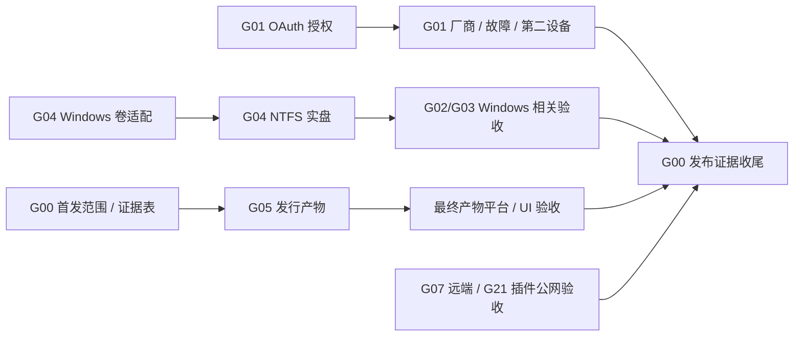

# Anynote 待办总入口

更新：2026-10-21（G18 已完成文档核对与 ADR；真实账号/设备验收仍以各组条目为准）。

**结论**：按共享代码、测试与外部资源，将原清单拆为 **22 个执行组（54 条）**，另保留 **16 条后续议题**和 **21 条已完成记录**。每条任务只在一个文件维护勾选状态；T 编号稳定，G 编号表示执行组。较大的实现组按组内步骤续会话，真实验收组按平台或厂商分批，不要求一次会话全部完成。

优先级沿用原清单：P0 为发布可靠性/数据保护门槛，P1 为 v1 能力与发行，P2 为性能和工程完善，P3 为后续或可选能力。拆分时保留原勾选状态，后续实施结果记录在各组文件。

## 判断依据

| 类型        | 分组方式                                    | 典型组                 |
| ----------- | ------------------------------------------- | ---------------------- |
| 验收 / 实测 | 共用账号、设备、服务与报告，按平台/厂商分批 | G01–G03、G06–G07、G21  |
| 独立实现    | 独立协议或数据路径，明确接口交接            | G05、G10、G15–G16      |
| 内核 / 重构 | 共用源文件和回归测试，组内串行              | G04、G08–G09、G11、G17 |
| UI / 配置   | 共用界面及其状态来源                        | G12–G14、G20           |

- 核心备份和三个云盘 Provider 已有实现记录，未完成的真实账号/设备验收单独组织；不把已实现的 Provider 重新列为开发任务。
- 源码入口仅作后续工作的定位参考。本次核对了模块位置、部分调用关系和测试入口，没有做完整功能审计或运行产品验收；旧清单描述开工时仍需核对。
- Windows 卷适配与物理设备枚举共享卷探测文件；云盘账号、校验和性能组共享核心操作/Provider；导航与视觉共享桌面入口。这些组的代码集成需要协调。

## 推荐分组

表中的前置区分代码依赖与外部资源；“可并行”只针对无共享写入的范围。

| 组                                                                         | 任务                                            | 前置                                  | 可并行 / 集成限制                  |
| -------------------------------------------------------------------------- | ----------------------------------------------- | ------------------------------------- | ---------------------------------- |
| [G00 首发范围与发布证据](docs/todo/00-release-scope.md)                    | 确认首发边界，建立并最终汇总发布证据表          | 负责人确定范围；最终收齐发布证据      | 先建表，各组准备可并行             |
| [G01 云盘授权与真实账号验收](docs/todo/01-cloud-drive-acceptance.md)       | OAuth → 厂商读写/故障 → 条件发布 → 第二设备恢复 | OAuth 身份、账号、第二设备            | 与本地实现并行；同远端槽串行       |
| [G02 跨平台数据与凭据验收](docs/todo/02-platform-acceptance.md)            | 平台数据闭环、系统凭据、Electron 底层能力       | 目标平台；Windows 卷项接 G04          | 不同平台可分批并行                 |
| [G03 独立设备与物理磁盘演练](docs/todo/03-disaster-recovery.md)            | 独立恢复、外接盘/磁盘满、断电、设备性能组合     | 独立设备、测试盘/副本；Windows 接 G04 | 同设备故障与性能测试串行           |
| [G04 卷适配与 Windows 实盘验证](docs/todo/04-volume-adapters.md)           | Windows 卷适配 → NTFS；物理设备映射与提示       | 实现无外部前置；实测需 Windows        | 与云盘/导入并行                    |
| [G05 桌面打包、签名与发行](docs/todo/05-desktop-distribution.md)           | 扩展装包 → 签名更新 → CI/安装升级               | G00 范围、证书、CI、设备              | 打包准备先行；最终接相关功能产物   |
| [G06 原生交互与无障碍人工验收](docs/todo/06-native-ui-acceptance.md)       | 读屏、IME、原生对话框、键盘和缩放               | 目标平台、IME/读屏器                  | 基线先行；G14/G20 后补测           |
| [G07 Cloudflare 真实故障与容量验收](docs/todo/07-cloudflare-acceptance.md) | 长期调度/故障、24h 老化 GC、真实容量与成本      | Cloudflare 测试服务、真实等待/负载    | 同远端命名空间串行；云盘证据接 G01 |
| [G08 本地备份大清单与桌面响应](docs/todo/08-local-backup-performance.md)   | 大清单优化与真实 Electron 响应测量              | 规模样本与 Electron                   | 与 G17 同包修改错开                |
| [G09 远端维护生命周期与保留配置](docs/todo/09-remote-retention.md)         | 维护记录回收、保留配置与空间预估                | 生命周期/保护契约                     | 与 G07/G10 协调协议与复测          |
| [G10 Cloudflare 中断续传](docs/todo/10-cloudflare-resume.md)               | 可恢复分块/下载进度与遗留上传清理               | 源切点/持久进度契约                   | 与 G09 共享协议串行                |
| [G11 云盘上传续传与索引成本](docs/todo/11-cloud-drive-performance.md)      | 跨进程上传会话、查询分页与缓存                  | 请求量/会话基线                       | 与 G12/G13 共享核心串行集成        |
| [G12 云盘校验等级与恢复预算](docs/todo/12-cloud-verification-budget.md)    | 已完成：内容校验等级、流量提示与恢复前空间预算  | 本地回归通过；实测接 G01/G03          | 与 G13 共享界面串行                |
| [G13 云盘账号设置与网络状态](docs/todo/13-cloud-account-settings.md)       | 自定义 Client ID、多账号/重登录、网络等待       | 实现先行；真实重授权接 G01            | 与 G11/G12 串行集成                |
| [G14 搜索定位、导航与目录契约](docs/todo/14-navigation-search.md)          | 大目录决策 → 搜索定位/链接修复 → 导航与书橱     | 排序/查询决策                         | 与 G17/G20 同文件修改错开          |
| [G15 网页媒体流式导入与目录授权](docs/todo/15-web-import.md)               | 有界资源入库、可配置预算、相邻资源目录          | 资源句柄与授权边界                    | 与 G16/G17 协调 Storage 接口       |
| [G16 归档、开放导出与入口预算](docs/todo/16-archive-export.md)             | 当前内容归档、流式 Markdown 导出、入口限制      | 导出闭包；入口提示接 G15              | 与现有归档改动/G17 串行集成        |
| [G17 模块依赖与动态类型边界](docs/todo/17-module-boundaries.md)            | 消除包循环、划清领域接口、收紧动态结果类型      | 选定一个依赖循环/接口批次             | 不能与同包功能改造同时落地         |
| [G18 文档状态与 ADR](docs/todo/18-documentation-adr.md)                    | 已记录 ADR 与文档治理；证据见组内交接           | 当前源码与专项证据                    | 文档收尾由单一集成人处理           |
| [G19 桌面负载基线与首屏体积](docs/todo/19-desktop-performance.md)          | 代表性负载 → 首屏/依赖优化 → 实际资源验收       | 代表性设备/样本，先建本机基线         | 入口/装包与 G05/G14 协调           |
| [G20 视觉组件与设计验收](docs/todo/20-visual-components.md)                | 共用 token/组件、状态、窗口与主题截图           | 当前设计和组件基线                    | 与 G14/G19 共享界面串行            |
| [G21 插件公网端点验收](docs/todo/21-plugin-network-acceptance.md)          | 真实 HTTPS、DNS/地址校验、超时/撤销/预算        | 受控公网 HTTPS 服务                   | 与云盘/磁盘验收并行                |

后续范围见 [BACKLOG](docs/todo/BACKLOG.md)，历史实现与整理背景见 [DONE](docs/todo/DONE.md)。

## 关键说明

**闸门组**：G01 的真实 OAuth 授权解锁最多云盘实测（厂商读写、故障、条件发布、第二设备和组织租户）；G04 的 Windows 卷适配解锁 Windows/NTFS 与相关平台/磁盘验收；G00 的首发范围决定最终必须收齐哪些证据。没有一个全局代码前置需要阻塞所有实现组。

- G01 中注册 → 授权 → API/故障 → 第二设备按同一厂商串行，但不同厂商分批；某个账号受阻不让其他实现空转。
- G04 的 Windows 适配后即可验收 NTFS，不把 P2 Linux 物理设备枚举当 P1 验收的硬前置。G03 的现有磁盘恢复/性能场景也可先做。
- G09/G10、G11–G13、G14/G20、G15–G17 有共享文件或契约，采用串行集成；独立 worktree 只隔离编辑，不会消除语义冲突。G17 按包分批，不与同包功能重构同时落地。
- 设备批次 G02/G03/G06 和账号批次 G01/G07/G21 的本地脚本、语料和报告模板可先准备；代码完成、自动化通过、真实设备/服务验收分别结项。
- **需人工完成**：产品范围确认、账号注册/审核/授权、签名身份、组织管理员配合、独立设备准备、真实输入法/读屏/对话框操作以及物理拔盘/断电。AI 可准备实现、脚本和报告；缺少这些资源时保留对应条目未完成。

## 执行建议

1. 先启动 G00 的范围和证据表；同步准备 G01 的 OAuth 资源、G04 的卷适配。等待外部资源时，可从 G08、G15 或其他无共享写入的实现组开工。
2. 按优先级完成首发所需代码，G05 准备发行产物；账号/设备一旦就绪就执行对应验收，不等待 P2/P3 优化全部完成。
3. 按代码区域排串行队列：云盘 G12/G13/G11，远端维护/传输 G09/G10，界面 G14/G20；具体次序可按优先级调整。G15 与 G16 先约定资源/预算接口，再独立实现，最后汇总入口提示。
4. G17 选择没有并发功能修改的包实施；G18 随各组完成同步 ADR。真实报告逐项交给 G00，发布前补测最终产物受影响的场景。
5. 后续清单先决策、再按议题立项；不把 16 条后续能力合并为一个实现会话。

图中只表示主要门槛；G00 仅汇总首发范围内的要求，P2/P3 不因画入依赖而自动升级为发布门槛。

## 交接规则

- 每个会话结束更新所属任务文件：勾选真正达到完成条件的条目，并记录改动范围、命令/结果、报告路径、版本、设备/语料、未执行项和下一步。部分完成保持未勾选，并附进展。
- 文档/ADR/专项说明的信息归属和收尾步骤见 [文档维护](docs/DOCUMENTATION.md)。专项说明只保存契约、步骤与证据，完成状态只在所属 T 条目维护。
- 不在总入口复制任务复选框。跨组只引用 T 编号和报告，避免同一条任务在两处维护；新增/移动任务时同步分组表和数量。
- 代码回归、浏览器交互、真实存储和独立设备证据分开写。模拟 RPC、合成语料、SIGKILL、模拟磁盘满不替代真实环境要求。
- 并行工作由各组维护自身文件；总入口、共享文档及专项清单由集成人串行同步。已完成项可在收尾归档到 DONE，保留 T 编号及证据。
- 本次拆分不勾选任何新完成项，也不自动完成 G18。原清单描述保留为待核对上下文，项目 AGENTS.md 与最新用户决定优先。

## 原章节对照

任务正文中的 §N 指拆分前章节，设计文档的章节号仍指对应设计文档。此表用于定位原上下文。

| 原章节              | 新位置                                                         |
| ------------------- | -------------------------------------------------------------- |
| §1 真实环境与可靠性 | G00、G03、G07                                                  |
| §2.1 跨平台共同     | G02、G05、G06                                                  |
| §2.2 Windows        | G04                                                            |
| §2.3 macOS          | DONE 中的 macOS/APFS 历史记录；剩余 exFAT/人工场景见 G03/G06   |
| §3 本地磁盘备份     | G03、G04、G06、G08；T020 见 BACKLOG                            |
| §4 远端备份         | G07、G09、G10；T026 见 BACKLOG                                 |
| §5 云盘备份         | G01、G05、G11–G13；T041 见 BACKLOG；Provider 已完成记录见 DONE |
| §6 编辑器与知识组织 | G14；T045 见 BACKLOG                                           |
| §7 导入导出         | G15、G16                                                       |
| §8 插件与工程       | G17、G18、G21                                                  |
| §9 性能与体验       | G19、G20                                                       |
| §10 后续范围        | BACKLOG；首发决策 T070 见 G00                                  |
| §11 已完成          | DONE                                                           |

设计依据：[产品与技术设计](docs/Anynote-Design.md)、[本地磁盘备份设计](docs/Anynote-Local-Disk-Backup-Design.md)、[云盘备份设计](docs/Anynote-Cloud-Drive-Backup-Design.md)。
