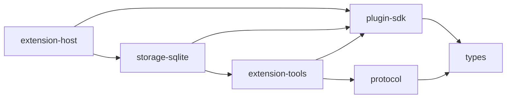

# ADR-011 · 扩展契约、工具与存储实现的依赖方向

状态：已采纳。日期：2026-10-21；G17 首批，基于 `7cf9358` 工作树。

[返回 ADR 索引](README.md)

## 背景

原 SDK 的脚本执行器引用 extension-tools 的搜索/网络校验，工具包又调用 SDK 执行器；SDK 内部的权限门面与提案实现还引用 Storage，而 Storage 依赖 SDK 和工具包。只迁移一条直接 import 不能消除这组间接包循环。

## 决定

- 搜索、网络与脚本状态契约校验归 SDK，供执行器、CLI 与 Storage 共用；SDK 的 workspace 依赖只有 types。
- 依赖 Storage 的权限门面及提案状态机归 storage-sqlite；extension-host 通过它创建 Notebook 范围的权限门面。
- extension-tools 单向依赖 SDK 与 protocol，负责清单、配置、迁移和 CLI。公开 SDK tarball 仅含便携契约/API；CLI tarball 包含所需执行器和校验，二者都不携带 Storage 实现。
- 提案使用限定操作名、SQL JSON 投影、按状态区分的记录与有类型的返回值。读取持久 JSON 时验证字段和目标；脚本 Worker 的 JSON 输出先校验正文与状态，再交给宿主。
- 扩展现有 `workspace:check`，检测 SDK/tools/protocol/types 参与的直接与间接循环，同时纳入 manifest 依赖及显式 TypeScript references。继续使用统一后端编译，不额外建立一套编译流水线。

图只展示首批接口。当时保留的 Storage 与 backup / backup-core / backup-local 循环已在同日第二批由 [ADR-012](012-backup-service-composition.md) 的装配层拆解；依赖检查也随之扩展为全仓。

## 取舍与后续

不新增只有转发代码的兼容模块，也不为此次迁移新增包。SDK workspace 中仍有 Node/QuickJS 内部模块，公开发布以打包白名单及干净消费者为边界。公共 `createAPI` transport、Storage 总分派和其余 SQL 投影的动态类型尚未全部收紧，继续由 G17 后续批次处理。

## 证据与验证

[依赖检查](../../scripts/check-workspaces.mjs)、[Storage 权限门面](../../packages/storage-sqlite/src/extension-host.ts)、[提案状态机](../../packages/storage-sqlite/src/proposals.ts)、[脚本结果校验](../../packages/plugin-sdk/src/script-state.ts)、[类型测试](../../tests/types/script-boundaries.ts)、[边界回归](../../tests/module-boundaries.test.mjs)。

实际验证命令、结果、未执行项和跨组交接统一见 [历史实施证据](../history/todo-2026-10-24.md#g17)。本批不改变 UI，不代表公网插件、最终发行或真实设备验收完成。
