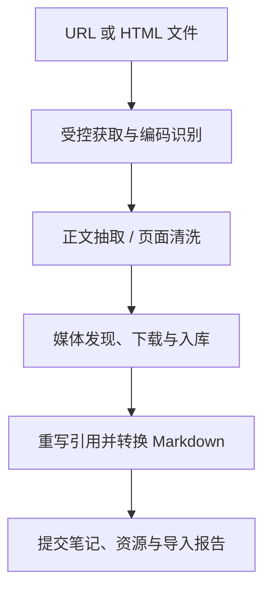

# Anynote 产品与通用数据设计

本文保留与桌面实现语言无关的产品、数据、导入导出、备份与 AI 设计。桌面架构和编辑器以 [Rust 总方案](RUST-DESKTOP-MIGRATION.md)、[Rust 数据契约](RUST-DATA-COMPATIBILITY.md)、[Rust 编辑器设计](RUST-EDITOR-DESIGN.md) 为准。设计目标不表示已实现，未完成范围统一见 [TODO](../development/TODO.md)。

桌面采用 Rust + GPUI + GPUI-Kit；浏览器扩展和 Cloudflare 保留 TS/JS。已知业务静态内置，不提供动态插件宿主或 SDK；已有未知业务数据仍须保全。

## 2. 用户需求与使用场景

### 2.1 核心用户任务

| 场景         | 用户操作                                | 期望结果                            |
| ------------ | --------------------------------------- | ----------------------------------- |
| 整理主题知识 | 建 Notebook，按目录整理笔记             | 每个主题形成独立、可迁移的知识库    |
| 自由记录     | 输入 Markdown、拖入图片、插入白板或视频 | 流畅编辑，不必反复切换工具          |
| 收藏网页     | 粘贴网页链接或导入 HTML 文件            | 正文转为 Markdown，可下载媒体本地化 |
| 阅读资料     | 导入 PDF、查看图片、做批注              | 原文件完整保存，批注与知识笔记关联  |
| 离线工作     | 无网络启动、搜索、编辑                  | 核心功能正常，待备份状态清晰        |
| 数据保护     | 配置 Cloudflare 备份目标                | 自动增量备份，可验证和恢复历史版本  |
| AI 整理      | 让 AI 总结、分类、修改、建立关联        | 先展示修改方案，应用后可追溯和撤销  |

### 2.2 范围划分

**v1 范围**：桌面应用；本地 Notebook；目录树；三种笔记；双模式 Markdown；白板与 YouTube 链接；网页/HTML 导入；搜索、标签、内部链接；本地快照；Cloudflare 备份；完整导入导出；AI 工具接口预留。

**后续范围**：多设备同步、移动端、多人协作、OCR、语义检索、完整 PDF 写回、复杂多列布局、数据库表格视图、端到端加密。

## 3. 概念模型与信息架构

### 3.1 主要对象

| 对象              | 定义                                                               |
| ----------------- | ------------------------------------------------------------------ |
| Workspace         | 本机应用工作空间，记录已打开 Notebook 与全局设置；不是知识数据容器 |
| Notebook          | 主题知识容器；拥有自己的 UUID、SQLite、资源、版本与备份配置引用    |
| Folder            | Notebook 内的逻辑目录，可无限嵌套                                  |
| Note              | Markdown、PDF 或图片笔记；有标题、目录、标签、版本和元信息         |
| Asset             | 本地不可变二进制对象，如图片、PDF、音视频、白板 JSON               |
| Resource          | 一个逻辑资源身份，指向某个 Asset，可通过新版本换绑                 |
| Revision          | 笔记或其他实体的一次不可变版本                                     |
| Backup generation | 一个可恢复的备份版本，包含确定的数据库或逻辑状态及资源集合         |

### 3.2 Notebook 与目录

- Notebook 之间严格隔离。跨 Notebook 链接可以存在，默认不把另一个 Notebook 的内容纳入导出。
- Folder 与 Note 共用 `nodes` 节点表；只有 Folder 可作为父节点。
- Note 本身不承载子目录。未来若要支持“页面内子页面”，通过独立产品决策引入，避免初期混淆目录与文档块。
- 节点名称可重名，身份由 UUID 决定；显示路径不参与资源定位。
- 拖拽移动必须校验同一 Notebook、合法父类型与无循环；目录删除进入回收站并覆盖整个子树。
- 首版跨 Notebook 移动采用“复制成功后再将源放入回收站”，不假设两份数据库之间有原子事务。

### 3.3 应用导航

左侧主要入口：Notebook 切换、搜索、最近、收藏、Notebook 目录树、标签、回收站。

上方：可隐藏文档标签页、前进/后退、面包屑、标题、笔记操作与辅助面板入口。

右侧：按需展示大纲、属性、反向链接、AI；每次默认显示一个辅助面板，支持固定，不同时堆叠多个窄栏。

全局命令面板提供创建、打开、移动、导入、插入块、运行内置命令与切换主题等入口。

## 5. 本地存储与一致性

### 5.1 Notebook 文件布局

当前持久化布局（[ADR-001](adr/001-notebook-storage.md)）：

```text
<notebook-root>/
  notebook.sqlite
  assets/
    sha256/ab/<64位哈希>.bin
<application-data>/
  _local/
    notebook-directories.json
    notebooks/<UUID>/...
```

Notebook UUID、显示名、图标和封面色以 `notebook_meta` 为准，不生成 `notebook.json`。设备快照、任务、游标与缓存保存在应用设备目录，不随知识库携带。主数据库连接直接持有写锁，不另建 Notebook 租约数据库。具体路径与租约以 [Rust 存储契约](../development/RUST-WRITE-STORAGE.md) 为准。

SQLite WAL 模式运行时会出现 `notebook.sqlite-wal` 与 `-shm`。这属于正常运行文件，不能把活跃 `.sqlite` 文件单独复制后称为完整备份。

全局设置和 Notebook 注册表可放在用户数据目录的 JSON 文件中；本机任务状态、Provider 游标与凭据引用也放在应用数据目录，避免备份进度改变 Notebook 内容后触发新的备份。知识业务数据不跨 Notebook 合并到一个全局数据库。

### 5.2 数据持久化原则

- 小型结构化数据、Markdown 正文、批注、引用、逻辑资源元信息存 SQLite。
- PDF、图片、音视频、白板场景文件等非结构化资源存 `assets/`。
- Asset 不可变，更新产生新哈希，历史 Revision 可以继续引用旧对象。
- 哈希去重限于同一 Notebook。全局物理去重需额外共享生命周期机制，首版不做。
- 文件名扩展名不作为类型依据；保留 MIME、原文件名与内容探测结果。
- 缩略图、编辑器 JSON 缓存、搜索索引、向量索引属于可重建数据；导出无需携带缓存目录。

### 5.3 数据库与文件的写入协议

数据库事务不能与文件系统原子提交，必须使用明确顺序：

1. 将新资源流式写入 `temp/`，计算 SHA-256，检查长度、类型和配额。
2. flush 后以不覆盖既有对象的原子发布写入内容寻址路径；已存在同哈希对象则验证后复用。
3. 开启 SQLite 事务，创建 Asset/Resource、笔记版本、资源引用、变更日志，提交。
4. 提交成功后发事件、更新 UI；提交失败则留下可回收孤儿文件，不产生悬空引用。
5. 按需完整性检查与显式清理检查临时文件、孤儿对象、缺失资源；缺失资源展示“资源损坏/待恢复”，不得静默当作正常笔记。

删除采取相反思路：先事务更新引用与软删除，物理文件延迟 GC。GC 必须同时检查活跃笔记、历史版本、回收站、本地快照和正在导出/备份的 pin，不能只看当前页面。

### 5.4 SQLite 配置与连接

- 启用 `foreign_keys=ON`、`journal_mode=WAL`，配置 `busy_timeout`。
- 初版优先 `synchronous=FULL`；性能优化必须明确断电耐久性代价。
- 每个 Notebook 单写队列；多窗口通过同一存储服务写入。
- 一个本地 Notebook 路径只允许一个应用实例持有写锁，第二实例只读或跳转原实例。
- 原始 Notebook 不建议置于网盘自动同步目录或网络文件系统；应用自己负责备份与远程恢复。
- 连接数采用 LRU 管理，不能为了全局搜索同时打开所有 Notebook 连接。
- 磁盘满、只读目录、数据库锁定必须有可操作的错误提示；编辑草稿保留并支持另存/导出。

## 6. 数据模型

### 6.1 核心表

| 表                   | 关键字段                                                                        | 说明                              |
| -------------------- | ------------------------------------------------------------------------------- | --------------------------------- |
| `notebook_meta`      | id、name、icon、cover_color、schema_version、content_seq、created_at            | 单行 Notebook 元信息              |
| `nodes`              | id、parent_id、kind、title、sort_key、revision、deleted_at、deleted_by          | Folder/Note 统一树                |
| `notes`              | node_id、note_type、head_revision_id、primary_resource_id、source_uri           | 三种笔记共有信息                  |
| `note_revisions`     | id、note_id、parent_revision_id、format、body、content_hash、created_at、actor  | 不可变笔记版本，正文或类型化状态  |
| `assets`             | hash、size、mime_type、relative_path、created_at                                | 物理不可变资源                    |
| `resources`          | id、asset_hash、role、original_name、metadata_json、revision                    | 稳定逻辑资源身份                  |
| `revision_resources` | revision_id、resource_id、asset_hash                                            | 固定某一版本实际使用的资源哈希    |
| `annotations`        | id、note_id、target_asset_hash、kind、selector_json、body、revision、deleted_at | PDF/图片批注                      |
| `tags` / `note_tags` | id、name / note_id、tag_id                                                      | 标签与绑定                        |
| `note_links`         | source_note_id、target_notebook_id、target_note_id、anchor、revision_id         | 可重建链接索引                    |
| `changes`            | seq、entity_type、entity_id、entity_revision、operation、payload_json           | 追加式业务变更日志，备份/事件依据 |
| `extension_data`     | extension_id、key、value_json、schema_version、revision                         | 保留既有业务数据的命名空间        |
| `history_pins`       | scope、target_id、expires_at                                                    | 防止正在使用的历史资源被清理      |
| `fts_notes`          | note_id、title_tokens、body_tokens                                              | 可重建全文索引                    |

所有知识数据的修改，包括标题、排序、标签、批注、持久化业务状态，都要更新版本并写 `changes`。只有编辑器缓存、阅读滚动位置等本机状态可以不参与备份。

### 6.3 树结构与排序

采用邻接表 `parent_id`。当前 `listNodes` 返回完整元信息快照（不含正文），客户端生成目录、筛选与移动候选；子树查询使用递归 CTE。树 UI 用显式栈与扁平虚拟列表，避免极深目录栈溢出。分页子项查询暂不实现，决策与大目录测量见 [目录契约](NAVIGATION.md)。

移动目录时遍历目标祖先，确认目标不在源子树内。首版暂不增加闭包表；大量子树统计确有瓶颈时再加可重建路径缓存。

`sort_key` 保留稀疏安全整数；查询始终加 `id` 作为并列排序。普通移动通过索引读取相邻键，间隙不足时只在同一事务中重排当前目录，重排也写入业务变更。常用计数缓存不能成为权威数据。

删除目录写入一个删除操作 ID 并标记整个子树；恢复只恢复同一删除操作产生的节点，防止把更早已删除的子项也恢复。原父目录不存在时提示恢复到 Notebook 根目录。

### 6.4 版本与草稿

- 编辑器内存状态实时更新；使用 650ms 防抖本地保存、切换笔记/失焦立即 flush。
- 中文 IME 组合输入期间不切模式、不替换文档；组合结束再保存。
- 每次持久化事务保证正文、引用、head 与变更日志一致。
- 历史面板可把连续输入版本折叠显示；后台压缩只能在备份游标、快照 pin 与历史策略允许后进行。
- “已保存”只在本地提交成功后显示；云备份独立显示“待备份/已备份至版本 X”。
- UI 进程崩溃可恢复最近一次成功持久化内容，防抖窗口内草稿可能丢失；可后续增加轻量草稿日志降低风险，不宣称绝对零丢失。
- 保存使用 `expectedRevision` 乐观锁；另一个窗口已修改时产生冲突提示或保留副本，不直接覆盖。

## 8. PDF 与图片笔记

### 8.1 PDF

PDF 原件存本地资源目录，PDF 笔记引用主 Resource；支持分页阅读、缩放、页缩略图、文内查找、文字选择、页码跳转、阅读位置记忆。

批注单独保存，结构包括：`targetAssetHash`、页码、归一化矩形、文字片段、前后文、颜色、批注正文、作者与版本。原 PDF 变更后，批注不自动套用到新哈希文件，需重新锚定或保持旧版本。

支持由选中文字创建关联 Markdown 笔记，并保存返回 PDF 页码与批注位置的链接。

PDF 文本抽取异步执行；扫描 PDF 没有文本时显示“OCR 未启用”。可选内置 OCR 服务生成可重建检索文本，不替换原 PDF。加密 PDF 的解密密码不写入导出包或云端元信息。

首版不实现任意 PDF 编辑与原文件批注写回。若后续提供导出带批注 PDF，必须作为新文件输出，并核验渲染、坐标与字体。

### 8.2 图片

图片笔记包含原图、标题、说明、标签与可选批注。支持缩放、适应窗口、实际尺寸、旋转查看与 EXIF 信息；查看旋转是视图状态，修改图像则生成新 Asset。

SVG 默认清洗并栅格化预览，原文件可保存；不得将未经清洗的 SVG/HTML 当作受信应用代码执行。超大图像使用缩略图与分辨率分级，避免一次解码挤占内存。

## 9. HTML / 网页转 Markdown

### 9.1 导入入口

- 粘贴 HTTP(S) 链接，预览标题、目标 Notebook/目录、预计媒体数，再导入。
- 选择 HTML 文件，可同时授权其相邻资源目录；支持相对路径图片和其他附件。
- 提供“正文模式”和“尽量保留页面内容模式”。正文模式优先提取文章，页面模式不承诺复刻 CSS 排版。
- 导入任务可取消、重试和查看失败资源；Notebook 页面不用等待全部任务结束才能继续使用。

### 9.2 处理管线



1. 获取 HTML，保留来源 URL、最终 URL、获取时间、标题和可选原始 HTML 资源。
2. DOM 解析禁用脚本与自动外部资源加载。正文提取使用 Readability；失败可退回经过清洗的页面内容。
3. 转换前收集媒体，必要时同时扫描正文和原 DOM，以处理 Readability 清理掉的懒加载属性。
4. 清洗 `script`、事件属性、危险 URL 与未允许的 iframe；Readability 本身不是安全清洗器。
5. 下载媒体到本地，计算哈希并去重，重写为 `anynote-resource:` 引用。
6. 使用 Turndown 与自定义规则处理代码、表格、任务列表、链接、媒体、数学片段。
7. 预览转换结果并生成导入报告；提交一组有资源完整性保证的笔记状态。

### 9.3 媒体同步规则

| 来源                             | 处理方式                                            |
| -------------------------------- | --------------------------------------------------- |
| `img src`                        | 下载并重写                                          |
| `srcset` / `picture`             | 根据尺寸与策略选择合适资源；保存来源信息            |
| `data-src` 等懒加载属性          | 已知模式适配，无法识别则报告                        |
| 内嵌 `data:` 图片                | 解码后入库，限制解码体积                            |
| 本地相对路径                     | 在用户授权目录内解析；禁止逃逸与符号链接越界        |
| 可直接获取的音视频文件           | 在配额内下载；大文件明确展示大小与下载状态          |
| 页面 CSS 背景图                  | v1 不全面恢复；语义内容中的背景图可由站点适配器提取 |
| YouTube 等平台视频               | 保留安全视频块与可下载缩略图；不保证离线播放        |
| PDF/附件链接                     | 默认保留链接，用户选择后作为资源下载；不抓整站      |
| `blob:`、流媒体、DRM、需登录资源 | 报告无法直接本地化，保留来源与失败状态              |

“媒体已本地化”只对成功下载的项目成立。存在失败时笔记显示“导入完成，部分资源未下载”，不能假装全部离线可用。资源重试成功后生成新笔记版本。

### 9.4 网络、资源和安全约束

- 默认仅 HTTP(S)，设置响应大小、超时、重定向次数、资源总量、单文件配额与并发上限。
- 每次重定向都重新校验目标。默认拦截 loopback、私网、链路本地、云元数据地址；内网站点需要显式开启 Notebook/任务级策略。
- 对 DNS 解析和实际连接地址做一致性检查，防止仅校验一次 hostname 后被重绑定。
- HTML 文件资源只读取已授权根目录；不开放任意 `file://`。
- 不自动复用用户浏览器登录态，不尝试绕过付费/登录墙。
- 用户主动触发的浏览器选区/ChatGPT 采集另见[浏览器采集设计](BROWSER-CAPTURE.md)：仅使用当前获准页面会话读取用户选择的内容，不把会话凭据转交桌面导入器或云端；该采集路径不改变普通 URL 导入的默认行为。
- 动态站点可在后续 Rust 管理的隔离系统 WebView 会话中获取渲染后的 DOM；需要用户选择会话，获取内容仍需清洗。
- MIME 与内容嗅探不匹配时降级为附件；压缩炸弹、超大 SVG、巨大像素图片需要解码预算。
- 默认建议下载并发 4、页面超时 30s、单资源 100MB、每次导入总量 500MB；这是可配置产品初值，不是底层平台上限。

## 10. 搜索、关联与知识组织

- Notebook 内全文搜索默认覆盖标题、Markdown、PDF 抽取文本、标签、批注。
- 全局搜索先查已注册 Notebook 元信息，再按预算打开数据库并汇总结果；展示 Notebook 与路径，支持取消。
- FTS5 默认 tokenizer 对中文分词不足；索引前进行中文分词或采用经验证的 trigram/分词方案，查询必须使用一致策略。
- 搜索结果支持类型、Notebook、目录、标签、更新时间过滤，提供关键词上下文与跳转位置。
- 内部链接使用 UUID，不使用标题或路径；改名/移动不破坏链接。
- 反向链接由正文解析产生，可重建；不存在的目标显示失效链接并允许修复。
- 标签、收藏、最近使用与链接是基础能力。知识图谱作为可选能力，不占据主编辑界面。
- AI 语义检索未来作为 SearchProvider 添加，向量索引记录模型版本、内容哈希与分块策略，编辑后标脏并异步重建。

## 11. 统一备份设计

### 11.1 备份模型

每个 Notebook 可以启用一个或多个备份目标。Cloudflare 为主目标；各目标独立调度、独立成功状态、独立游标。

一个备份版本至少包含：Notebook ID、lineage/branch ID、generation ID、base generation、schema/format 版本、快照内容序号、所有实体版本、资源清单及 SHA-256、创建时间、创建设备、完成状态。

备份只在完整数据可恢复后才进入 `committed`。上传成功一部分不算“备份完成”。网络失败不回滚本地编辑，不阻塞下一个本地保存。

### 11.2 本地快照与一致性切点

统一 Snapshot Service 提供两种 Snapshot：一致性 SQLite 文件和指定序号的逻辑状态。

捕获流程：

1. flush 已确认的编辑器草稿，等待存储写队列当前任务完成。
2. 在该 Notebook 写队列设置短期 barrier，同时阻止 GC 删除被读取资源；UI 仍可输入并积累待保存状态。
3. 使用 SQLite Online Backup API 获取数据库快照，在快照内读取 `content_seq` 与全部需保留资源清单，生成 pin。
4. 快照完成后释放写 barrier；后续编辑属于更高序号，不纳入本次备份。
5. 对大型数据库优化可在不阻塞长期写入的前提下做在线备份，但必须从最终快照内部确定序号与资源集，并测试并发写入和 GC。

SQLite Online Backup API 用于活跃数据库一致性备份；可评估 `VACUUM INTO` 用于离线/维护导出，但不能用普通文件复制替代。

### 11.3 任务状态与触发

任务状态：`queued → preparing → uploading → verifying → committing → completed`；另有 `paused`、`failed`、`cancelled`，失败任务可从已验证对象继续。

默认建议：编辑停止 60s 后触发 Cloudflare，自动备份约每分钟检查一次变更；手动“立即备份”可绕过间隔。无业务变更和资源变更时跳过快照上传。电池、计量网络、大文件任务允许暂停策略。

重试采用指数退避与抖动；永久鉴权失败提示配置修复；限流按服务返回的重试信息延后。应用退出不保证长备份能完成，保留任务状态下次恢复。

### 11.4 保留、删除与恢复

- 默认建议保留最近 30 个完成版本，再按日/周/月采样保留；首次设置展示预计空间，不把该策略等同于云厂商内置恢复窗口。
- 本地/云端删除为 tombstone；旧备份仍保留删除前内容，直到超出保留策略。
- 永久清理备份是独立操作；必须保护所有保留版本完整清单引用的数据库块与附件；当前不依赖历史 delta 链。
- GC 采用 mark-and-sweep：从所有保留版本及进行中任务标记，再回收无引用且超过宽限期的对象。
- 恢复默认创建新的本地目录和新 Notebook 身份，保留 `restoredFrom` 来源，不覆盖现有库。
- 灾难恢复保留原 Notebook 身份时必须重新认领写入权、产生新 epoch/lineage，并重新建立备份游标，防止旧客户端继续写旧分支。
- 多个备份目标独立失败时显示具体情况，例如“Cloudflare 已完成；本地备份待重试”，不提供虚假的单一绿色成功图标。

## 12. Cloudflare 主备份端

本节按当前物理备份实现更新，替代早期实体 delta/周期 checkpoint 草案；决定见 [ADR-005](adr/005-generation-publication.md) 与 [ADR-006](adr/006-complete-checkpoints.md)。

### 12.1 职责分配

| 组件   | 当前职责                                                                           |
| ------ | ---------------------------------------------------------------------------------- |
| Worker | 应用 Token 鉴权、协议校验、对象上传校验、generation 发布及恢复/维护接口            |
| D1     | Notebook/分支身份、writer epoch、generation 状态与清单引用、对象验证目录、维护状态 |
| R2     | 不可变数据库块、完整附件文件与完整版本清单                                         |

D1 不保存用于恢复重建的领域实体 delta，也不是本地 SQLite 文件同步服务。具体路由与表结构以 [Worker](../../apps/cloudflare-backup/src/index.ts) 及其 migrations 为准。

### 12.2 物理增量协议

1. 捕获一致性 SQLite 与其完整资源闭包，从副本读取 `snapshotSeq`。
2. 将数据库按 1MiB 分块，清单记录整库大小/哈希、有序块及完整附件；重复块可重复出现在有序列表中。
3. 携带 generation、lineage、device、expectedHead、writerEpoch 调用 plan，建立 staging 并获取缺失对象。
4. 只上传缺失块与附件；附件传输可使用 multipart，但最终仍为一个完整文件对象。按 SHA-256/大小验证，不把 ETag 当 SHA-256。
5. Worker 验证引用对象完整后原子发布；客户端确认 committed 后推进 ack 游标。响应丢失先查询同一 generation。

### 12.3 每代完整 checkpoint

每一代都是完整恢复清单，独立于更早版本。checkpoint 表示完整引用集合，不表示每次重传整库；未变化对象复用。不再实施“每 100 代或每天生成逻辑 checkpoint”，不维护实体 delta 链或可选 SQLite 加速点。

当前清单为 `anynote.sqlite` v1、schemaVersion 5，要求 `sqlite-assets-v1`；旧逻辑协议及 BLOB 格式不兼容。清单和空间预算见 [存储契约](SQLITE-STORAGE.md) 与 [流式备份](../features/STREAMING-CLOUD-BACKUP.md)。

### 12.4 原子发布与并发控制

对象先验证，随后 D1 batch 中的事务 guard 检查 `expectedHead`、writer/epoch、维护锁和退休状态，再更新 head 与 committed。guard 失败回滚，不将 UPDATE 零行当作成功。恢复列表仅暴露已提交版本。

接管显式提升 writer epoch，旧写入者不能覆盖新 head。恢复默认创建新 Notebook；分支接续由用户明确选择。备份不提供双向同步或离线编辑自动合并。

### 12.5 当前核心 API

下表为源码已存在的核心路由子集；对象 multipart 与维护接口见对应专项文档。

| 接口                                                     | 用途                             |
| -------------------------------------------------------- | -------------------------------- |
| `GET /v1/capabilities`                                   | 协议与能力                       |
| `POST /v1/notebooks/:id/backup/plan`                     | 完整清单规划、staging 和缺失对象 |
| `PUT /v1/notebooks/:id/backup/:generation/objects/:hash` | 小对象上传与验证                 |
| `POST /v1/notebooks/:id/backup/:generation/commit`       | 条件发布                         |
| `GET /v1/notebooks/:id/backup/:generation`               | 固定版本状态确认                 |
| `GET /v1/notebooks/:id/backups`                          | 已提交版本列表                   |
| `GET /v1/notebooks/:id/backups/:generation/manifest`     | 固定版本完整清单                 |
| `GET /v1/notebooks/:id/objects/:hash`                    | 已授权对象读取                   |

### 12.6 恢复流程

固定 committed generation 并持有恢复 pin → 下载完整清单 → 按有序块拼接 SQLite → 校验块与整库大小/哈希 → 下载并验证附件 → 校验 schema、完整性、外键及资源闭包 → 重映射身份并重建索引 → 登记新 Notebook。

恢复不重放实体 delta，也不依赖 D1 导出数据库。缺失、损坏、取消或 pin 续约失败不登记半成品。历史云验收报告不能替代当前格式在真实服务与独立设备上的验收，状态见 G03/G07。

### 12.7 鉴权、部署与成本控制

- 个人自托管 v1：Worker/D1/R2 部署到用户自己的 Cloudflare 账号。桌面端使用独立应用 token；Cloudflare 管理 token 仅用于部署工具，不能保存到笔记或渲染进程。
- 管理服务版以后使用独立账号认证与设备 token；每次 API 都验证 owner 和 Notebook 授权。
- 上传/下载可采用短时 R2 预签名 URL，鉴权由 Worker 完成；不把长效 R2 Secret 下发到 Renderer。
- 查询以 owner/Notebook/generation 建索引，分页且限制 batch。避免每次保存全库扫描、每次资源检查一个请求。
- Worker 尽量做控制面，附件直接进入 R2；需要校验的大文件采用流式或异步任务，超过运行预算时进入待验证状态。
- D1 分片与 Worker bindings 规划需另行容量设计；不能假设动态创建无限 D1 后即可无配置绑定访问。
- 成本由 D1 行读写/容量、R2 容量/操作、Workers 调用与计算构成。本文不固定报价；通过实际 Notebook、附件量、版本保留量进行压测与预算。

## 15. 私有导入/导出格式

### 15.1 `.anynote` 格式

采用 ZIP 容器，扩展名 `.anynote`，MIME 建议 `application/vnd.anynote.notebook+zip`。v1 为完整、自包含的 Notebook 导出包，不依赖外部备份对象。

```text
manifest.json
notebook.sqlite
assets/sha256/ab/<hash>.bin
previews/cover.png                 # 可选
```

manifest 示例：

```json
{
  "format": "anynote.notebook",
  "formatVersion": 1,
  "schemaVersion": 5,
  "appVersion": "0.1.0",
  "notebookId": "notebook-uuid",
  "generationId": "export-uuid",
  "createdAt": "2026-10-01T14:30:00Z",
  "snapshotSeq": 128,
  "database": {
    "path": "notebook.sqlite",
    "size": 1048576,
    "sha256": "<64位SHA-256>"
  },
  "requiredExtensions": [{ "id": "anynote.whiteboard", "dataVersion": 1 }],
  "assets": [
    {
      "path": "assets/sha256/ab/<hash>.bin",
      "sha256": "<64位SHA-256>",
      "size": 524288,
      "mimeType": "image/png"
    }
  ],
  "includesHistory": true,
  "includesTrash": true
}
```

示例 hash 为占位，正式 schema 要求合法 64 位十六进制。manifest 只描述格式与文件校验，数据库仍是业务权威；两者冲突则拒绝导入或进入修复流程。

### 15.2 导出规则

- 使用 Snapshot Service 导出一致性数据库，不打包活动 WAL 文件。
- 默认包含历史与回收站，所有其引用的资源都必须包含；可选择“仅当前内容”，通过导出专用数据库剔除历史后重新计算资源闭包。
- 不包含 credentials、设备 token、Provider 本机游标、日志、临时文件和可重建缓存。
- 持久化业务数据在数据库或 Asset 中，必须纳入资源闭包；归档不执行或安装代码。
- 导出在临时路径流式生成，完成校验后 rename 到用户目标位置；失败不留下看似完整的包。
- 首版使用支持大文件的 ZIP/ZIP64 实现，并给导出任务显示磁盘空间预算。
- 内置哈希用于损坏检测，不代表包来源可信；如需来源认证另加签名格式。

### 15.3 导入规则

1. 只读取 manifest，检查版本、文件数量、大小预算与格式。
2. 解压到临时目录，拒绝绝对路径、`..`、符号链接、重复条目、大小写冲突与压缩炸弹。
3. 校验数据库与资源大小/SHA-256，验证 SQLite header、schema、`integrity_check`、`foreign_key_check` 与资源引用。
4. 外来 SQLite 不加载扩展、不执行包内自带脚本；仅接受识别的 schema。需要迁移时由应用受信迁移代码处理。
5. 高于支持范围的 schema 禁止写入，可提供只读/升级指引；低版本迁移前保留原包。
6. 数据验证通过后原子移动到 Notebook 根目录并注册，失败撤销临时状态。
7. 默认作为新 Notebook 导入，分配新 ID，保留来源 ID，重写包内自指内部链接。跨 Notebook 外链保留并标注未解析。
8. 若资源 ID 定义为 Notebook 局部，可保留 Note/Resource ID；其全局身份由 Notebook ID 与局部 ID 组合。避免无必要重写未知业务数据。
9. 存在未知业务块时允许导入，保留原始数据与预览；不执行导出包中的任何代码。

### 15.4 开放格式导出

另提供普通 Markdown 文件夹导出：逻辑目录映射为磁盘目录，冲突名称加短 ID，路径安全化；附件复制到相对路径；内部链接转换为相对 `.md` 路径；白板输出预览与原场景；视频输出链接。

PDF/图片原件按原始字节输出，批注可附加 JSON/Markdown sidecar。开放格式可能丢失扩展编辑能力，导出报告必须说明；`.anynote` 是完整保真格式。

## 17. AI 能力预留

### 17.1 AI 能力分层

1. **AIProvider**：本地模型/远程模型调用、流式输出、模型配置、用量。
2. **Context Builder**：仅收集授权 Notebook、选区、关联笔记与检索片段。
3. **Tool Registry**：稳定的知识操作工具，不暴露 SQL/任意文件。
4. **Proposal/Apply**：先生成结构化变更提案，再通过领域服务应用。
5. **Audit/Undo**：保存来源、操作 ID、前后版本与撤销路径。

### 17.2 初始工具集合

| 工具                         | 作用                 | 默认策略                     |
| ---------------------------- | -------------------- | ---------------------------- |
| `search_notes` / `read_note` | 检索与阅读           | 当前授权 Notebook 内可执行   |
| `list_tree`                  | 查看目录与笔记元信息 | 按范围分页                   |
| `create_note`                | 创建总结、学习笔记   | 创建前预览标题与目录         |
| `propose_note_patch`         | 润色、补充、提取结构 | 返回 diff，不直接写          |
| `apply_note_patch`           | 应用提案             | 用户批准或已授权的窄范围策略 |
| `move_nodes` / `set_tags`    | 归类、整理           | 展示批量操作清单，可撤销     |
| `create_links`               | 建立关联             | 展示目标与理由               |
| `import_webpage`             | 收集网页             | 使用同一导入服务与网络规则   |
| `trash_notes`                | 删除到回收站         | 显式确认；禁止默认永久删除   |

### 17.3 变更提案

AI patch 包含目标 Note、`expectedRevision`、块 ID/范围、修改原因、操作集合和引用。应用时检查版本，过期提案拒绝或重新生成，避免 AI 根据旧内容覆盖用户新编辑。

同一 Notebook 小批量操作可一次事务提交；跨 Notebook 长任务用步骤清单与补偿/撤销记录，不宣称全局原子。每一步使用 operation ID 防止模型重试重复创建。

AI 总结必须尽量给出原笔记/页码引用。嵌入索引是可重建辅助数据；正文与资源永远不是只能从模型输出恢复的状态。

### 17.4 隐私与提示注入

默认 AI 关闭；开启后明确模型与上传范围。远程模型不自动接收整个 Notebook 或未授权 PDF。钥匙放 Secret Store，调用日志默认不记录完整正文。

网页/PDF 中的指令视为不可信资料，不得修改宿主授权范围或自行调用删除/外发工具。Context 与工具权限必须由宿主控制，不能只靠提示词约束。

未来可提供 MCP 适配层复用相同工具 API；桌面本地访问需 token/会话授权，限制 Notebook 范围，不默认开放一个所有应用可访问的无鉴权端口。

## 21. 性能与可观测性

以下为验收目标，需指定机器与测试语料后测量，不是现阶段承诺：

| 项目              | 建议目标与样本                                     |
| ----------------- | -------------------------------------------------- |
| 冷启动            | 中等桌面设备 3s 内可操作，优先显示 Shell           |
| 打开普通 Markdown | 50KB 文档 300ms 内显示可编辑内容                   |
| 本地保存          | 普通文档提交 p95 <150ms；防抖等待单独计算          |
| 树操作            | 10,000 节点，展开/定位不全量渲染，交互无明显卡顿   |
| 搜索              | 10,000 笔记、已索引条件下首批结果 p95 <500ms       |
| PDF               | 100MB 样本按页加载，不一次渲染全部页               |
| 超大 Markdown     | 1MB 以上自动进入性能策略/源码模式提示              |
| 备份              | 流式哈希/上传，无完整大文件读入内存；UI 保持可操作 |

记录本地 SQLite 提交时间、任务队列、资源吞吐、备份成功率、恢复验证结果、编辑器模式转换耗时。日志支持导出且默认脱敏。

## 22. 测试与验收

### 22.1 必要测试层次

- Domain：目录无环、父类型、软删除/恢复、版本冲突、资源引用。
- Storage：事务、磁盘满、写入中断、进程崩溃、WAL 快照、迁移、GC pin。
- Editor：Markdown 往返语料、未知块、模式切换、中文 IME、撤销、未知块保留。
- Import：相对路径、srcset、懒加载、编码、脚本清洗、网络重定向、媒体失败与重试。
- Provider 合约：无变化不上传、重复请求幂等、部分上传不提交、哈希不匹配、配额与鉴权。
- Restore：完整包、Cloudflare 完整 checkpoint + 对象去重、历史/回收站、跨版本。
- UI：真实内容截图、键盘、无障碍、浅/深主题、窗口尺度。

### 22.2 重点故障注入

| 故障                      | 必须保证                                   |
| ------------------------- | ------------------------------------------ |
| 资源写完后 DB 提交失败    | 无悬空引用，孤儿资源可回收                 |
| 备份上传一半掉线          | 旧 committed 版本仍可恢复，新版本不可见    |
| commit 已成功但响应丢失   | 重试/查询同一 generation，不能重复逻辑变更 |
| 上传后对象损坏/被删除     | 校验失败，不显示备份成功；可重新上传       |
| 第二设备使用旧 epoch 写入 | 拒绝或新分支，不覆盖现有 head              |
| 备份期间继续编辑/GC       | 恢复状态与 snapshotSeq 一致，资源完整      |
| Cloudflare 提交记录损坏   | 列举已完成版本仍可恢复，未提交版本不可见   |
| 未知业务块                | 文档数据不丢，预览与原始内容仍可保全、导出 |
| 导入恶意 ZIP/SQLite       | 无路径逃逸、代码执行或覆盖现有 Notebook    |
| AI patch 基于旧版本       | 拒绝或重新提案，保留用户修改               |

### 22.3 v1 发布门槛

1. 三种笔记完全离线可读；Markdown 完全离线可编辑。
2. 一个 Notebook 一个数据库，至少验证 1,000 层逻辑嵌套与 10,000 节点样本，具备性能预算与可取消处理。
3. HTML 导入报告准确，成功本地化媒体断网可见。
4. `.anynote` 导出后在另一台干净设备恢复，笔记、资源、历史与批注一致。
5. Cloudflare 完成备份→恢复实测。
6. 无变化不传实体/附件；只改正文不重传原附件。
7. Cloudflare 增量备份含删除与持久业务数据，恢复后与源快照领域数据一致。
8. 原生业务与系统 WebView 的授权、资源范围及网络边界均通过验证。
9. 核心页面通过浅/深色、中文、键盘与尺寸检查。
10. 每次备份版本均可定位其验证状态；上线前进行一次真实灾难恢复演练。

## 凭据、隐私与恢复

### 凭据与加密

凭据进入平台 Secret Store，通过 Secret API 代理获取；Linux 需检测可用 keyring。系统安全存储不可用时提示配置并提供明确降级方案，不宣称所有平台都已安全加密。

网络使用 TLS，远端对象默认私有。Cloudflare 常规结构化备份中服务端能读取 D1 元数据和未做客户端加密的 R2 正文，这与 E2EE 不同。

未来 E2EE 模式需定义密钥恢复、轮换、加密 manifest、随机/确定性对象命名泄露、历史版本、AI 明文访问与设备授权。可让 D1 只存最小备份目录、加密 payload 放 R2，但服务器搜索/校验等能力会变化。

不支持的 schema 明确拒绝；不进行危险自动降级。数据库损坏时先保全原始文件，避免自动重建覆盖证据。应用回退须校验最新数据可读，不能覆盖回接管前的快照。遥测默认最小化并可关闭，不采集正文、敏感来源 URL 或凭据。

## 相关设计

- [视觉与交互](UI.md)、[导航与目录](NAVIGATION.md)。
- [SQLite 与增量备份](SQLITE-STORAGE.md)、[本地备份](Anynote-Local-Disk-Backup-Design.md)。
- [架构决策](adr/README.md)、[发行验收范围](RUST-RELEASE-SCOPE.md)。
