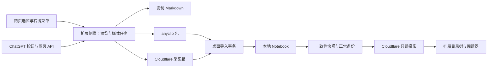

# 浏览器扩展：笔记采集设计

日期：2026-10-25。状态：实施基线，开发版本已实现主要流程；真实接口与发行验收未完成。实施任务统一见 [F025](../development/TODO.md#f025)。

## 实施差异（2026-10-25）

当前操作见[功能说明](../features/BROWSER-CAPTURE.md)。媒体网络下载按单资源串行执行，WebCrypto 每次缓冲一个最多 20 MiB 的资源，降低同时占用；归档写入按 256 KiB 块推进。浏览器最终下载采用 Blob，尚不声称全流程恒定内存。目录投影失败不阻止备份或采集确认，浏览请求明确提示缺少投影。确认对象只包含服务端当前 applied 集合在同一快照中的回执，避免重复打包无限历史。

ChatGPT 网页接口仍为实验适配；2026-10-25 已获取授权真实对话的文字、表格与代码块，用户在更新后确认采集和导出可用。尚未解析的非文字部分明确记为缺失；不把合成测试当成媒体契约验证。设备登录只支持会话内保存；未提供“记住设备”。已有笔记先展示 Markdown 原文，图片按需预览，其他附件下载。2026-10-25 已按用户授权删除旧资源并部署 schema v5，真实云端配对、浏览、图片/卡片采集上传、桌面后端归入/回执、防重复与撤销通过；用户 GUI 和长期场景不据此标记通过。所有未完成项统一在 F025 维护。

图片组与卡片补充：API 仍提供对话正文，DOM 仅按消息 ID 补充 `AsyncImageGroup` 的已渲染图片地址；同时支持 `data-message-id` 与 `data-dil-message-id`。不重跑搜索词，不把任意页面图片混入对话。自定义卡片经 parse5 和 Markdown AST 转换为受限的内联 HTML，桌面通过专用 rehype 插件再次校验带采集标记的卡片，不全面开放原始 HTML。单卡片限 100,000 字符、2,000 节点、32 层；图片组最多 200 个。真实页面 DOM 已核对，下载、包导出及导入由合成 fixture 验证；真实新版扩展媒体采集尚待重载后验收。

## 1. 方案与边界

新增独立的 Chrome/Edge Manifest V3 浏览器扩展，提供网页选区采集、ChatGPT 当前对话采集、Markdown 复制、`.anyclip` 采集包导出、Cloudflare 云端采集与只读浏览。复用现有 Markdown、媒体校验和桌面导入能力，保留桌面端对 Notebook 的唯一写入权。

本文按以下建议形成可实施基线：**云端采集箱立即保存且可查看；桌面端下次连接时归入目标目录；已有笔记展示最近一次已发布备份的只读视图。** 这满足桌面离线时继续采集，但不承诺桌面未运行时直接改写正式 Notebook。若要求后者，应重做云端权威写入和同步设计，不能在此方案里悄悄增加第二个 writer。

首版假设：Chrome/Edge Chromium 116+；连接用户已部署的单用户 AnyNote Cloudflare 服务；一次采集一个网页选区或一个 ChatGPT 对话的当前分支。Firefox/Safari、整站抓取、账号全部对话批量下载、云端编辑既有笔记、多设备合并、商业托管账号系统不在本次范围。

| 需求         | 用户操作与结果                                                                         |
| ------------ | -------------------------------------------------------------------------------------- |
| 网页选区     | 右键“采集到 AnyNote”，打开侧栏预览，保留选区结构、来源和媒体                           |
| ChatGPT 对话 | 对话页注入“采集对话”按钮，通过该网页会话可访问的 API 读取当前对话历史，转换为 Markdown |
| 三种出口     | “复制 Markdown”“导出采集包”“保存到云端”；后两项包含成功采集的媒体文件                  |
| 云端浏览     | 选择 Notebook、分支和目录，读取最近备份中的笔记；采集箱独立显示尚未归入的内容          |
| 媒体完整性   | 每项标明已保存、仅链接、失败或用户跳过；不能将临时链接算成已离线保存                   |

## 2. 已核查的现状

| 当前实现                                                                                                                                   | 对本设计的影响                                                  |
| ------------------------------------------------------------------------------------------------------------------------------------------ | --------------------------------------------------------------- |
| [Worker](../../apps/cloudflare-backup/src/index.ts) 使用 `APP_TOKEN` Bearer 鉴权；`/v1/backups` 列出 committed generations                 | 没有现成的用户登录、目录树和笔记 CRUD；需新增受限浏览与采集接口 |
| [备份快照](../../packages/backup/src/cloud-snapshot.ts) 和 [对象闭包](../../packages/protocol/src/cloud-objects.ts) 保存 SQLite 分块及附件 | 浏览器不能仅靠现有接口高效读取单篇正文；需增加只读投影          |
| [原子发布](adr/005-generation-publication.md) 检查 writer、epoch 和 expected head                                                          | 扩展不得接管 writer、改写数据库分块或修改备份 head              |
| [一致性快照](../../packages/storage-sqlite/src/database-snapshot.ts) 固定 SQLite 与附件引用                                                | 浏览投影须从这份快照生成，不能在备份后再读取变化中的活库        |
| [HTML 导入器](../../packages/importer/src/html.ts) 使用 JSDOM、Node crypto；资源暂存依赖文件系统                                           | 提取可共享的 DOM 转换规则，不能将整个 Node 导入器打包进扩展     |
| [现有导入事务](../../packages/storage-sqlite/src/operations.ts) 可提交笔记及资源                                                           | 新采集包经过校验、资源重映射后接入；不能直接信任包内资源 ID     |
| `.anynote` 是含 `notebook.sqlite` 的完整笔记本归档                                                                                         | 采用独立的轻量 `.anyclip`，不伪装成现有整库恢复包               |

本轮做了源码及图索引核查；图覆盖是 best effort，实际行为以源码为准。没有运行真实 ChatGPT 会话采集、扩展 PoC、Cloudflare 部署或功能验收。下文新增路径、接口与预算均是设计，不代表已存在。

## 3. 运行结构与交互



- **Service worker**：注册右键菜单、权限和页面注入，分派任务；不依赖内存变量或强行保活保存任务。
- **Content script**：读取获准页面的选区、挂载 ChatGPT 按钮；不持有云端令牌。普通网站只在用户操作后临时注入。
- **页面会话适配器**：仅在必要时进入 MAIN world，执行固定的 ChatGPT 只读操作；不是任意 URL/headers 请求代理。
- **扩展侧栏与专用 Web Worker**：预览、Markdown 转换、媒体下载、哈希和 ZIP 打包。任务及媒体分块保存在扩展 origin 的 IndexedDB；消息只传任务和资源标识。

DOM 清洗与转换在扩展文档中完成；不在没有 DOM 的 Web Worker 中直接调用 DOMParser/Turndown。哈希、ZIP 与其他纯计算移入 Worker。持久键遵循点分命名，例如 `capture.task.<id>`、`capture.asset.<hash>`、`cloud.connection.<id>`；来源签名 URL 只在当前任务内存使用，恢复时通过来源 ID 重新解析。

侧栏提供“采集”“设置”两个独立路由视图（`#capture` / `#settings`）。采集页包含标题、来源、Markdown、媒体状态及三个出口；设置页集中提供 Cloudflare 配对、可折叠目录树、阅读区及采集箱，显示“最近备份于……”。路由切换保留草稿和云端目录选择；未连接时导入云端引导到设置页。界面按用户最新要求采用白底扁平风格、统一的笔记 A Logo 与 Lucide 图标；图标随扩展离线打包，保留许可，不引入 React 运行时。按需创建对话框。阅读器关闭任意 HTML 执行，远程媒体需主动加载。

菜单和注入按钮的事件应立即启动选区读取并尝试打开侧栏，再做网络请求，避免丢失用户手势。侧栏无法打开时提示点击扩展图标继续，不能丢弃草稿。切换页面不覆盖其他任务；关闭侧栏后未完成任务转暂停，重开可恢复。首版不额外引入 offscreen 常驻任务。[Chrome sidePanel](https://developer.chrome.com/docs/extensions/reference/api/sidePanel)、[Service worker 生命周期](https://developer.chrome.com/docs/extensions/develop/concepts/service-workers/lifecycle)

## 4. 网页选区采集

1. 右键菜单仅在 selection 场景出现。按菜单事件的 `frameId` 定位实际 frame，读取 `Selection` / `Range.cloneContents()`，立即保存片段及原页面基础 URL；`selectionText` 仅作纯文本降级。任务绑定 tab/frame/documentId，结果校验实际文档身份与 URL；导航或选区变化时停止重试，不能把旧选区文字与新页面资源混合。[contextMenus](https://developer.chrome.com/docs/extensions/reference/api/contextMenus)
2. 捕获选中的节点、文本、链接和媒体；补齐片段所需的列表、代码或表格祖先结构，但不扩大到未选择的正文。输入框按实际文本范围处理；密码输入框不采集。跨域 iframe、浏览器受限页和已消失的选区必须给出明确结果。
3. 从原 DOM 读取 `currentSrc`、`srcset`、已支持的懒加载属性等，再在不加载外部资源的 detached DOM 中清洗。只处理选区，不运行整页 Readability，不向服务器重新抓取来源页。
4. 分离 `sourceUrl/baseUrl` 与“需要抓取的 URL”。现有 `prepareImport` 遇 `input.url` 会抓取网页并替换 HTML，不能直接复用这个参数语义。
5. 复用 Turndown、DOMPurify 和现有规则，处理标题、列表、表格、代码语言、链接与图片。保留代码中的反引号和换行；不支持的布局转为可读文本并记录提示。来源和采集时间写入 manifest，预览允许选择是否在正文展示来源。

基础权限为 `activeTab`、`scripting`、`contextMenus`、`storage`、`sidePanel`；文件保存需要时加入 `downloads`。`https://chatgpt.com/*` 作为固定 host 权限支持默认按钮；用户配置的云端 origin 和必要媒体 origin 继续逐个请求可选 host 权限。跨域 iframe 不在主 frame 的临时授权保证范围内；授权不足时只能明确降级，不静默抓整页。[activeTab](https://developer.chrome.com/docs/extensions/develop/concepts/activeTab)、[permissions](https://developer.chrome.com/docs/extensions/reference/api/permissions)

## 5. ChatGPT 对话采集

### 5.1 API 边界与可行性前置

官方 Conversations API 文档描述的是与 Responses API 配合的会话状态；本轮未找到能够据此承诺读取用户 ChatGPT 网页历史的公开契约。因此本方案依赖**网页当前使用的内部接口**，不得把 OpenAI API key、Conversations API 或 ChatGPT 登录互相等同。[OpenAI 会话状态文档](https://developers.openai.com/api/docs/guides/conversation-state)

先用获授权的真实测试会话验证：当前页面如何定位 conversation、所需登录态、历史完整性/分页、当前分支、附件解析、页面跳转与生成中行为。精确 endpoint、返回字段、会话凭据方式和媒体地址均以该 PoC 为准；本文不将历史流传的内部路径写成已验证协议。适配器随扩展版本发布，不下载远程可执行代码。

### 5.2 请求与转换

- 使用 manifest 静态 content script，仅匹配 `https://chatgpt.com/*` 顶层页面，扩展启用后自动注入；安装/启动时也尝试为已打开页面挂载。按钮挂载幂等；SPA 路由变化和局部 DOM 替换后重建，不重复监听，新聊天页不显示对话采集按钮。[静态 content scripts](https://developer.chrome.com/docs/extensions/reference/manifest/content-scripts)
- 优先在获准页面的同源上下文发起固定只读请求；确需页面 JS 会话状态时用一次性 MAIN 注入。会话凭据仅在该页面请求期间使用，不写入扩展存储、导出包、日志或云端。不得绕过登录、验证码、工作区权限或其他访问控制。
- MAIN 与网页共享环境，返回值一律视为不可信数据。绑定 tab/frame/document、任务 ID、对话 ID，校验 schema、体积和超时。若需要 `postMessage`，origin/source/nonce 仅用于关联和减少误接收，不能当成隔绝同页面脚本的认证。[content scripts](https://developer.chrome.com/docs/extensions/develop/concepts/content-scripts)、[消息安全](https://developer.chrome.com/docs/extensions/develop/concepts/messaging#security-considerations)
- 默认输出用户当前选定分支从根到末尾的完整 user/assistant 消息；按父子关系排序，不按映射对象的遍历顺序拼接。编辑、重新生成的其他分支不混入。若 API 默认末节点与页面所选分支不能对应，先要求在预览中选择，不能声称采到当前分支。
- 用户和助手消息分别带角色标题，保留原始 Markdown、代码、表格、数学源码和引用；数学渲染并非首版承诺。引用和工具结果只保留网页已向用户展示的内容；不导出系统/开发者消息、隐藏推理、内部工具负载或凭据。
- 对 API 返回的内容 part 做有界、显式解析；图片、附件、音视频交给媒体管线，未知 part 显示“此内容未能转换”而非静默丢失。保存 conversation/message ID、分支末节点、采集时间和适配器版本，便于定位重复与错误。
- 正在生成时默认等待完成后重新读取；可主动选择“保存当前快照”，必须标明未完成。分页不足、父节点缺失、循环或体积超限不得标为完整对话。
- `401` 提示重新登录，`403`/挑战停止请求，`429` 尊重 Retry-After 并有限重试；页面关闭/跳转取消其会话请求。接口变化时保留草稿和错误；用户可明确选择“仅采集当前可见内容”的 DOM 降级，但该结果不算 API 历史采集验收通过。

整个对话不做“Markdown → HTML → Markdown”往返。只有 HTML 类型的公开可见内容需要 DOM 转换。

## 6. 媒体和三种出口

### 6.1 统一媒体任务

草稿保存 Markdown、来源、媒体清单及完整性报告。媒体项区分 `saved`、`link-only`、`failed`、`skipped`；成功项记录 SHA-256、字节数、经校验的 MIME 与原文件名。同一字节内容只保存一次，不以 URL 作为内容身份。

| 媒体来源                              | 处理                                                                                  |
| ------------------------------------- | ------------------------------------------------------------------------------------- |
| 公共 HTTP(S) 图片、文件、直接音视频   | 获准 origin 下下载；校验重定向、大小、MIME 和哈希，保存原始文件                       |
| 相对路径、picture、srcset、懒加载     | 按源页面解析绝对地址，优先实际显示资源，不下载所有分辨率                              |
| data URL                              | 限制解码大小和类型，解码入库；不保留巨大内嵌字符串                                    |
| 页面 blob URL                         | 页面仍在且资源可读时，由页面侧分块传输；页面关闭或不可读则报告缺失                    |
| ChatGPT 附件 ID、生成图片、带签名地址 | 用当前获准会话解析并及时保存字节；过期时在同一会话重新解析，绝不把签名 URL 当永久资源 |
| 流媒体、DRM、嵌入视频                 | 保留安全来源链接/可获取封面，注明未保存视频本体；不破解或承诺离线播放                 |
| SVG/HTML、超大图像                    | 原件按附件保存；预览清洗或栅格化，设置解码像素预算，不以内联可信 HTML 执行            |

扩展页面请求外域需要 host 权限；content script 仍受页面同源规则限制。普通跨域媒体请求不附带页面或云端凭据；只有经过明确适配的来源会话请求使用该来源认证。禁止将 Cloudflare Authorization 转发给媒体服务器。[Chrome 跨域请求](https://developer.chrome.com/docs/extensions/develop/concepts/network-requests)

扩展不能照搬 Node 的 DNS/连接地址校验并宣称防住 DNS rebinding。首版不提供任意网页可调用的后台 URL 代理；拒绝显式本地/私网地址与危险协议，限制来源和重定向，遇到不能安全判定的跨域跳转则失败并提示。云端只接收扩展已上传的字节，不代抓页面任意 URL。

媒体直接落扩展 IndexedDB 分块；页面私有 blob 使用小块消息、ACK 和背压，不把全媒体转成一次 base64 消息。扩展消息并非 Blob/ArrayBuffer 的零复制管道。[Chrome 消息序列化](https://developer.chrome.com/docs/extensions/develop/concepts/messaging#serialization)

### 6.2 复制 Markdown

在侧栏点击时复制已生成的 `text/plain`，不先等待网络再调用剪贴板。公共来源媒体保留经过校验的绝对 URL；私有、过期、blob、扩展资源地址和包内相对路径改为可读的媒体占位说明，提示用采集包或云端导入保留文件。普通文本剪贴板不承诺携带二进制附件，也不偷偷上传媒体获取公网链接。[Clipboard](https://developer.mozilla.org/en-US/docs/Mozilla/Add-ons/WebExtensions/Interact_with_the_clipboard)

### 6.3 `.anyclip` 私有采集包 v1

采用标准 ZIP 容器，自定义格式标识；“私有格式”表示 AnyNote 专用导入协议，**不表示文件已加密**。

```text
capture.anyclip
  manifest.json
  content.md
  assets/<sha256>.<safe-extension>
```

manifest 至少包含：`format: "anynote.capture"`、`version: 1`、`captureId`、标题、来源类型/安全 URL/采集时间、可选对话与消息 ID、正文路径/字节数/SHA-256、媒体清单、缺失项与完整性标志。每个成功资源项包含包内路径、SHA-256、字节数、MIME、显示文件名。来源中的认证参数及临时签名不进入包；不保存原始会话 JSON、cookies 或 token。

目标 Notebook/目录不属于文件内容，在导入时选择；云端上传请求另外携带目标。正文摘要、资源清单和完整性信息共同生成规范化内容摘要，避免同一 captureId 的附件或正文被悄悄替换。

导出或云提交前冻结一份采集快照。摘要使用确定性序列化的 manifest 内容及正文/资源哈希，不包含 ZIP 时间戳、压缩参数与摘要字段自身。网络重试沿用同一快照与 captureId；冻结后编辑、重采或媒体重试改变内容时生成新的 captureId。预览草稿与已冻结快照分开，不能就地修改已导出/提交内容。

`content.md` 使用包内相对媒体路径；图片为标准图片语法，PDF/附件/音视频至少有可读下载链接，扩展预览可按 MIME 展示受控播放器。导入后才重写为 `anynote-resource:<新 UUID>`。引用式链接和图片也要通过 Markdown 语法树处理，不能全局替换字符串误改代码示例；只有 manifest 列出的路径能成为资源引用。

导入流程：校验格式与预算 → 校验每项路径/大小/哈希 → 用户选择目标目录并预览缺失项 → 为资源分配本地 ID → 重写引用 → 复用本地事务提交笔记与资源。拒绝路径穿越、绝对路径、符号链接、重复条目、额外未声明文件、压缩炸弹、引用不存在的成功附件和不支持的版本。包本身不触发二次外网下载。不要把包内 ID 交给现有资源更新分支。

有失败媒体时默认要求重试或明确选择“保留缺失说明继续”；包中同时记录缺失报告。只有完整性报告通过才能标为“完整采集”。重复导入按 captureId 和内容摘要提示已导入；要生成另一份笔记时由用户明确选择，不靠改文件名绕开。

现有 HTML 导入媒体白名单并不覆盖 ChatGPT 的所有附件：图片主要为 PNG/JPEG/WebP，附件本地化仅 PDF。新增采集导入需支持经大小/哈希检查的普通文件附件，按不透明字节保存、只提供安全下载；不执行 Office/HTML/脚本或自动解包 ZIP。图片预览复用 `packages/protocol/src/image-safety.ts`，新增类型只有通过相应解码校验后才能预览，不能把旧白名单移植后声称已支持全部媒体。

### 6.4 初始资源预算与性能

首版沿用当前 `packages/protocol/src/import-limits.ts` 的媒体默认预算：单资源 20 MiB、总媒体 80 MiB、200 项、网络并发 4、单响应超时 30 秒、图像 40 MP。正文同时满足现有提交契约的 2,000,000 个 JavaScript 字符上限与 8 MiB UTF-8 上限；manifest 1 MiB、ZIP 解压总量 90 MiB、最多 202 个条目，消息分块不超过 256 KiB。文件出口在共享 capture v1 契约中固定这些上限，不能依赖离线时不存在的服务协商；云端另外取服务声明上限的较小值。验收要求本版本扩展能导出的包均可被本版本桌面解析导入，目标磁盘不足等环境错误须单独报告。这些是产品预算，不是浏览器官方上限；提高预算须先验证分块内存与下游限制。

ZIP 和 SHA-256 在 Worker 中增量处理，复用现有 `fflate` 等能力，媒体通常采用 STORE，正文适度压缩；不手写密码学实现。分块暂存、处理和上传不应让 JS 活跃缓冲区随包总量线性增长。下载需要完整 Blob 时由持久化分块构造并实测其内存行为；不能仅因使用 Blob 就宣称流式。存储配额不足立即暂停并保留可恢复任务，不默认申请无限存储。

## 7. Cloudflare 接入

### 7.1 连接与权限

产品入口叫“连接 AnyNote 云端”。所谓“登录 Cloudflare”在本方案中是连接部署于 Cloudflare 的 AnyNote 服务，**不是**要求扩展保存 Cloudflare 账号密码、管理 API token 或现有高权限 `APP_TOKEN`。

桌面端利用已有连接创建短时一次性配对凭据，用户把 endpoint 和配对码粘贴到扩展。配对码使用足够熵的随机值、5 分钟过期、单次兑换、次数限制；通过 HTTPS POST 传递，不放在 URL/日志中。兑换时在单个原子状态变更中消费，并得到可撤销的随机设备令牌，服务端仅存令牌摘要。

授权按 notebook/lineage 限制为 `browse:read`、`capture:create`、`capture:read-own`；不能调用备份原始对象、writer 接管、恢复或维护删除接口。设备令牌默认只存 `chrome.storage.session` 并限制 content script 访问；显式“记住设备”才持久化，并说明浏览器存储不是桌面系统密钥库。令牌设有限有效期，可从桌面撤销；失效后重配对。云端地址必须由扩展 UI 配置，网页不能更改。

先调整 Worker 的路由鉴权，再暴露配对和业务接口；Origin/CORS 不能代替令牌授权。每次请求都校验 notebook、lineage、对象归属与 scope。桌面首次配对之后，扩展可在桌面离线时使用尚有效的授权。首版不建设 Cloudflare OAuth、租户账户与计费系统。

`ownerDeviceId` 由服务端从已验证令牌派生，不接受客户端指定。plan、上传、commit、状态、正文和媒体路由都校验所有者、Notebook/分支授权及状态；异主 ID 冲突不泄露已有采集内容。桌面受信 writer 的领取/读取是另一类权限，不借用浏览器的 read-own。

### 7.2 云端采集箱与可靠归入

```text
local draft → uploading → queued → applied → backedUp
                                ↘ needs-target / retryable-error
```

1. 扩展选择目标 `{notebookId, lineageId, parentId, observedGenerationId}`，以固定 `captureId` 和内容摘要创建上传计划，上传缺失资源，然后提交。
2. 服务端先验证所有声明资源和正文的字节数、哈希及预算，再原子标记 `queued`。相同 ID 与相同摘要重试返回同一结果；不同摘要返回冲突。提交响应丢失时查询状态，不换 ID 重传。此时 UI 显示“已保存到云端，待桌面归入”，内容已能在采集箱阅读。
3. 当前获授权的桌面 writer 领取任务；租约及操作绑定 writer epoch 与单调的 `targetVersion`。下载到受控暂存区后，重新校验本地目标文件夹是否存在且可写。目录变化不能静默回退根目录，释放领取并转为 `needs-target`。只有未被领取的 queued/needs-target 可重选目录；活跃领取、applied、backedUp 不得改目标，确认请求校验领取和目标版本。已归入后的移动属于独立操作。
4. 同一个 SQLite 事务写入笔记、资源引用以及 `capture_receipts(captureId, digest, noteId, appliedSeq)`；附件先安全落地。重试先检查 receipt。新表属于持久化知识状态，须进入归档/恢复与 schema 契约。当前不要求兼容历史数据，明确拒绝不支持版本，不增添隐式兼容支路。
5. 云端 `applied` 仅代表本地持久化。Worker 不解析 SQLite，因此新增独立于可选浏览投影的 `captureAcks` 对象：从同一 SQLite 快照导出有预算的 `{captureId,digest,noteId,appliedSeq}`，在 manifest 中引用并加入对象校验闭包。commit 检查采集摘要、目标 lineage、`appliedSeq <= snapshotSeq`、当前 writer 与代次，然后原子推进 `backedUp`。不能接受浏览器自行声明已备份。确认列表分批有界，不在每代无限重复全部历史；响应丢失时可从 committed generation 查回确认。
6. 未归入或仅 applied 的内容不按备份 GC 清理。backedUp 后经宽限期才可清理采集附件；保留小型完成回执，避免恢复旧快照时自动重复执行历史采集。恢复较旧版本视为历史回滚，不默认重放已完成任务；需要再次导入时产生明确的新操作。

采集箱对象使用独立存储前缀和引用表，避免被现有备份 GC 误删。未提交上传可在明确 TTL 后回收；queued 内容不自动过期删除。配额耗尽时拒绝新的上传，不删除已提交采集。采集箱需要删除时由用户明确操作，并处理与领取/应用并发，不能删除仍在确认中的唯一副本。

writer 接管或恢复旧快照后，当前 writer 可重新领取未 backedUp 的 queued/applied 任务：本地 receipt 匹配时只补确认，receipt 缺失时用仍保留的云端字节重新归入。旧 writer 不得再确认或发布；备份提交继续受 epoch/CAS 约束。backedUp 终态不自动重放。扩展重配对会获得新设备身份，旧设备自己的未完成采集仍由桌面管理，不能仅凭相同客户端名称继承读取权。

### 7.3 云端目录与笔记内容

- 桌面从**同一一致性备份快照**派生浏览投影：分页的目录节点、笔记元数据/正文、资源映射。Markdown 和媒体按内容哈希复用，未变化正文无需反复上传；只读视图不包含本地绝对路径、凭据和本地设备设置。
- 投影描述并入 manifest 与对象闭包，复用 plan、对象验证和 commit；generation 与浏览指针在同一 D1 事务发布。投影失败不影响本地编辑；对应备份不得发布一个虚假的完整浏览指针。可以正常提交无投影备份并明确显示浏览暂不可用，后续完整备份补齐。
- 闭包必须覆盖所有目录分页、正文、资源映射及媒体引用，而不只是根索引；plan、commit、retention、pin 使用同一闭包。无投影的 generation 提交时原子设置其 browse 为 unavailable，不沿用旧指针冒充最新；用户可明确选择查看较旧的完整投影和其时间。
- 目录按 parent 分页，笔记按 ID 读取，不能为展开一个文件夹下载整个 SQLite 或全部正文。持久映射可以复用 generation 对象关系；实现时选择最少的索引结构，不引入第二套可写笔记数据库。
- 浏览请求和分页游标固定 `{notebookId,lineageId,generationId}`；目录、正文、附件不混读不同代。切换最新备份需明确刷新。显示快照时间和分支，不将“云端最新备份”称为“桌面实时内容”。
- 树只投影未删除节点并验证父链，保留实际排序字段；不能直接返回含回收站的现有 `listNodes` 全量结果。正文资源映射以该 note revision 的 `revision_resources` 固定哈希为准，不能读资源的最新指向覆盖历史图片。
- 对媒体读取校验其属于已授权的 generation/resource；不能仅凭任意 hash 或 `verified` 标记读取。浏览使用有上限的短期 pin，避免 retention 删除正在查看的版本；过期后要求刷新，不能无限保留所有历史。
- 新 capability 为 `capture-v1`、`browse-snapshot-v1`，启动时先探测。既有部署或备份没有投影时显示“需要桌面发布浏览数据”，不能显示空库或假造完整树；目录浏览按需启用。Markdown 笔记提供正文，PDF/图片提供原件阅读；未知扩展块可读降级，不在扩展内启用第三方可执行插件。

以下是新增 API 分组建议，最终命名可等价调整：

| 分组                                               | 职责                                                  |
| -------------------------------------------------- | ----------------------------------------------------- |
| `/v1/pairings`、`/v1/devices`                      | 创建/兑换配对、列出与撤销设备；管理操作仅桌面凭据可用 |
| `/v1/library/notebooks`、分支/目录/笔记/资源子路由 | 限定授权、快照与分页的只读浏览                        |
| `/v1/captures/plan`、对象上传、`commit`、`status`  | 幂等上传与采集箱阅读                                  |
| `/v1/captures/claim`、`ack`                        | 当前桌面 writer 领取与归入确认；浏览器没有该权限      |

## 8. 改动范围与实施阶段

建议新增 `apps/browser-extension/`；新增仅由浏览器和桌面导入共同使用的 `packages/capture/`，承载包契约、校验与资源引用转换。现有 `packages/importer/` 内提取不依赖 Node 的 DOM 规则子入口；Node 继续负责网页抓取和文件系统暂存。不建立通用采集插件市场、站点注册框架、同步引擎或全能网络代理。

受影响的既有模块为 importer、storage-sqlite 导入与 schema、protocol/types 的备份对象契约、backup 快照与发布、cloudflare-backup 路由/迁移/维护、desktop 导入入口/配对/采集箱消费。浏览器扩展属于独立应用，不能放进现有桌面 `extensions/` 运行时并假定权限模型相同。

桌面接入复用 `packages/first-party-adapters/src/import.ts` 的预览/提交流程，并从存储内部提取可信的已准备笔记提交核心；外部输入不可指定任意 staging 文件路径。只读 UI 可从 `apps/desktop/src/DocumentView.tsx`、`ResourceImage.tsx` 提取正文渲染与资源 resolver 边界，不能直接搬入其桌面请求、第三方插件与白板编辑动作。

| 阶段                  | 交付与完成信号                                                                                                                                                          |
| --------------------- | ----------------------------------------------------------------------------------------------------------------------------------------------------------------------- |
| 0：验证关键假设       | 用真实获准 ChatGPT 会话验证 API、当前分支、图片和附件；验证 MV3 手势与会话资源传输。保存脱敏 fixture 与结论；若 API 方案不可行，仅暂停该适配器，不能用 DOM 降级冒充完成 |
| 1：契约与离线闭环     | 明确 `.anyclip` v1、媒体状态、统一预算与 receipt 模型；实现桌面导入与重复导入回执；选区 → 预览 → 包 → 桌面笔记/附件断网可读                                             |
| 2：ChatGPT 与扩展体验 | 完成 API 历史转换、分支/引用/媒体、复制、取消恢复与权限；与阶段 1 共用转换和资源管线                                                                                    |
| 3：云端浏览           | 冻结 captureAcks 与备份闭包契约；完成能力探测、配对与受限令牌、快照投影、目录/正文/资源 API 及 GC 保护；旧部署明确提示升级                                              |
| 4：云端归入闭环       | 完成采集上传、当前 writer 消费、本地 receipt、backedUp 确认；桌面离线采集后再上线不丢失、不重复                                                                         |
| 5：打包与验收         | 扩展权限/CSP/离线构建、隐私说明、Chrome/Edge 实测；小规模真实 Cloudflare 验收、内存与目录分页基准                                                                       |

阶段 0 与离线包契约可并行探索；冻结契约后，选区/ChatGPT UI 与桌面导入可并行实现。共享导入模型、schema、鉴权和发布契约由单一责任人串行集成。实现中途只可称对应阶段完成，不把文件导出通过写成云端闭环已完成。

## 9. 验收与失败边界

| 类别           | 必须验证的行为                                                                                                                      |
| -------------- | ----------------------------------------------------------------------------------------------------------------------------------- |
| 选区           | 跨节点列表/部分表格/代码/图片、相对 URL、输入框、frame、选区丢失；不混入未选择正文                                                  |
| ChatGPT        | 长对话与分页、编辑/重生成分支、生成中、SPA 切换、图片/附件/引用、未知 part、401/403/429/接口变更；真实 API 结果与页面所选分支一致   |
| 媒体           | data/blob/受保护资源、过期签名、重定向、重复内容、MIME 欺骗、SVG/解码炸弹、超限/断网/取消；断网后验证已保存媒体                     |
| 包与导入       | hash/大小错误、路径穿越、重复/遗漏条目、引用式 Markdown、代码中的伪链接、资源 ID 冲突、重复导入、提交前后中断                       |
| 扩展安全       | 伪造页面消息不能云写入或取得 token；权限拒绝/撤销、受限页、CSP、页面 XSS 输入、退出清理；云端数据和私有签名 URL不进入日志           |
| 云端一致性     | 上传/commit/ack 丢响应、桌面崩溃、writer 接管、目标目录删除、恢复旧快照；applied 未备份不清理附件，同一 capture 不重复生成笔记      |
| 云端浏览       | 固定代分页、分支切换、无投影版本、删除/维护并发、pin 过期、越权 notebook/hash、PDF/图片及未知块降级                                 |
| 性能与生命周期 | SW 被回收、侧栏关闭/重开、IndexedDB 配额、80 MiB 媒体包分块处理；万节点目录分页且按需取正文；记录峰值内存、主线程长任务和实际网络量 |

优先复用仓库 Vitest、Playwright 和现有 Cloudflare 本地测试设施。新增纯转换/包校验单元测试、导入与 Worker 集成测试、真实 Chromium 扩展浏览器测试，以及媒体/目录规模基准。云端公网只做隔离 Notebook 的小规模验证；不执行容量或费用压力测试。报告写入 `tmp/reports/`，长期结论与剩余状态写回文档；没有执行的测试不得声称通过。

## 10. 实施交接

先复核实际代码与阶段 0 的网页接口证据，再分阶段实施。实施者可以自主调整名称、等价 API、局部文件组织和测试结构，删除没有实际用途的包装层；保持包格式、幂等语义、授权边界与单 writer 约束。若核心假设被证伪或必须改变公开协议/云端写入架构，只暂停受影响部分，带证据回到设计，不阻断独立工作。

报告真实改动、实际运行的测试、设计偏差与尚未验证的风险。设计完成不等于实现或上线完成。**设计已完成。请手动切回实施模型后继续。**
