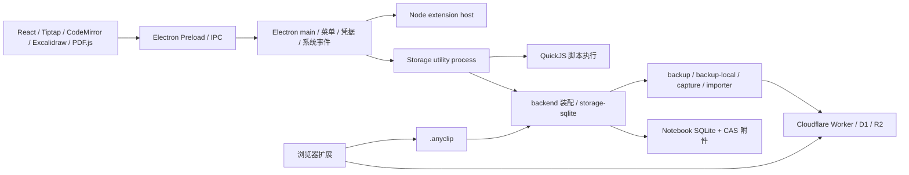
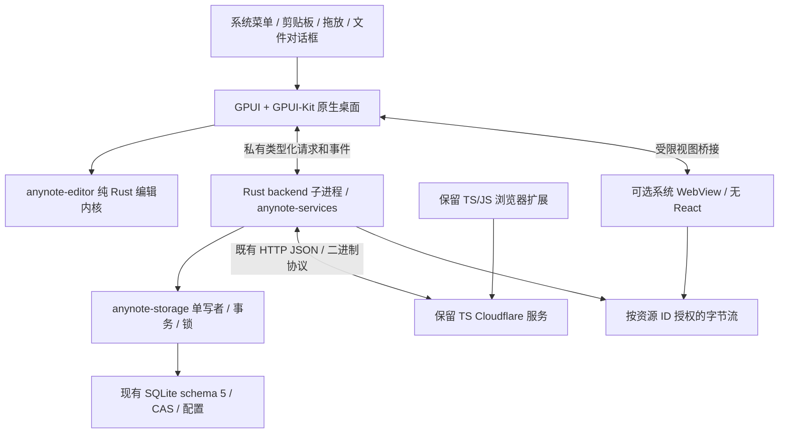
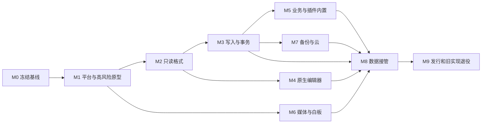

# Rust + GPUI + GPUI-Kit 桌面迁移方案

日期：2026-11-08。状态：**设计完成，迁移尚未实施，技术原型与验收尚未执行**。

代码基线：AnyNote `1b0a52bd431a3f3f13707214cdbf59bf957185ad`。本方案只增加设计文档和索引，不修改业务实现、数据、部署或现有 TODO 状态。后续实现前应固定新的基线并检查差异。

## 1. 范围与阅读顺序

目标是用 Rust 重写桌面业务、编辑内核和原生 UI，以 GPUI + GPUI-Kit 提供桌面界面。浏览器扩展与 Cloudflare 服务继续沿用现有 TypeScript/JavaScript 构建和部署链；不能因删除桌面 Node 依赖而破坏它们。

配套文档共同组成方案：

1. [现状与功能迁移清单](RUST-MIGRATION-INVENTORY.md)：源码、功能入口、依赖、内置能力和移除范围。
2. [数据与协议兼容方案](RUST-DATA-COMPATIBILITY.md)：SQLite、附件、归档、配置、凭据、备份与采集。
3. [原生编辑器设计](RUST-EDITOR-DESIGN.md)：AnyNote 与 quiet-md 对照、编辑模型、GPUI 渲染和编辑验收。
4. 本文：整体架构、选型、WebView 边界、阶段依赖和发布门槛。

### 1.1 不可降低的迁移约束

- 桌面发布物不得包含或启动 React、Electron、Node.js、QuickJS、V8 嵌入宿主、`gpui-shell`、动态插件宿主或兼容旧桌面的 JS sidecar。测试期可在隔离副本上运行旧应用，作为行为对照；它不进入 Rust 发布包。
- 系统 WebView 是用户明确允许的局部视图例外：只使用系统引擎及受控页面，不引入独立 JavaScript 运行时。页面可有必要的渲染桥接代码，但文档模型、编辑命令、持久化、鉴权、网络导入和业务规则归 Rust。原生 UI 仍全部由 Rust/GPUI 实现。
- 保留当前可用功能及数据；对于存在实现但入口未接通、测试失配和未完成的远期需求，分别记录，不能把旧设计文档当作已交付功能，也不能把旧 bug 固化为兼容要求。
- 完全删除桌面插件的安装、注册、授权、执行、更新、通信和生命周期机制。已知插件提供的业务内置；插件运行能力本身按要求移除。未知第三方程序不能在“不再执行它”的同时承诺任意行为一致，须清点、逐项改写或明确为未完成；仅保留内容不等于功能迁移完成。
- 本次明确要求当前数据兼容，优先于仓库一般的“开发期不保证历史数据兼容”规则。范围是基线实际可打开的 schema/格式，以及用户已有的配置、用户文件和持久内容；不借机支持当前本就拒绝的任意历史格式。

### 1.2 研究方法与证据边界

使用 `codebase-memory` Tier 2 发现符号和调用关系，再读取实现、manifest、测试和脚本；核查索引覆盖并补读缺失区间。索引快照为 `2026-11-08T02:17:54Z`，工具报告非当前监听项目，因此具体路径 freshness 与源码核对优先于图结论。静态图出现的同名误连不作为运行时事实。quiet-md 未在索引中，按其本地源码直接核查。

库选型在 2026-11-08 查阅维护方仓库、发布说明和官方 API 文档。文中“选择”是目标设计；“需 PoC”不是已验证兼容。未运行现有全量测试、真实设备、签名、Cloudflare 端点或压力测试。现有 [TODO](../development/TODO.md) 的平台、真实云、耐久性及发行缺口仍然有效，不随迁移方案自动关闭。

## 2. 当前架构与迁移边界



[backend/src/index.ts](../../packages/backend/src/index.ts) 是现有服务装配入口；[electron/storage.ts](../../apps/desktop/electron/storage.ts) 持有存储实例、备份和扩展更新调度器，并请求主进程访问凭据。迁移保留存储故障隔离、单写者、备份/恢复协议和任务语义，删除插件宿主与扩展更新调度器。

| 范围                                                                      | 处理                                                  | 需要保留的边界                                                              |
| ------------------------------------------------------------------------- | ----------------------------------------------------- | --------------------------------------------------------------------------- |
| `apps/desktop/src` 与 `electron`                                          | Rust + GPUI 重写后退役                                | 原生菜单、键盘、输入法、书橱/目录/标签/搜索/阅读/编辑、设置、任务和恢复     |
| `storage-sqlite`、`backend`、`backup`、`backup-local`                     | Rust 重写；完成消费者清理后退役 TS 桌面实现           | SQL 与 CAS、导入/导出、任务恢复、物理设备/电量/网络策略                     |
| `protocol`、`capture`、`importer`、`types`                                | 审核消费者后保留 TS 必需部分；Rust 实现同一外部契约   | 浏览器/Worker 不加载 Rust 桌面，不靠 TS 运行时向 Rust 提供业务              |
| `apps/browser-extension`                                                  | 保留                                                  | MV3、采集/配对/云浏览与 `.anyclip`，其源码含 `.js`，无需强行改语言          |
| `apps/cloudflare-backup`                                                  | 保留                                                  | Worker/D1/R2、路由、能力协商、备份与采集状态机                              |
| `plugin-sdk`、`extension-host`、`extension-tools`、`first-party-adapters` | 将业务归并到 Rust 后删除桌面插件基础设施及分发链      | 首方 adapters 大多只是既有核心的包装，不要再造一套业务                      |
| `extension_data`、旧自定义块、插件用户文件                                | 按数据规则保留/映射                                   | 表名不能用作删数据依据；当前表也包含核心元数据                              |
| 构建/测试/CI                                                              | Rust 桌面与 TS 服务双流水线，最后清理 Electron 专属链 | 保留浏览器、Worker 与跨语言协议验证；废弃插件功能测试，保留提取出的业务用例 |

完整到组件、操作及测试入口的映射见[清单](RUST-MIGRATION-INVENTORY.md)。依赖不按根 `package.json` 一次性卸载：先按保留项目的实际 import/build 闭包拆分，最终桌面运行闭包不得包含 TS 执行器。

## 3. 目标架构

### 3.1 模块布局与依赖

以下目录为**拟新增**，本次不创建 Rust workspace：

```text
apps/desktop-rust/             anynote-desktop：GPUI 窗口、页面、系统适配、资源视图
crates/anynote-core/           ID、格式 DTO、错误、命令结果、校验与纯业务规则
crates/anynote-storage/        SQLite、CAS、锁、路径、事务、快照、读写持久化
crates/anynote-services/       应用装配、导入、备份、恢复、采集、任务、内置命令
crates/anynote-editor/         GPUI 无关文档、编辑事务、选区、撤销、格式编解码
apps/browser-extension/       保留原有 TS/JS 工程
apps/cloudflare-backup/       保留原有 TS 工程
packages/{protocol,...}/      仅保留 TS 消费者所需的契约和实现
```

依赖方向：`desktop → services/storage/core`，`services → storage/core`，`storage → core`，`editor → core`。编辑器的 GPUI 视图在 `desktop-rust` 内组合 `anynote-editor`；core/editor 不依赖 GPUI、网络、系统凭据或数据库。媒体、配置和平台适配先作为这些 crate 内的模块，不为每个功能建立 crate、依赖注入框架或事件总线。



### 3.2 进程、线程和通信

**保留一个 UI 进程和一个 Rust backend 子进程。** 同一 Rust 二进制通过内部 `--backend` 模式启动后端，不初始化 GPUI；沿用当前存储故障隔离，而非迁移时顺便取消进程边界。后端汇聚存储、导入、备份及采集。插件进程消失，不为每个业务额外开进程。

- UI 主线程只处理输入、布局、Entity 更新和系统窗口调用。编辑事务同步生成内存结果；大文档解析、图片解码和昂贵转换下放工作队列，结果携带文档 revision，过期结果丢弃。
- 后端使用一个 Tokio runtime 管理 I/O 与取消；SQLite 连接由专用阻塞工作队列拥有，首版保留当前全局写命令串行队列及已有 LRU/pin 规则，不暗中改成不同 Notebook 并行写。指定只读请求可以旁路；长归档/网络任务冻结一致快照后在事务外处理，不能一直占住写队列。
- 采用继承的匿名管道，控制帧为版本化、长度前缀的 `serde` JSON：`requestId/op/input`、对应结果/结构化错误，以及带 `taskId/sequence` 的进度事件。Rust 内部以枚举和结果类型分派，拒绝未知命令；不是重新开放 SDK 或通用脚本 RPC。
- 元数据帧设上限（初始 1 MiB，M1 测试后固化），大正文与附件通过独立的带资源 token 的有界二进制帧流传输；单块初始 256 KiB。禁止把完整 PDF/归档 base64 塞进 JSON。管道仅供父子进程，不开放默认 HTTP/TCP 服务。
- 取消与结束是不同消息；读请求可取消。跨库转移、采集等已有持久回执的写操作沿用 operation ID 查询结局；普通保存断线后重新读取权威 revision/正文摘要核对，无法确认时保留草稿并报冲突，不能假定存在通用幂等回执。进度可合并，保存结果、错误和提交状态不可丢弃；队列满时施加背压。
- 打开/切换文档先取得版本及内容；保存携带已有 `expectedRevision`/冲突语义。成功后才将该 revision 标为已保存，失败保留内存草稿。退出先等待必要提交，允许用户取消退出或显式放弃；不能将异步 task 被 drop 当作保存成功。
- 后端退出时 UI 显示可恢复错误并保留草稿；重启后检查锁、事务和未完成任务，再重新取得 revision。仅在确认任务没有提交时重放。崩溃前尚未保存输入的跨进程日志属于当前远期 F012，不冒充现成功能。
- 原生凭据由平台模块持有；按现有需要把短时凭据送给执行网络请求的 Rust 后端，不进入 UI Entity、日志、WebView或一般任务状态。

M1 必须测量 IPC 对现有保存 p95 预算的占比。若后续证据支持合并为单进程，需要独立决定并覆盖崩溃恢复，不以“Rust 自动安全”为理由取消隔离。

### 3.3 UI 复用与交互

以 Kit 的 Root/Theme、Button、Input、Select、Menu、Dialog、Popover、Tree/VirtualList、Table、Tabs、Resizable、Command、Progress 等完成现有界面。书橱、纸张背景、页面分栏等应用专用外观通过组合与主题实现；保持拟物和桌面应用观感，不以组件库默认主题替换产品风格。

对话框按操作动态创建，关闭即释放 Entity、订阅和任务。稳定组件身份绑定 Notebook/node ID，不在每次 render 重建输入状态。页面、标签、目录与预览只读取必要摘要；大附件、白板/PDF 初始化延后到打开时。

原生菜单与快捷键由同一个 Rust Action 集合分派。能力是否可用取决于焦点、只读状态和选区；避免菜单启用但快捷键失效。复用 GPUI 文件选择、剪贴板、系统 URL、拖放和窗口能力，缺口才添加平台适配或 `rfd`。Kit 无障碍基础不等于应用已通过读屏：自绘书橱、目录和 WYSIWYG 必须补角色、名称、状态和选区文本。

## 4. 技术选型与取舍

### 4.1 GPUI-Kit 的准确身份与版本策略

本方案的 GPUI-Kit 指 [longbridge/gpui-kit](https://github.com/longbridge/gpui-kit)。官方 `gpui-kit` facade 包含 GPUI、Base、Component 和 assets；`gpui-shell` 是另行加入的 JavaScript 扩展宿主，本项目禁止依赖。这里不是将旧 `gpui-component` 名称随意替换成 Kit。[官方架构](https://gpui-kit.com/docs/)

调研时 [gpui-kit 0.9.0](https://docs.rs/crate/gpui-kit/0.9.0) 发布于 2026-11-02，配套 `gpui-pre =0.3.11`。M1 以该组合建立 PoC，固定 Cargo.lock、Rust toolchain 和所需 features；如实施时升级，先重跑原型矩阵再改锁文件。不混用 quiet-md 的 vendored GPUI 0.2.2 和 Kit 0.9.0 的类型。官方安装文档当前要求 Rust 1.92+，由目标依赖图最终验证，不能只看顶层 crate 的声明。[安装要求](https://gpui-kit.com/docs/installation/)

| 责任            | 主选方案与复用理由                                                                                   | 备选及不采用的理由 / 验证门槛                                                                                                                                                                                             |
| --------------- | ---------------------------------------------------------------------------------------------------- | ------------------------------------------------------------------------------------------------------------------------------------------------------------------------------------------------------------------------- |
| UI 与源代码输入 | Kit Component/Base；源码模式复用 Kit Editor，表单复用 Input                                          | 单纯 GPUI 全自绘增加控件维护；Kit TextView/Editor 不能直接冒充 WYSIWYG。见 [Editor](https://gpui-kit.com/component/editor/)、[Input](https://gpui-kit.com/component/input/)                                               |
| WYSIWYG         | 独立 Rust core，优先接 Kit `base::text::editor_host` / TextView 布局，参考 quiet-md 的事务和输入架构 | 不复制 DocxXML 持久层，不保留 Tiptap；宿主未覆盖的表格/选区自行实现，详见[编辑器设计](RUST-EDITOR-DESIGN.md)                                                                                                              |
| SQLite          | `rusqlite`，直接复用 SQL/事务/Online Backup、需要的 SQLite 编译选项                                  | 不用 ORM 自动建模/迁移，不换 KV 数据库；保证 FTS5、严格 schema、WAL、锁和 backup 行为。见 [rusqlite](https://docs.rs/rusqlite/latest/rusqlite/)                                                                           |
| 异步网络与任务  | Tokio + reqwest/rustls，流式下载/上传、显式取消和并发限制                                            | 不给每个窗口建 runtime；不以 `reqwest::get` 默认行为替代现有下载安全规则。见 [Tokio](https://docs.rs/tokio/latest/tokio/)、[reqwest](https://docs.rs/reqwest/latest/reqwest/)                                             |
| Markdown/HTML   | `pulldown-cmark` 的 offset 事件做解析基础；原始片段自己保留。`html5ever` 解析 HTML，沿用当前转换策略 | 通用 HTML→Markdown 库可试验但不得改变链接/资源/未知块语义；comrak AST 也不能自动保证原文无损。见 [pulldown-cmark](https://docs.rs/pulldown-cmark/latest/pulldown_cmark/)、[html5ever](https://github.com/servo/html5ever) |
| ZIP 与哈希      | `zip` 流式读写现有 ZIP，`sha2` 复用 SHA-256；格式保持已有 manifest 规则                              | 不换压缩包类型、不自造 ZIP、不假定 serde key 排序等于 TS canonical JSON。见 [zip-rs](https://github.com/zip-rs/zip2)、[sha2](https://docs.rs/sha2/latest/sha2/)                                                           |
| 图片/矢量       | GPUI image 用于显示；Rust `image` 解码/缩略图，必要时 `resvg` 处理 SVG                               | 不允许任意 SVG 外部资源；锁定现有支持格式、动画/方向/像素上限，不能从 PNG PoC 推断全格式。见 [image](https://docs.rs/image/latest/image/)、[resvg](https://docs.rs/resvg/latest/resvg/)                                   |
| PDF             | `pdfium-render` + 随包固定的 Pdfium 原生库，GPUI 页面纹理和 Rust 标注覆盖层                          | Pdfium 是 C++ 引擎，通过 Rust 调用，无 JS 运行时；需资源流/字体/文本选择/发行验证。系统 PDF WebView 仅作经 PoC 论证的后备。见 [pdfium-render](https://github.com/ajrcarey/pdfium-render)                                  |
| Unicode         | `unicode-segmentation`；显式区分字节、标量、字素、UTF-16                                             | 不用 Rust `chars().count()` 机械替换 JS `.length`；兼容字段和交互坐标分别定义。见 [Unicode 分段](https://docs.rs/unicode-segmentation/latest/unicode_segmentation/)                                                       |
| 凭据与系统选择  | 平台凭据服务，评估 `keyring` 的对应 backend；优先 GPUI 原生文件选择，缺口用 `rfd`                    | keyring 不负责自动解开 Electron safeStorage 文件；Linux 无安全凭据服务必须报错，不能降级明文。见 [keyring](https://docs.rs/keyring/latest/keyring/)、[rfd](https://docs.rs/rfd/latest/rfd/)                               |

以上库是能力明确、有公开维护源的优先候选，不能据此统称所有组合“成熟生产可用”。M1 记录每个实际依赖的版本、最近发布、支持平台、维护问题、许可证、native ABI 和替代方案；尤其 Kit/WebView 与 Pdfium 动态库须分别锁定。引入库前先检查 Kit/现有 Rust 模块是否已经提供该能力。只在有测量证据时增加缓存、并发或持久派生索引。

### 4.2 保留网络规则而不是照搬插件权限层

现有 [safeDownload](../../packages/importer/src/network.ts) 具备 URL 协议/凭据检查、公网 DNS 判定、连接地址确认、逐次重定向复核、总时限、流式字节上限和取消。插件权限体系删除后，网页导入和采集仍需要这些业务边界。

Rust 下载器由一处实现：解析 URL → 解析并验证全部 IP → 连接绑定已验证地址且 TLS SNI/证书仍按原主机验证 → 每次重定向重新走流程 → 按流限额。禁止绕过证书校验、通过默认自动跳转绕过地址判定，或让代理设置悄悄改变连接策略。合法 Cloudflare 自托管 endpoint 的规则与网页任意 URL 导入分开配置；错误仍能在导入报告/任务中心定位。

## 5. 媒体与系统 WebView

### 5.1 功能分配及采用条件

| 功能                               | 默认实现                                                                | WebView 采用条件                                                                                                                                                  |
| ---------------------------------- | ----------------------------------------------------------------------- | ----------------------------------------------------------------------------------------------------------------------------------------------------------------- |
| 书橱、树、搜索、设置、任务、管理页 | GPUI + Kit                                                              | 无需 WebView                                                                                                                                                      |
| 正文阅读与 WYSIWYG                 | GPUI / Rust 编辑内核                                                    | 不用 WebView 包装旧编辑器                                                                                                                                         |
| 图片及区域标记                     | Rust 解码 + GPUI 缩放/平移/选区                                         | 原生实现已可行，不引入浏览器                                                                                                                                      |
| PDF                                | Pdfium worker 渲染、页面文本/命中信息回传，GPUI 导航、缩放与批注 UI     | M1/M6 证明原生渲染或文本层在目标平台成本不可接受时，受限 PDF 页面视图；PDF.js 可作为无 React 的渲染库候选，业务与批注仍 Rust，另审页面资产依赖                    |
| 白板                               | Rust scene/操作内核 + GPUI canvas；保留 Excalidraw 数据格式             | 若 GPU/文字/图形绘制成本明显过高，仅将 Rust 渲染模块编译 WASM，以 Canvas 绘制；权威 scene/事务仍在原生 Rust，禁止 React 版 Excalidraw，WebView 不解决操作内核缺口 |
| 视频嵌入                           | GPUI 原生卡片和元数据；当前支持 provider 的实际播放交给隔离系统 WebView | 播放器 iframe 与浏览器编解码适合复用系统引擎；受控本地资源与外站视图严格隔离。不新增通用网页浏览、动态登录抓取或未接线的时间点批注；HTML 导入归 Rust 服务         |

白板是关键路径，必须从锁定的 Excalidraw 0.18 版本提取实际暴露的工具与交互清单：基础图元、手绘/文字、连线绑定、选择/多选/组合、层级、复制/粘贴、撤销/重做、缩放/平移、图片、样式、导出及 scene 未知字段等，以当前可达功能为准。不是仅兼容几种 JSON 字段或展示旧 PNG 就算完成。先用 Rust 做 scene 往返，再分批实现操作、命中/坐标和原生渲染；逐项通过前旧客户端不得退役。可研究已有 Rust 图形库复用算法，但本次没有找到并验证可无缝替代 Excalidraw 的成熟 Rust 全功能编辑器，不虚构现成替代。

### 5.2 已知平台限制与决定

优先使用 Kit 现有 `gpui-webview` 集成，避免从零拼接两个事件循环；它仍被维护方标为实验能力。调研时 macOS 使用 WKWebView，Windows 使用 WebView2，Linux 为 WebKitGTK/X11；原生 Wayland 子视图不受支持。相关 overlay/clipping 也受后端限制。[官方 WebView 指南](https://gpui-kit.com/docs/webview/)

- **Linux**：全原生页面可走 Wayland；需要嵌入 WebView 的完整发行配置先选 X11/XWayland。检测并提示缺少 XWayland/WebKitGTK，不把“禁用视频/网页”计为功能通过。若要求纯 Wayland 完整功能，必须先补平台集成并通过 M1；不得将此缺口隐藏在打包阶段。Wry 的 GTK-host Wayland 路径不等于它可以直接挂在任意 GPUI Wayland 窗口。[Wry API 限制](https://docs.rs/wry/latest/wry/struct.WebViewBuilder.html)
- **Windows**：验证官方示例要求的 DirectComposition 配置。子 WebView 可能覆盖原生浮层，初始方案为打开全局 Dialog/菜单时先隐藏子视图，以快照占位，关闭后恢复焦点和播放状态；popover 不跨子视图边界。是否改用特定 composition 后端由真机结果决定。
- **macOS/X11**：不为解决遮挡直接引入第二套 GPUI 依赖。`gpui-fast` 只是可比较的候选，必须整套匹配且重新验证布局、输入及包体；默认仍以锁定的 Kit 后端为基准。

这些是公开限制下的设计决定，不是三平台集成已成功的结论。M1 为每个平台记录运行后端、显示协议、缩放和实际失败模式。

### 5.3 通信与资源协议

WebView 不是通用前端宿主。每个视图绑定 `viewId + epoch + notebookId + nodeId + revision`，只允许固定消息：`ready`、视口/选区、用户输入意图、媒体状态、渲染完成/失败、资源读取。写入命令由 Rust 检查节点与 revision，后端提交后返回新 revision；没有通用 `run`、文件系统、SQL、凭据或插件调用。

桥接控制消息使用版本化 JSON：`protocolVersion/requestId/viewId/epoch/kind/payload`；Rust 在入口验证来源、大小、类型、频率、资源所属和当前 epoch。页面导航/重建后旧消息失效；重试需要幂等请求 ID。默认控制消息上限 64 KiB，大场景由 Rust 的资源流加载；上限在 M1 压测中固化，不能无界调大。

- 本地页面由受控 scheme/等效平台映射提供，打包资源只读；只暴露资源 ID 和临时能力 token，不泄露绝对路径或长期 token。附件流支持 Range、取消和限流，MIME 与真实内容匹配。
- `evaluate_script` 仅调用固定桥函数、传 JSON 编码参数，不拼接用户文本为脚本。需要回执时使用显式 reply/timeout，不能把脚本提交成功等同于页面已加载或已保存。
- 本地受信页面可启用有限桥；第三方 iframe/导航视图没有业务桥，也不继承登录凭据。链接、弹窗、下载、摄像头/麦克风等有显式策略；外部 URL 交系统浏览器或现有允许的嵌入规则。
- CSP 限制页面资源与网络源；不因字体、CDN 或 PDF worker 失败而放宽到任意执行。Rust 负责附件导出、云请求和剪贴板写入的最终授权。
- PDF/白板用户内容视为数据；恶意 HTML、SVG 和 URL 不可通过序列化进入原生能力。系统 WebView 缓存只存可再生数据，不能成为唯一正文/场景状态。

### 5.4 生命周期与预算

`NotCreated → Loading → Ready → Suspended → Closing → Dropped` 由所属文档视图管理，另有可重试的 Failed 状态。只在用户首次打开需要的内容时创建；一个视图一个 Entity，不在 render 中重建。

切标签时暂停音视频、停止绘制和非必要读取，显式隐藏原生 child；不渲染 Entity 本身不保证子视图隐藏。缩放/resize 更新原生 bounds，测试 100/150/200% 与跨屏移动。关闭按具体功能协调：正文走 session flush；白板保持只有点击“保存”才提交的现状，关闭未提交草稿不得偷偷生成新 revision。业务完成关闭决定后，停止接受新请求、取消资源流、注销回调、释放 texture/对象 URL，再丢弃 WebView handles，最后销毁父窗口；WebView 销毁本身不触发保存。

初始预算为最多一个活跃媒体 WebView，非活跃视图只保留 Rust 状态，必要时按用户切换重建；多标签播放需求以现有行为对照决定。内存测量必须计入系统 WebView 子进程，不只统计 Rust 主进程。冻结、重启或失效回调不得写入另一个刚打开的文档。

## 6. 数据与插件退出策略

详细格式、字段与检验步骤见[数据方案](RUST-DATA-COMPATIBILITY.md)。以下决定约束全部阶段：

1. 首个 Rust 版本继续读写当前 Notebook schema 5、原有 Markdown/custom directives、CAS 附件、`.anynote`/`.anyclip`、备份 manifest 和 Cloudflare 协议；不混入新的 Notebook 格式升级。
2. 保持当前表/索引/触发器 SQL 及 `_backup_revision` 语义。`extension_data` 保留为数据兼容结构，其中核心 revision、AI proposal、迁移回执和用户内容继续可读写；禁止恢复插件执行能力。
3. JSON 数字、空值/缺失、排序、时间戳、UTF-16 长度、canonical digest 和路径大小写必须按现有实现做跨语言黄金测试。Rust 的默认类型与序列化不能自动代表兼容。
4. 工作区/Notebook/CAS/设备配置路径分别盘点。Electron localStorage 在 Chromium LevelDB 中，safeStorage 为平台加密数据，都不是一个 `serde_json` 读取即可完成的转换；需要 Rust 离线只读读取器和平台 fixture。
5. `keyring` 作为新凭据存储只解决后续访问。老凭据无法可靠解密时，让用户重新录入并验证后切换引用，旧密文保留；不会携带 Electron 解密 sidecar进入目标产品，也不写明文迁移文件。
6. 对照期所有旧/Rust 测试使用隔离副本，禁止同时对正式 Notebook 写入。正式接管前关闭旧客户端、检查锁与目录身份，完整保全 DB/必要 sidecar、全部附件（含孤立文件）、第三方状态、配置及用户文件，再执行可重入的配置转换。普通备份会修剪孤立附件，不能作为唯一迁移保全副本。首版没有 Notebook 格式转换，验证副本后仍在原规范路径取得独占锁并接管，不建立两份可并行写入的正式库。
7. 迁移接管日志位于设备目录，不篡改 Notebook DDL；每步带版本、源指纹、目标、完成状态和校验摘要，恢复时从已验证步骤继续。无 Rust 新写入时可回到切换前状态；已有新写入则先完整保全最新数据、验证旧客户端可读，再把最新数据交给旧程序。不能用旧快照覆盖新笔记或回退云游标；具体路径与反向配置处理见数据方案 §5。

插件退出按[功能清单](RUST-MIGRATION-INVENTORY.md)逐项执行：内置阅读模板、callout、首方白板/视频/导入/备份、已有 AI 提案等成为静态 Rust 命令与类型；已存设置/任务结果转换为相应业务数据。未知自定义块保留源数据、预览/导出能力和可识别状态。未知已安装插件先生成待迁移清单，阻止把“全部业务已覆盖”标成通过，不能借静默停用掩盖功能丢失。

## 7. 执行阶段与验收门槛

阶段定义依赖与放行条件，具体实施已拆为唯一 [TODO 中的 RM01–RM38](../development/TODO.md#rust-migration)，包含 M/D/E 映射、子任务、公共文件归属与真实验收批次；一个阶段可跨多个执行组。每次实施更新该 TODO，必要结论写入现有[实施记录](../development/IMPLEMENTATION.md)，记录实际 commit、平台、fixture、命令和未完成项，不另建进度账本。下列全部为**待执行**，设计分组不是实施完成证据；阶段编号在三份附文中引用时以本文为准。



| 阶段                      | 前置条件           | 具体产出与任务                                                                                                                                                                                                   | 可验证的退出标准                                                                                                                                                      |
| ------------------------- | ------------------ | ---------------------------------------------------------------------------------------------------------------------------------------------------------------------------------------------------------------- | --------------------------------------------------------------------------------------------------------------------------------------------------------------------- |
| **M0 基线与契约**         | 本方案             | 固定旧提交；导出操作名/输入结果、所有正文节点/scene/自定义块、schema SQL、文件与配置；建立匿名 fixture、截图/交互清单与性能基线；分离当前入口、未接线代码和未来需求；清点实际插件                                | 每个清单 ID 有来源、目标模块、测试与状态；真实插件清点完成或明确无法访问；所有当前格式有旧实现读写样本；已知旧测试失配单独记录                                        |
| **M1 框架/高风险 PoC**    | M0                 | 建 Rust workspace/锁文件；三平台 Kit 窗口、菜单、IME、可访问性、动态 Dialog、服务 IPC；试编辑宿主/表格/大文档，Pdfium与WebView；白板文本/连线/图像模型往返；safeStorage/localStorage读取与HTML提取/清洗/转换差分 | 三平台原型有设备证据；Kit版本/features与无JS宿主依赖检查通过；明确Linux显示协议；所有高风险有可行路径和剩余规模，不能用截图代替可输入/可保存/可回收                   |
| **M2 只读数据**           | M1、M0 corpus      | 实现 schema严格验证、CAS校验、锁、目录/搜索/历史/回收站读取、archive/clip解析、配置导入计划；Rust只读书橱/阅读                                                                                                   | 旧数据原地只读零变化；对所有fixture逐字段/字节与哈希核对；损坏/未知版本/路径逃逸明确拒绝；无数据库自动重建                                                            |
| **M3 写入核心**           | M2                 | 创建、保存/CAS、资源注册、目录/标签、历史、回收站、链接、批注、跨库transfer、快照；任务取消/重启；导入导出                                                                                                       | 事务失败无半写；冲突不丢草稿；旧→Rust→旧隔离副本能读；跨库部分失败/重放/清理和schema触发器语义通过                                                                    |
| **M4 原生编辑器**         | M2；保存闭环依赖M3 | 按编辑器附文做source map、事务、选择、IME、undo、表格、图片/custom blocks、源码模式和保存协调；挂接当前真实入口                                                                                                  | 附文E系列用例逐项通过；未编辑源字节不变，受支持编辑语义一致；三平台真实IME/剪贴板/读屏无阻塞问题；原生编辑性能达到§8                                                  |
| **M5 业务UI及插件内置**   | M3；编辑相关依赖M4 | 书橱、树、搜索、导航、管理页、任务/诊断、导入报告、已有提案；清单§4全部阅读模板/统计/检索/目标/整理次数/公开文本命令；菜单/快捷键、配置与原生路径授权                                                            | 清单非媒体非备份项闭环；核心能力不走插件注册/消息；既有插件业务有对应内置入口，未知插件阻塞项显式保留                                                                 |
| **M6 媒体/白板**          | M1；持久化依赖M3   | PDF/图片/当前视频provider、范围读取、缩放/旋转/标记；白板scene兼容、全部可达编辑操作、预览导出；WebView桥和销毁                                                                                                  | 旧场景往返+交互库存全部通过；字体/资源断网可用；PDF标记坐标一致；模态遮挡/焦点/多屏/销毁压力通过；无React和隐藏业务JS                                                 |
| **M7 备份/恢复/采集**     | M3；任务UI依赖M5   | 本地卷/目标/计划/保留/清理、冻结快照、Cloudflare chunk/asset/commit/续传/维护/恢复、capture claim/import/ack/backedUp、设备配对管理                                                                              | 现有Worker无需改协议即可互通；本地故障注入与受控真实小规模测试分开通过；身份/哈希/状态顺序一致；真实老化与物理盘项未测不得关闭                                        |
| **M8 配置与正式接管演练** | M3–M7完成          | 在克隆用户数据演练localStorage/凭据/插件数据转换、源指纹/空间预检、锁、备份、原子发布、崩溃续作、回退；最后建立接管向导                                                                                          | 重复执行不重复创建或覆盖；中断/磁盘满保留旧完整副本；用户文件/配置/凭据都有可审计去向；Rust新写入后的回退有明确数据处理；跨平台恢复闭环                               |
| **M9 发行与清理**         | M8、全部功能门槛   | 新构建/安装/升级链；签名、公证、包身份、资源/native库、无运行时扫描；替换桌面CI；按消费者闭包删除Electron/React/插件代码与脚本，更新文档/索引/发布矩阵                                                           | 最终包无Node/React/Electron/QuickJS/gpui-shell；三平台安装/离线首用/卸载保留/升级回退通过；TS浏览器/Worker独立构建和协议测试通过；功能/格式/性能/平台矩阵无未解释阻塞 |

### 7.1 并行与交付粒度

- M0→M1→M2→M3 为基础路径；M4 的纯编辑内核可在 M2 后与 M3 并行，M6 的媒体/白板原型从 M1 后并行。M5、M7 分别拥有 UI/业务和备份服务模块，共享契约改动先合入。
- 每次实现按一组完整垂直能力交付，例如“保存+冲突+历史+重开”，而不是先把全部类型翻译完再验证。核心、编辑器、媒体、备份的文件 ownership 分开，不并行改 schema/协议常量。
- M6 白板、M1/M8 凭据与 Chromium 配置、M7 恢复是主要工期不确定项。完成原型前不承诺日期；按交互库存/fixture 数和真实平台结果估算，不能靠降级功能缩短关键路径。
- 中间版本仅对测试副本启用；不在生产功能缺失时卸载旧程序。最终只有 Rust 版本接管，旧 JS 代码不作为长期运行回退层。

### 7.2 功能验收归属

下表把[清单](RUST-MIGRATION-INVENTORY.md)的全部 24 类验收映射到阶段；146 个操作继续以清单中的逐项分组为准，最终均汇入 M8/M9 的端到端报告。

| INV ID             | 主要目标模块                                     | 实施阶段                           |
| ------------------ | ------------------------------------------------ | ---------------------------------- |
| 01、02、03、05、06 | desktop 工作区/会话/阅读/检索 + services/storage | M2 读取，M3 写入，M5 交互          |
| 04                 | editor core + desktop 编辑视图                   | M4（E0–E5先后验证）                |
| 07、08、09、10     | desktop 媒体/平台视图 + Rust 媒体业务            | M6；读取/保存依赖M2/M3             |
| 11、12、18、23     | services 导入/导出/提案/内置命令 + desktop       | M3 内核，M5 UI/内置化；媒体部分M6  |
| 13、14、15、17     | services 备份/恢复/采集 + 平台卷适配             | M7；15的诊断/清理基础先在M3/M5完成 |
| 16                 | services 任务/诊断 + desktop任务中心             | M3协议，M5界面，M7长任务/恢复      |
| 19、20、22         | desktop平台壳/Actions/主题/可访问性              | M1平台原型，M5完整接线             |
| 21                 | desktop平台凭据 + 配置迁移                       | M1可行性，M8真实接管               |
| 24                 | 构建、发行与保留TS工程                           | M9                                 |

## 8. 验证方案

### 8.1 功能、格式与跨语言测试

| 层级     | 方法                                                                                         | 判定                                                                                           |
| -------- | -------------------------------------------------------------------------------------------- | ---------------------------------------------------------------------------------------------- |
| 纯核心   | Rust 单元/属性测试：操作、选区、事务逆变换、JSON/路径/时间/Unicode、格式校验                 | 边界与失败场景覆盖；不是给每个getter写镜像测试                                                 |
| 数据差分 | 旧TS与Rust分别消费同一不可变fixture，输出标准结果；旧写Rust读、Rust写旧读；附件逐字节SHA-256 | 标准语义相同，要求原始保留的字段/正文/附件字节相同；不要求两次独立SQLite写入产生相同物理页布局 |
| 后端集成 | 独立进程运行：SQLite锁/WAL、事务、导入/导出、任务取消/恢复、CAS/transfer、备份与retention    | 不只测试mock；注入每个发布边界失败，确认旧有效状态仍可恢复                                     |
| 原生UI   | GPUI/Kit测试支持驱动真实组件输入、焦点和状态；保留统一动作/元素ID的测试适配                  | 替换Electron DOM/CDP驱动，不能让旧Playwright选择器空跑通过                                     |
| 系统UI   | 真机输入法、文件对话框、菜单、拖放、多屏DPI、读屏；最终包截图/录像                           | 无头GPUI测试无法证明OS窗口/IME/WebView行为                                                     |
| WebView  | 本地页面桥接协议测试、异常来源/过期回调/大消息/资源撤销、原生窗口生命周期                    | 浏览器页测试只覆盖页面；真实系统引擎另跑焦点/遮挡/关闭/失败恢复                                |
| 外部项目 | 保留TS扩展/Worker自己的测试与构建；增加Rust producer/consumer协议fixture                     | 两端可独立发布；能力不支持时明确拒绝，不把Worker“HTTP 200”当完整协议通过                       |

既有 `tests/` 及 `scripts/*smoke*` 用例先提取业务断言。当前 `test:document` 的全文编辑入口与旧 `test:editor`/`test:desktop` 中残存的逐块编辑选择器要先校正基线；禁止将失配脚本作为已经确认的迁移前行为。插件宿主/打包/签名目录测试在机制删除后删除，不新增“移除功能仍能运行”的测试；业务、内容兼容和下载边界断言迁到 Rust。

### 8.2 性能预算

沿用[当前性能验收](../development/validation/PERFORMANCE-UI-ACCEPTANCE.md)的有效业务预算，不把 JS bundle 预算硬换算成 Rust 二进制大小：

| 场景                       | 迁移门槛                                                                                                                   | 方法                                                                                                |
| -------------------------- | -------------------------------------------------------------------------------------------------------------------------- | --------------------------------------------------------------------------------------------------- |
| 新进程到固定Notebook可操作 | p95 < 3 s                                                                                                                  | 至少5次，分别记录OS缓存保留与真实冷缓存，不混合统计                                                 |
| 52,216字节文档打开         | p95 < 300 ms                                                                                                               | 首用与连续打开分开；包括可输入状态                                                                  |
| 保存提交                   | p95 < 150 ms，不含自动保存防抖                                                                                             | 包含IPC、校验和SQLite提交，不仅测UI函数                                                             |
| 万篇搜索/跨库搜索/反链     | p95 < 500 ms                                                                                                               | 复用4库/11,064节点、1,000层目录与跨库链接语料                                                       |
| 虚拟树滚动、备份时UI响应   | p95 < 150 ms                                                                                                               | 实际滚动/操作到响应；同时记录帧时间和主线程阻塞                                                     |
| PDF/图片                   | 现有100页约100MiB PDF、4096²图片可范围读/显示/标记；不得整文档常驻解码                                                     | 补复杂字体、扫描件、矢量及真实照片，不只合成样本                                                    |
| 编辑/白板手势              | 新增目标：100KiB普通文档输入到呈现p95 ≤ 50 ms、p99 ≤ 100 ms；60Hz滚动帧p95 ≤ 16.7 ms；白板按固定scene/动作同样测量输入延时 | 与旧版同机同操作轨迹对照，记录输入、布局、提交/呈现；不得以GPU宣传FPS替代结果；详见编辑器方案§10.4  |
| 持续媒体/任务资源          | 同机同语料总RSS/工作集及峰值不劣于旧基线10%以上；关闭后句柄/活跃任务回到基线                                               | 包括backend与系统WebView；60s仅冒烟，另跑1h；稳态末段增长超过起段10%或32MiB（二者取大）须查明并重测 |

最后两行及相对内存阈值是**新验收预算**，不是已测成绩；M0 记录设备和旧版数值，达不到不得自行放宽。Rust发布包、首用加载、磁盘临时空间也建立基线；PDF原生库/字体/WebView进程单独列账。发布前测低配机器、电池/离线状态、外接盘和备份并发；CPU节流不代替低配实机，SIGKILL不代替断电。

### 8.3 平台矩阵

设计覆盖 macOS、Windows、Linux；CPU架构/最低OS版本在 M0 根据现有产物和用户范围冻结，M1 证明支持后才写进发行声明，不能仅靠交叉编译认定可用。

| 平台    | 必测组合                                                                                                                               | 当前迁移重点                                                                               |
| ------- | -------------------------------------------------------------------------------------------------------------------------------------- | ------------------------------------------------------------------------------------------ |
| macOS   | arm64；若已有/拟发布x86_64则同样验收；APFS与外接exFAT；Keychain锁定/解锁；Retina/双屏；VoiceOver/中日文IME                             | bundle ID/签名身份、safeStorage解密、文件授权、WKWebView生命周期                           |
| Windows | x86_64；其他架构须独立决策；NTFS/文件占用/长路径/非ASCII；DPAPI；WebView2；100/150/200% DPI；NVDA/IME                                  | 原子替换/目录sync边界、卷标识当前缺口、安装升级与卸载保留、子视图遮挡                      |
| Linux   | 先复用ubuntu-24.04构建基线；X11及Wayland会话下XWayland完整功能；原生Wayland纯GPUI路径；ext4/exFAT；Secret Service锁定/缺失；IBus/Fcitx | Vulkan驱动、WebKitGTK依赖、无keyring错误、显示协议差异；不能宣称当前WebView支持原生Wayland |

真实设备、物理断电、长时老化、签名、公网网络和Cloudflare容量仍使用现有 TODO 的证据边界。对照时仅使用受控数据和已有授权预算；本次方案不会发起这些操作。

## 9. 发行、退役与架构决策

### 9.1 发行计划

[当前 release workflow](../../.github/workflows/release.yml) 产出 AppImage、DMG 和 NSIS EXE；目标首先保持这些用户安装形式及 `app.anynote.desktop` 身份。M9 为 Rust 二进制写平台打包步骤：macOS `.app`→签名/公证→DMG，Windows 使用 NSIS 包装Rust程序及资源，Linux AppImage包含合适的原生依赖并记录系统WebKitGTK/Vulkan要求。GPUI-Kit本身不等于安装器，`cargo build` 不能替代安装/卸载/升级验收。[官方打包指南](https://gpui-kit.com/docs/packaging/)

CI分为 Rust桌面、TS浏览器、TSWorker、跨语言契约四组。Rust执行 `cargo fmt --check`、`cargo clippy --workspace --all-targets`、`cargo test --workspace`、锁定依赖构建及对应平台UI测试；具体workspace/features由M1建立，以上是拟执行命令。发布产物检查资源离线完整性、native库ABI、许可证清单和禁止依赖。旧 `build:backend` 不再是浏览器/Worker构建的隐含前置，协议fixture生成单独命令化。

未来自动更新、签名身份和失败回退沿用 F006/A011/V011 的未完成状态，不虚构现有 updater。Rust版本至少覆盖当前手动安装更新的行为；若正式发行要求自动更新，应在M9中按独立门槛交付，验证签名与失败恢复。新旧版本发现数据版本不支持时明确拒绝，不重写数据。

### 9.2 决策记录

| 决策                                                     | 理由                                            | 备选与取舍                                                               |
| -------------------------------------------------------- | ----------------------------------------------- | ------------------------------------------------------------------------ |
| ADR-R1：纯Rust桌面 + Kit facade                          | 满足技术边界并复用现有控件基础                  | Tauri/React或Electron混合无法满足；全自绘控件成本更高                    |
| ADR-R2：Markdown为持久源，Rust编辑事务，参考quiet-md架构 | 保存AnyNote已有格式与链接，不把UI模型写入数据库 | 直接引入quiet-md DocxXML或ProseMirror JSON会新增格式迁移和双重真源       |
| ADR-R3：先保持schema与外部协议                           | 将语言替换与数据升级风险分开                    | ORM重建/新数据库会破坏严格DDL和备份互操作                                |
| ADR-R4：保持Rust后端进程隔离                             | 延续当前存储故障边界，复用同一命令契约          | 单进程更简单但改变故障语义，须测量与独立设计                             |
| ADR-R5：删除插件机制，已知业务静态内置                   | 功能归属明确，无动态JS宿主                      | WASM插件/Rust dylib插件仍是插件体系，均不引入                            |
| ADR-R6：原生媒体优先，WebView受限例外                    | 复用系统浏览器能力同时控制资源与业务边界        | 全Web UI不符合目标；纯原生网页/全编解码器成本过高                        |
| ADR-R7：白板保持格式且重写编辑能力                       | React禁用使现有组件不可直接复用                 | 保留React岛违反约束，只展示PNG或改为外部编辑会丢失交互；未完成时延后退役 |

### 9.3 风险处置与完成定义

| 风险                               | 早期验证 / 处理                                      | 阻塞点                                      |
| ---------------------------------- | ---------------------------------------------------- | ------------------------------------------- |
| WYSIWYG选区、表格、IME与原文保持   | M1用混合文档做全编辑闭环；M4按附文性质测试与真人输入 | 不能改为仅源码编辑交付                      |
| Excalidraw复杂scene与操作覆盖      | M0冻结库存、M1验证核心几何、M6逐操作差分             | 完整交互未覆盖不退役旧客户端                |
| Kit/WebView版本/平台限制           | 固定依赖、M1真实窗口验证；优先native与XWayland配置   | 不把Linux失败当UI偶发问题略过               |
| 严格DDL、JSON hash、旧归档         | M2跨语言fixture；DDL原样，未知字段保留               | 校验失败不写正式数据                        |
| safeStorage/Chromium配置不可直接读 | M1平台fixture、M8副本迁移；无法解密则重新录入        | 凭据失效不能导致任务静默使用空token或丢配置 |
| 备份快照/提交/断电一致性           | M3/M7按状态边界故障注入及真实恢复                    | “单元测试绿”不代替物理设备/云验收           |
| 删除共享TS包破坏保留应用           | M0 import闭包、M9独立干净构建                        | 浏览器/Worker构建不依赖桌面Node后端         |
| 当前实现/文档/测试漂移             | 入口核对与基线问题单，不照搬过时选择器               | 所有差异有处置，不把已知坏基线称为通过      |

**迁移完成**同时要求：清单每项当前业务有对应Rust入口与验证；格式/配置/用户文件迁移可重入且有回退；插件执行体系和桌面React/Electron/JS宿主从发布物及构建依赖闭包移除；当前外部协议与TS应用继续可用；最终包在声明支持的平台通过功能、输入、性能、资源和恢复验证。未执行、降级、只读保留或待确认的项目必须单独列出，不能记作全部迁移完成。
