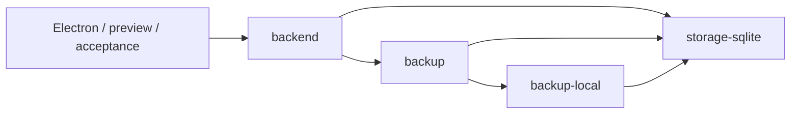

# ADR-012 · 备份服务装配与 Storage 的单向依赖

状态：已采纳。日期：2026-10-21；G17 第二批，基于 `76a52ef` 工作树。接续 [ADR-011](011-extension-module-boundaries.md) 的备份循环后续项。

[返回 ADR 索引](README.md)

## 背景

backup、backup-local 使用 SQLite、资源闭包、临时任务及 Storage；Storage 又动态加载备份操作和快照捕获，任务重试也反向引用 backup。动态 import 延迟执行，并不能消除包依赖循环。

## 决定

- 新增私有 `@anynote/backend` 作为 Electron、预览 API、备份验收工具的共同装配入口。它导出的 Storage 在构造时注入备份操作；基础 `@anynote/storage-sqlite` 可独立消费，不加载或依赖备份包。
- Storage 使用每实例的 `ServiceOperation` 映射，不使用进程全局注册。服务输入和结果为 `unknown`；分派结果以 `handled` 区分，未处理分支不允许携带结果。操作名称目录归各备份包，装配层只读取轻量目录，实际服务 仍按需加载。
- 默认服务操作沿用 Storage 串行队列；原先可并发的预览、远端读取和维护操作由装配描述显式标记。快照捕获保持串行。任务重试直接调用同一分派，不重新入队，避免死锁；返回任务句柄验证 UUID 和可选状态。
- 快照入口严格验证 Notebook ID、受管暂存目录及 AbortSignal。快照 SQL 使用专用投影并验证唯一元数据行、Notebook 身份、schema v4 和十进制序列号。仅读取最多两行来拒绝重复元数据；本地备份保留精确序列字符串，远端 number 清单拒绝超出安全整数范围的序列。
- `workspace:check` 扩展到所有 workspace 的 manifest 依赖和显式 TypeScript references；保留统一后端编译与共享 `dist` 镜像。按包构建的依赖闭包补入 `extensions/*`，不新增第二套 composite 编译流程。

## 取舍与范围

新增包负责服务装配与执行策略，不是旧导入路径的兼容转发。需要完整备份功能的宿主应从 backend 创建 Storage；仅需要笔记存储的消费者可继续使用 storage-sqlite。内部 backup 服务继续使用现有 Storage 能力，尚未将所有调用细化成独立领域端口。

本批收紧的是服务分派、快照 SQL/输入和任务重试结果。Storage 的公共 `run/execute`、其他通用 SQL 行、持久 JSON 和 SDK transport 的动态边界仍由 G17 后续批次逐组处理；构建图无循环不代表这些类型工作全部完成。

## 证据与验证

[装配入口](../../../packages/backend/src/index.ts)、[服务接口](../../../packages/storage-sqlite/src/services.ts)、[快照校验](../../../packages/backup/src/snapshot-metadata.ts)、[回归与独立消费者](../../../tests/backup-boundaries.test.mjs)、[类型负向断言](../../../tests/types/backup-boundaries.ts)、[构建图检查](../../../scripts/check-workspaces.mjs)。实际命令、环境、结果和未执行项见 [历史实施证据](../../development/history/todo-2026-10-24.md#g17)。
