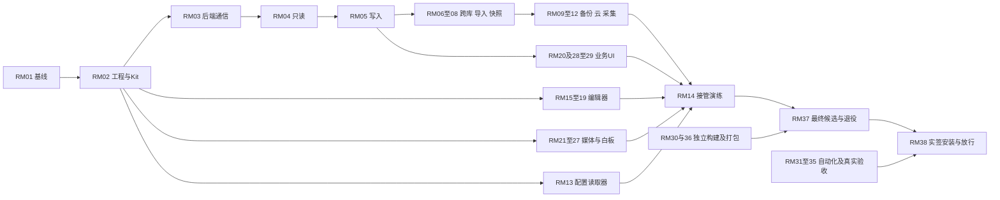

# Anynote 待办

更新：2026-11-09。所有任务状态统一维护于本文件。RM01、RM02、RM03、RM04、RM05、RM06、RM07、RM08、RM09、RM10、RM11、RM12、RM13、RM15、RM16、RM17、RM24 已完成；其余组以各节状态为准，保留真实剩余范围。

**结论**：Rust 桌面迁移共 **38 个执行组 RM01–RM38，已完成 17 组，剩余 21 组**。每组包含可单独验收的子任务；组未完成时可以跨会话接续，不将整个 M 阶段塞进一次实施。

| 类型                                         | 数量        | 范围                                                        |
| -------------------------------------------- | ----------- | ----------------------------------------------------------- |
| [Rust 桌面迁移执行组](#rust-migration)       | 21 组未完成 | 基础、数据、编辑器、媒体、内置业务、接管、实测及发行退役    |
| [需要跨操作系统验证的](#platform-validation) | 14          | 平台适配、数据与凭据、恢复、物理设备、原生交互和性能        |
| [与正式发布相关的](#release)                 | 11          | 首发决策、类型质量、签名更新、发行包与 CI、真实云和公网验收 |
| [远期扩展功能](#future)                      | 15          | 可选备份优化、AI、编辑器、检索、加密、同步、采集与工具扩展  |

原有事项剩 **40 条有效未完成条目**；[F020](#f020) 因明确移除插件机制而取消，保留编号及理由，取消不等于实现完成。RM 是迁移执行单元，与 V/A/F 有范围映射，不将两者相加冒充独立任务总数。V/A/F 编号和有效未完成状态保留，实际证据满足对应条目时再同步更新；不因 Rust 实现通过而自动关闭真实验收。远期扩展未经确认不纳入迁移。

已取消的云盘任务 A001–A006、F003、F004、F011 不恢复；A004 的 Cloudflare 条件发布验收已并入 A007。备份范围仍为本地磁盘与 Cloudflare。旧编号与历史实施证据见[历史记录](history/todo-2026-10-24.md)，近期阶段进展见[合并归档](history/todo-progress-2026-10-25.md)。

## Rust 桌面迁移：拆分依据

设计依据：[总方案](../design/RUST-DESKTOP-MIGRATION.md)、[功能清单](../design/RUST-MIGRATION-INVENTORY.md)、[数据兼容](../design/RUST-DATA-COMPATIBILITY.md)、[编辑器](../design/RUST-EDITOR-DESIGN.md)。M0–M9、D1–D6、E0–E9 是设计范围；本节 RM 子任务复选框是实施状态。已完成组保留依赖锚点；实际交付与未完成范围以下方复选框和实施记录为准。

| 类型      | 本次如何划分                                                            | 判定边界                                                          |
| --------- | ----------------------------------------------------------------------- | ----------------------------------------------------------------- |
| 核心/重构 | workspace、IPC、存储事务、文档模型和编辑事务分别确定所有者              | 修改同一模型/SQL/协议/测试的工作串行，不按优先级拆散              |
| 独立实现  | 导入、归档、本地备份、云传输/维护/采集、图片、PDF、白板各自形成完整闭环 | 白板分 scene/操作、绘制交互、资源保存；不把全部媒体或备份合成一组 |
| UI/配置   | 工作区、任务/备份管理、内置命令、配置读取与接管状态机                   | 先等稳定服务契约，再接真实服务；控件和 Dialog 复用 Kit            |
| 真实验收  | 普通平台设备、物理故障设备、Cloudflare、公网 DNS/TLS、签名发行分批      | 外部资源未到位不阻塞离线实现；模拟测试不替代真实结果              |

RM02 已固定[五个 Rust 工程与平台测试入口](RUST-DESKTOP-DEVELOPMENT.md)；后续组的模块与测试名称仍为**拟建范围**，不存在的文件不作为已实现入口。沿用总方案五个 Rust 工程单元，不因拆任务增加 crate。原 Electron/React 仅在隔离测试副本作为比较基线，不能进入最终运行包。

### 推荐分组

“前置”是该组完整接线与验收的依赖；明确列出的早期子项可先做。同一组内按子项顺序执行；并行仍须满足下文公共文件归属规则。

| 组            | 任务                                     | 前置                                                      | 可并行范围                             |
| ------------- | ---------------------------------------- | --------------------------------------------------------- | -------------------------------------- |
| [RM01](#rm01) | 固定基线、兼容语料与覆盖清单（已完成）   | 设计方案                                                  | 已交付；后续复用冻结材料               |
| [RM02](#rm02) | Rust workspace、Kit 与平台壳（已完成）   | RM01                                                      | 完成工具链后解锁独立模块               |
| [RM03](#rm03) | 后端进程、类型化通信与任务基础（已完成） | RM02                                                      | 与 RM13/15/22 原型并行                 |
| [RM04](#rm04) | schema v5 只读、资源与搜索（已完成）     | RM03                                                      | 与 RM15 并行                           |
| [RM05](#rm05) | 写事务、资源修订与核心状态（已完成）     | RM04                                                      | 独占基础 SQL/写入热点                  |
| [RM06](#rm06) | 跨库复制/移动与回执（已完成）            | RM05                                                      | 与 RM07/08 并行                        |
| [RM07](#rm07) | HTML/文件/采集包导入与重试（已完成）     | RM05；07.1 可在 RM02 后原型                               | 与 RM06/08 并行                        |
| [RM08](#rm08) | 一致快照、归档、导出与核心清理（已完成） | RM05                                                      | 与 RM06/07 并行；媒体终验交 RM24/26    |
| [RM09](#rm09) | 本地备份与卷适配（已完成）               | RM08.1/.2 基础契约；完整媒体语料随 RM24/26 补齐           | 与 RM10 并行，调度由 RM10 所有         |
| [RM10](#rm10) | 云传输/恢复/续传及调度（已完成）         | RM08.1/.2 基础契约；本地调度联调等 RM09                   | 与 RM09 并行                           |
| [RM11](#rm11) | writer、保留与维护恢复（已完成）         | RM10                                                      | 与 RM12 并行，上传契约改动串行合入     |
| [RM12](#rm12) | 配对、采集消费、同切面浏览（已完成）     | RM07、RM10                                                | 与 RM11 并行                           |
| [RM13](#rm13) | 偏好与凭据读取/转换（已完成）            | RM02                                                      | 与数据/编辑核心并行，真机另验          |
| [RM14](#rm14) | 原路径接管及无损回退                     | RM13；完整演练等 RM06–12、19–29                           | journal 原型可先做，不激活真实数据     |
| [RM15](#rm15) | Markdown 模型与原文保留（已完成）        | RM02、RM01 语料                                           | 与存储/媒体 codec 并行                 |
| [RM16](#rm16) | 文本事务、选区、撤销和组合输入（已完成） | RM15                                                      | 独占事务/selection/history             |
| [RM17](#rm17) | 列表、表格与结构编辑（已完成）           | RM16                                                      | 已交付；视图接线交 RM18                |
| [RM18](#rm18) | 连续 GPUI 编辑视图与输入（部分完成）     | RM16/17；18.1 可在 RM02 后原型                            | 与独立媒体模块并行                     |
| [RM19](#rm19) | 源码模式与保存会话（部分完成）           | RM18、RM05                                                | 独占 DocumentSession/save controller   |
| [RM20](#rm20) | 声明块与已知插件业务内置                 | RM19、RM07；纯命令可先基于 RM05                           | 与 RM21–27 并行                        |
| [RM21](#rm21) | 图片阅读、编辑块与版本（本地完成）       | RM05、RM19；解码可先做                                    | 与 PDF/白板并行                        |
| [RM22](#rm22) | 白板 scene 与操作内核                    | RM02、RM01 语料                                           | 不依赖 UI，可与编辑器并行              |
| [RM23](#rm23) | 白板绘制与交互（部分完成）               | RM22、RM02；WebView 路线另等 RM27.1/.2                    | 与 PDF 并行                            |
| [RM24](#rm24) | 白板保存与历史资源闭包（已完成）         | RM23、RM19、RM05；24.3 等 RM06.1/.2 与 RM08.2/.3 本地契约 | 与独立 PDF/图片验收并行                |
| [RM25](#rm25) | PDF 引擎与页面/文本几何                  | RM05、RM02；25.1 原型可先做；WebView 后备另等 RM27.1/.2   | 与白板/图片并行                        |
| [RM26](#rm26) | PDF 选择、批注与索引                     | RM25、RM19                                                | 与白板并行                             |
| [RM27](#rm27) | 系统 WebView 与视频接线                  | 宿主 RM02/05，27.1 原型可先做；视频 27.3 等 RM19/20.3     | 宿主由一人所有，调用方仅接接口         |
| [RM28](#rm28) | 书橱/目录/搜索/阅读与原生交互            | RM05、RM19；只读壳可基于 RM04                             | 与 RM29 并行，root/actions串行合入     |
| [RM29](#rm29) | 任务、诊断、备份与恢复管理页             | RM09–12、RM03                                             | 与 RM28 并行，复用同一任务状态         |
| [RM30](#rm30) | TS 保留端构建隔离与互通测试              | RM01、RM02；互通随 Rust 模块补齐                          | 与 Rust 功能实现并行                   |
| [RM31](#rm31) | 原生自动化与性能回归                     | RM02 可建 harness；全量等 RM19–29                         | 只改测试/驱动，性能修复交模块所有者    |
| [RM32](#rm32) | 三平台普通设备验收批次                   | 原型批次依赖各 .1；终验等 RM14/31/37                      | 按设备串行，与独立云批次并行           |
| [RM33](#rm33) | 物理盘、灾难与独立设备恢复               | RM09/10/14、候选包                                        | 同盘串行，可与 UI/云批次并行           |
| [RM34](#rm34) | 真实云互通、故障与老化                   | RM10–12/29、受控端点与账号                                | 同命名空间串行，老化等待可做本地任务   |
| [RM35](#rm35) | 内置下载器公网边界验收                   | RM07/20/27、受控 DNS/TLS 服务                             | 与 Cloudflare 分命名空间/资源执行      |
| [RM36](#rm36) | 原生打包、签名接线与发行 CI              | RM02/30；完整候选包等功能组                               | 发行配置独占，不与 RM37 同时改manifest |
| [RM37](#rm37) | Electron/插件退役及文档清理              | RM14/20/30/36、全部功能本地通过                           | 独占依赖清理；真实终验未过不发布       |
| [RM38](#rm38) | 签名安装、升级回退与最终放行             | RM31–37、A011，全部必需门槛                               | 最终串行汇总，不提前切正式资料         |

### 逐组任务

#### RM01 · 固定基线与兼容语料（已完成）

2026-11-08 完成 RM01.1–RM01.3（M0/D1/E0 基线范围），完成项移入[实施记录](IMPLEMENTATION.md#rm01)。[冻结材料与复现方法](RUST-MIGRATION-BASELINE.md)覆盖 146 个白名单操作、20 个内部/漏接线入口及 INV-01–24，旧 reader 自校验通过；产品行为未改。

后续边界：旧 smoke 选择器、视频 CSP、retention 白名单缺陷已实际记录而未修复；macOS/Windows、真实凭据/用户插件、完整白板动作及设备/云/发行未测范围见基线文档，按 RM13/14/22–27/31–38 继续验收。RM01 完成只表示基线和限制已固定，不关闭对应 V/A/F 或宣称 Rust 功能通过。

#### RM02 · Rust workspace、Kit 与平台壳（已完成）

2026-11-08 完成 RM02.1–RM02.3，完成项移入[实施记录](IMPLEMENTATION.md#rm02)。[Rust 开发入口](RUST-DESKTOP-DEVELOPMENT.md)固定五个工程、锁定依赖/native 库与许可证、fmt/clippy/test 和平台探针。Rust 壳无需 Node；本机 Linux Wayland 启动与 X11 原生交互探针通过。

后续边界：平台检查壳不代表业务完成；RM03 后端通信已补齐；RM25 Pdfium 装载、RM27 WebView 仍未实施。电量/网络/恢复只保留接口，真实订阅随调度接线；真实 IME/文件选择器/读屏/多屏 DPI、macOS/Windows 生命周期仍交 RM32.1/.2，发行与 hosted CI 交 RM36。未改变任何 V/A/F 验收状态。

#### RM03 · 后端进程、通信与任务基础（已完成）

2026-11-08 完成 RM03.1–RM03.4，完成项移入[实施记录](IMPLEMENTATION.md#rm03)。同一原生二进制提供无 GPUI 的 `--backend`、有界匿名管道与二进制资源流、类型化命令/错误、取消/超时/背压、任务持久化/中断恢复和诊断服务。[公共接入契约](RUST-DESKTOP-DEVELOPMENT.md#rm03-后端与公共接入契约)固定任务、资源、调度与保存断线后的核对规则。

验证：新增 16 项 RM03 测试通过，含真实子进程并发、崩溃/重连、旧会话/响应、流中断、退出排空与日志故障；原生 Xvfb/X11 壳回归通过。UI 不执行管道/状态库 I/O，断线不推定保存成功，无插件 RPC。

后续边界：当前任务为健康检查，资源流以有界诊断导出验证；Notebook 事务、实际保存/回执、文件租约、业务长任务和管理 UI 由 RM04–12/19/29 接入，三平台真实生命周期交 RM32。全工作区回归仍有并行白板测试的 JSON 键顺序断言失败，未改其范围；不改变任何 V/A/F 或 M1 三平台验收状态。

#### RM04 · schema v5 与只读数据面（已完成）

2026-11-08 完成 RM04.1–RM04.3，完成项移入[实施记录](IMPLEMENTATION.md#rm04)。`anynote-storage::notebook` 已交付精确 schema/可选 tracker 校验、外部目录与只读 LRU、正文/历史/批注/未知 JSON、历史 CAS 范围读取、FTS/短查询/跨库搜索与反链定位。[接续契约](RUST-READONLY-STORAGE.md)固定线程所有权、取消/预算、资源版本和 WAL 恢复拒绝边界。

验证：storage 14/14（含实际 SQLite trigram/JSON/Backup API）、28 组 TS/Rust 差分、旧 TS search/navigation/workspace/冻结语料 30/30；原库文件清单/hash 不变。首次沙箱内旧锁崩溃测试超时，沙箱外重跑通过。Clippy 与 Rust 五工程依赖边界通过。

后续边界：仅本机合成只读数据面，写事务由 RM05、业务 IPC/UI 由 RM28/29 接入；未完成三平台、实际用户库/卷、断电或性能验收。M2 放行仍依赖 RM15/M1 等既有门槛，不改变任何 V/A/F 状态。

#### RM05 · 写事务、资源修订与核心 JSON 状态（已完成）

2026-11-08 完成 RM05.1–RM05.4，完成项移入[实施记录](IMPLEMENTATION.md#rm05)。交付与旧 TS 互斥的 SQLite 写租约、全局有界队列、LRU/pin、事务及既有 backup revision 触发器；建库/笔记、排序/标签/收藏/回收站、保存 CAS、历史恢复、链接/批注、资源闭包和内置 JSON/提案状态均在现有 schema v5 上实现。[接续契约](RUST-WRITE-STORAGE.md)固定所有权、错误/重试、历史资源和后续服务边界。

验证：storage **32/32**（另 1 个 ignored 为父测试显式执行的崩溃子进程 fixture）、**17 组 TS/Rust 写入互通**、RM04 **28 组只读差分**及旧 TS storage/organization/workspace/冻结语料 **33/33**。修复 Unix 额外 DB 句柄 close 意外释放 POSIX 锁的问题，实际旧 TS + 两个 Rust 进程互斥及 SIGKILL 后重开通过；未提交事务退出回滚、资源 I/O/JSON 失败、提案状态回滚和历史白板嵌图不漂移均有本机证据。旧 workspace 锁测试首次沙箱超时，沙箱外重跑 6/6 通过。Clippy 与五工程依赖边界通过。

后续边界：本机 Linux 合成数据验证，不代表生产接管、三平台、真实用户库/卷、断电、性能或 V/A/F 验收；业务 IPC/UI 仍由 RM28/29 接线。资源发布失败可留下未引用 CAS，清理归 RM08；不支持 hard link 的卷当前明确失败，卷适配与实机验证保留给 RM32/33。不清理旧密文、未知插件状态或历史资源，不改 RM06 及以后范围。

#### RM06 · 跨库复制/移动与幂等回执（已完成）

范围：`anynote-services` transfer及对应存储回执，独立transfer故障套件；对应 M3。

- [x] **RM06.1** 构建节点、历史、批注、资源完整闭包，重映射内部链接和白板资源；保留现有节点/文件预算。
- [x] **RM06.2** 按目标提交/持久回执→核对源目标指纹→软删除源的顺序实现复制与移动，不用普通save重试替代跨库协议。
- [x] **RM06.3** 覆盖operation ID重放、两端任一中断、源/目标后续编辑、资源失败；重试不重复复制，失败不丢源数据。

2026-11-08 完成。本机 storage **36/36**、服务 transfer 专项 **4/4**、旧 transfer **8/8**，另 **8 组 TS/Rust 互通**通过；包括两端事务回执前后进程退出、目标提交后 SIGKILL、重放/恢复、两端编辑/资源损坏与完整历史闭包。storage Clippy、transfer 源文件隔离 Clippy、脚本 ESLint 与五工程依赖检查通过。并行模块初期曾阻断整包构建，随后原工作区服务专项和探针构建通过；全 services Clippy 仍被并行 RM08 的 archive/open_export 两处 lint 阻断，未声称全包通过。详见[实施记录](IMPLEMENTATION.md#rm06)及[跨库接续契约](RUST-WRITE-STORAGE.md#跨库复制与移动)。

验收：既有 transfer 业务断言本地闭环；最终白板具体编辑场景互通仍随 RM24 验证，三平台/真实卷/断电/性能和 V/A/F 未关闭。

#### RM07 · 导入、下载、预览与媒体重试（已完成）

2026-11-08 完成 RM07.1–RM07.3，完成项移入[实施记录](IMPLEMENTATION.md#rm07)。交付 Rust HTML/Readability/Markdown 转换、公网下载边界、相邻目录授权、URL/HTML/Markdown/文件预览和同快照确认、媒体选择/本地化、原 HTML 与失败报告、`.anyclip` 严格校验及原子回执、保留用户编辑的媒体重试。[服务接续契约](RUST-IMPORT.md)固定所有权、预算、取消、临时文件与重试规则。

验证：17 份旧 Readability/DOMPurify/Turndown HTML 黄金样本逐字一致；3 份 JS canonical 数值/UTF-16 key 语料、冻结采集与 ChatGPT 卡片、恶意 ZIP/路径/限额、真实本机 HTTP/TLS fixture、事务回滚、预览冻结/清理和重试编辑保护通过。5 组 TS/Rust 互通、旧相关回归 48/48；具体 Rust 回归与环境限制见实施记录。

后续边界：仅本机 Linux 合成数据和服务接口；UI/IPC/任务状态接线仍归 RM28/29、采集消费归 RM12，真实公网归 RM35。未验证三平台、真实用户库/目录、GUI、性能或 V/A/F；同步 HTML/文件工作须放后台线程，SQL 开始提交后的取消不撤销提交。未引用 CAS 的保全沿用 RM05，不擅自删除。

#### RM08 · 一致快照、归档、导出与核心清理（已完成）

2026-11-08 完成 RM08.1–RM08.4 的基础接口与本地契约验收，完成项移入[实施记录](IMPLEMENTATION.md#rm08)。[快照与归档接续](RUST-SNAPSHOT-ARCHIVE.md)固定 Online Backup/WAL 切面、附件 pin、完整/当前 ZIP/ZIP64、导入新库、持久快照恢复、Markdown 目录/ZIP、保全证据和清理隔离/复核/恢复接口。RM09/10 可据此开始实现。

本机合成语料中，TS↔Rust 完整/当前/ZIP64 互通、旧页隐私、恶意归档拒绝、源库损坏后恢复、处理中断不发布半包、过期/重开/引用变化清理拒绝和移动失败回滚已通过。清理只覆盖超出策略的持久快照；apply 返回隔离字节，确认提交后 purge 才释放空间，失败保留回执和剩余文件。

后续边界：完整白板/PDF 工作流闭包仍由 RM24/26 终验，任务/管理 UI 接线归 RM29；RM14 迁移保全必须包含配置及外部资料，不能用普通裁剪快照代替。本轮不覆盖真实用户库、三平台/物理卷/断电/拔盘、20 GiB 压力或大规模清理延迟；同步完整性检查期间的取消可能延后至该阶段结束。V/A/F 状态不变。

#### RM09 · 本地备份 v3 与卷适配（已完成）

- [x] **RM09.1** 备份根/卷 ID、设备映射、交叠/网络挂载/空间/FAT32 限制和等待磁盘状态；Linux/Windows 卷 fixtures、macOS UUID 响应解析均已验证，设备 ID 不作为独立物理盘证明。
- [x] **RM09.2** 复用未裁剪冻结切面，实现 1 MiB 有序 DB 分块、整附件、保守 token/manifest 指纹校验和 pending→manifest→cleanup；更换租约/重启先重捕获，只清理 journal 管理且仍匹配的文件。
- [x] **RM09.3** 手动/分组备份、全量验证、损坏报告、恢复新库和 RM03 任务回执；磁盘满/路径替换/取消/发布失败注入、真实进程退出后旧成功副本可恢复。自动调度由 RM10 接入。

2026-11-08 完成本地与模拟卷范围。[本地备份接续契约](RUST-LOCAL-BACKUP.md)记录服务/任务/卷接口、发布与恢复规则。验证：Rust RM09 **17/17**、既有归档 **14/14**、**8 组 TS↔Rust v3 互通**；旧本地备份/边界 **46 通过、1 既有跳过**；RM09 targets Clippy、格式、脚本 ESLint 和五工程依赖 guard 通过，详见[实施记录](IMPLEMENTATION.md#rm09)。

后续边界：本机 Linux 合成副本与模拟卷，不代表 Windows/macOS 原生分支编译或真实卷验证；拔盘、断电、真实 NTFS/exFAT/APFS 与独立物理盘交 RM32/33，完整媒体闭包随 RM24/26。GUI/IPC/管理页仍属 RM29，20 GiB/大规模延迟未测；不关闭任何 V/A/F 实测条目。

#### RM10 · Cloudflare传输、续传、恢复及调度（已完成）

范围：services云客户端/transfer/scheduler；对应 M7、D4主链。

- [x] **RM10.1** 保持 capabilities、plan→对象/multipart→commit、generation/lineage/device/head/epoch 与丢响应确认；校验 TS manifest 字节和 JSON 数值边界，实现独立恢复连接的配置、测试与持久化。
- [x] **RM10.2** 实现冻结身份绑定的上传/下载续传、持久 pendingGeneration/游标、恢复 pin/续租与校验后恢复新库；支持无本地 Notebook 时跨库/lineage 分页发现，切面变化不复用旧任务身份。
- [x] **RM10.3** 统一接入本地/远端调度：离线/电量/计费网络/大任务暂停，Retry-After/退避、取消、重启和永久错误修复；local-workerd与故障矩阵通过。

验收：外部协议不变、不重复提交/回退游标；真实云另验，首次本地通过不关闭 A007–A009。

2026-11-08 完成本组服务接口与本地验收，见[实施记录与接续契约](IMPLEMENTATION.md#rm10)。Rust 相关三包 116/116、旧 TS 相关 21/21、services 全 targets Clippy、五工程 guard 通过；实际 HTTP 故障代理和 local-workerd/D1/R2 覆盖 plan/commit 丢响应、跨进程续传、manifest 字节、损坏缓存、恢复新库、30 秒 pin 续租/失败、33 MiB multipart 会话过期及跨库分页。调度已直接派发工作区 RM09 本地备份服务和云上传服务。

后续边界：服务宿主 timer、业务 IPC 和任务/设置 UI 归 RM29；真实路径接管归 RM14，writer/retention/维护归 RM11，同切面 browse/captureAcks 生成归 RM12。已保存 multipart 片段以幂等 PUT 重新核实，不能宣称零重传。未覆盖真实 Cloudflare/三平台/用户库、20 GiB 压力或费用老化，A007–A009 及其余 V/A/F 保持原状态。

#### RM11 · writer、保留与维护恢复（已完成）

范围：services远端maintenance/retention，独立维护状态机测试；对应 M7。

- [x] **RM11.1** 实现writer查询、显式接管、epoch失效与冲突呈现，不自动夺取writer。
- [x] **RM11.2** 实现retention配置/预览/确认、日周月规则及head/branch/pin/staging保护；修正既有保存配置入口失配，不照搬坏白名单。
- [x] **RM11.3** 实现维护状态/异常恢复、tombstone及过期计划拒绝；保护集合变化后旧计划失效，预览无删除副作用。

验收：本地维护/retention故障测试完整；真实老化证据只在 RM34/A008 获取。

2026-11-08 完成服务接口与本地验收，见[实施记录与接续契约](IMPLEMENTATION.md#rm11)。复用 Worker 的 UTC 日周月采样、保护集合/CAS、tombstone 与协调器；Rust 持久化已确认接管/维护计划，丢响应与重启沿原身份恢复，旧 epoch 上传被阻止，保留配置不授予自动清理权限。修复旧 TS 保存配置白名单遗漏及协调器异常绕过协议错误处理的问题。Rust 三包 123/123、TS 相关 55/55、HTTP 适配器故障 12 组与 local-workerd/D1/R2 9 组通过。

后续边界：业务 IPC、冲突文案、设置/任务 UI 与新 writer 调度配置持久化归 RM29；原路径接管归 RM14。未连接真实 Cloudflare、真实用户库或执行真实老化/费用验收，RM34/A008 及其余 V/A/F 保持原状态。

#### RM12 · 配对、采集消费与同切面浏览（已完成）

范围：services capture消费/browse投影；对应 M7、F025已实现桌面能力。

- [x] **RM12.1** 实现配对/设备管理、限时claim、claimId/targetVersion/needs-target和receipt去重；资源与正文提交后才ack applied。
- [x] **RM12.2** 从上传的同一DB切面生成browse树/正文/附件和captureAcks；只有已提交备份含相应回执才成为backedUp。
- [x] **RM12.3** 与保留TS扩展/Worker完成本地闭环，覆盖重复claim/ack丢包、目录失效、撤销和版本变化；新增接口只经 RM10 所有者合入。

验收：不重复笔记、不虚报备份完成、不将采集改成浏览器直接写正式Notebook。

2026-11-08 完成本组服务接口与本地闭环，见[实施记录](IMPLEMENTATION.md#rm12)和[接入与复现](RUST-CLOUD-CAPTURE.md)。4 项 Rust 专项、相关三包回归、29 项 TS 回归、9 组 local-workerd/D1/R2 与实际 Chromium MV3 扩展闭环通过。验证 ack 丢响应后复用事务回执、目录/claim/版本失效、撤销、资源损坏拒绝、同切面正文/附件及提交后 backedUp；browse 超预算仍发布回执。

后续边界：后台宿主、业务 IPC、任务/设备设置 UI 接线归 RM29；真实 Cloudflare、三平台、真实用户库、容量与老化未验，RM34/A007–A009 及其余 V/A/F 保持原状态。

#### RM13 · 偏好与凭据读取/转换（已完成）

2026-11-08 完成 RM13.1–RM13.3 的离线读取/转换与原生凭据原型，完成项移入[实施记录](IMPLEMENTATION.md#rm13)。[配置迁移入口](RUST-CONFIG-MIGRATION.md)固定 LevelDB 副本读取、点分层偏好/秘密引用、已知状态 checksum/版本映射、未知包/状态保全和逆映射规则。10 项专项测试、Clippy、五 crate 边界及 Linux 私有 GNOME Keyring 的 Electron → Rust → OS 回读验证通过，未落盘解密后的测试 token。

后续边界：Linux 偏好证据为 Electron 41.9.1 生成的 file/dev origin 正常退出与已刷入 WAL 后异常退出合成样本；不恢复旧进程尚未落盘的内存值。Windows/macOS 只有原型代码和独立加密向量，原生分支编译、真实用户/锁定/跨设备/ACL 兼容由 RM32 验证。KWallet/basic_text/未知封装明确要求重新认证。RM14 尚未接管或发布配置，凭据结果始终保持任务暂停直至 capability 检查；未知必需插件未替代仍不能称功能等价。未关闭 V/A/F 或真实平台验收项。

#### RM14 · 原路径接管、迁移journal与回退（部分完成）

范围：services迁移状态机及desktop接管界面；对应 M8、D5。先做副本上的实现，正式激活等待全部功能门槛。

- [ ] **RM14.1** 实现userData/外部目录定位、互斥/空间/源指纹预检、包含孤立附件/用户文件/未知状态的完整保全与可重入journal；不得用裁剪备份代替。
- [ ] **RM14.2** 实现preflight→copied→verified→原规范路径独占接管，staging仅用于校验，不注册第二份同ID正式库；逐边界故障注入，保留原数据与有效副本。
- [ ] **RM14.3** 实现暂停调度/排空提交/冻结最新数据后回退，校验旧程序可读最新库；不回退共享云游标；UI偏好逆映射/新凭据重认证分别报告。

验收：重复运行不分叉，旧新不可双写；有新写入也可保全并回退。真实克隆资料/三平台演练归 RM32/33，未经门槛不接管日常资料。

2026-11-08：已实现 Linux 隔离副本的完整保全/空间与源身份预检、preflight→copied→verified→activated journal、逐文件校验、原路径 SQLite 租约、逐配置意图发布，以及 FIFO 排空后最新完整副本/`.anynote`/旧 TS 回读回退。桌面提供副本校验入口，正式激活禁用。实现与边界见[接管演练](RUST-MIGRATION-TAKEOVER.md)和[实施记录](IMPLEMENTATION.md#rm14)。

保留 RM14.1–.3 未勾选：跨客户端完整单实例互斥、Windows 原生身份、正式后台调度及所有服务排空、Chromium 偏好回填与旧端回读发布、完整激活/回退向导及真实克隆资料/三平台尚未完成。偏好仅输出逆映射待回填，新凭据明确需重新认证；本轮不激活日常资料，不改变 M8 或 V/A/F。

#### RM15 · Markdown模型与原文保留

范围：`anynote-core::protocol` Markdown/directive、`anynote-editor` model/source；对应 E2。

- [x] **RM15.1** 移植fence-aware directive和现有富编辑安全边界，建立覆盖全文的source segments、BlockId、已知/opaque块与源范围映射；quiet-md只参考分层。
- [x] **RM15.2** 实现局部serializer：无修改全文字节相等、局部修改范围外相等；保留CRLF/空白/BOM、reference definitions、未知JSON与资源引用。
- [x] **RM15.3** 用Rust/TS共同语料检查解析差异、未闭合fence/非法directive/超预算内容，不将DocxXML或GPUI AST写入持久层。

验收：格式差分通过，原文无声改写为阻塞项。

2026-11-08：已交付 `anynote-core::protocol::{markdown,rich}`、`anynote-editor::{model,source}` 和共用语料 `tests/fixtures/markdown/rm15.json`；Rust 13 项测试覆盖 54 份 Rust/TS 格式差分、RM01 冻结 Markdown、全文与局部字节相等、未知 JSON/资源保留、稳定 BlockId、引用重解析及固定 seed 200 次源编辑。TS 同语料及相关回归、Clippy/格式检查结果见[RM15 实施记录](IMPLEMENTATION.md#rm15)。修复现有 TS rich parser 的 BOM 偏移；所有 directive 继续保留原文，内置业务/视图交 RM20。仅完成离线 E2，不代表 M1/M2 阶段放行或真实 UI/IME 验收；下一组为 RM16。

#### RM16 · 文本事务、选区、撤销与组合输入（已完成）

范围：editor transaction/selection/history；对应 E3基础部分。

- [x] **RM16.1** 实现插入/删除/替换、marks/link、UTF-8/UTF-16/grapheme范围及选区映射，非法或过期范围不部分执行。
- [x] **RM16.2** 实现可逆patch、输入合并与唯一undo/redo，不复制整篇文档作为每一步历史；预算裁剪历史不得裁剪正文。
- [x] **RM16.3** 实现与OS无关的composition commit/cancel状态机，固定seed随机编辑验证不变量、撤销重放与源恢复。

验收：纯内核用例不依赖GPUI/设备；真实IME仍须 RM32。

2026-11-08：交付 `anynote-editor::{transaction,selection,history,composition,inline}`；复用 RM15 源模型增加原子批量 patch、Unicode/affinity 选区、局部 marks/link、增量历史及预编辑 overlay/commit/cancel。17 项专项测试通过（3 个固定 seed 各 300 轮 Unicode 编辑/组合、240 轮重叠格式操作），core/editor 合计 51/51、Clippy、格式和五工程边界检查通过；契约见[文本事务与输入内核](RUST-EDITOR-TRANSACTIONS.md)，证据见[RM16 实施记录](IMPLEMENTATION.md#rm16)。

后续边界：本组仅完成离线 E3 基础部分。结构编辑仍归 RM17，连续视图/原生输入归 RM18，保存会话归 RM19，三平台真实 IME/候选窗/焦点/a11y 归 RM32；未验证 UI、真实设备或输入性能，不关闭 M1/M4 或 V/A/F。

#### RM17 · 列表、表格与结构编辑（已完成）

范围：editor list/table/block操作及结构测试；对应 E3结构部分。

- [x] **RM17.1** 实现split/join、列表缩进/退出、引用、任务勾选及复杂粘贴，统一使用 RM16 事务。
- [x] **RM17.2** 实现当前表格创建、单元格编辑/导航、行列增删和跨块选择，保留现有语法安全降级边界。
- [x] **RM17.3** 实现块移动、atom前后落点和opaque保留；结构undo/redo、嵌套内容和资源引用测试通过，不新增复杂合并表格范围。

验收：现有可富编辑结构不能退化为仅源码；不得并行修改 RM16 的模型/事务核心。

2026-11-08：交付 `anynote-editor::structure`，复用 RM16 runs 编码器、原子事务和唯一历史。26 项专项测试通过，包含 3 个 seed 各 200 轮表格独立矩阵校验、180 轮列表操作、38 个共同语料可富编辑块转换、嵌套/空项、复杂粘贴、atom/未知 JSON/资源及完整撤销重放；core/editor 合计 77/77，Clippy、格式和五工程边界通过。接续见[结构编辑契约](RUST-EDITOR-STRUCTURE.md)，证据见[实施记录](IMPLEMENTATION.md#rm17)。

本组只完成离线 E3 结构内核。未接原生剪贴板/HTML 转换宿主、连续 GPUI 视图或保存；空段落和表格导航等投影约定交 RM18，保存交 RM19，真实 IME/设备/a11y 交 RM32。不改变 M1/M4 或 V/A/F 验收状态。

#### RM18 · 连续GPUI编辑视图与原生输入

范围：desktop编辑视图/Kit投影/native input；对应 E1/E4。

- [ ] **RM18.1** 先验证锁定 Kit editor_host 的段落/列表/表格/atom、叶节点几何、命中和原生输入接口，以及源码 Editor 的 `InputEditsEvent`、共享 undo 和程序化更新回声抑制；不足项做最小补齐原型，作为 M1 证据。
- [ ] **RM18.2** 接入RM16/17，完成连续正文、虚拟布局、光标/选区、slash/浮条、统一命令、滚动/搜索定位与拖放；复用Kit控件。
- [ ] **RM18.3** 接原生剪贴板、IME候选窗几何、焦点和可访问性文本/表格语义，重放当前test:document行为；真实输入/读屏交 RM32。

验收：不能以预览+文本框冒充WYSIWYG；可编辑语义和输入结果有断言，不仅截图。

2026-11-09：已接原生草稿入口、RM16/17 连续正文与行级虚拟布局、slash/工具条/原生菜单、内部块移动、搜索、字符串/Markdown/TSV 剪贴板、IME/source edits 共享历史及模型文本/表格可访问树。16 项编辑器测试（6 项 GPUI）和联合回归 107 项通过，Clippy/rustfmt/依赖边界检查通过。空任务、空引用、组合局部替换、代理对取整与格式切换历史边界有回归。详见[视图契约与证据](RUST-EDITOR-VIEW.md)、[实施记录](IMPLEMENTATION.md#rm18)。

RM18.1–.3 保留未完成：锁定 Kit 的 RTL/BiDi/范围几何与 HTML MIME 能力尚未补齐；跨复杂结构选择、独立表格/代码滚动、完整 a11y/真实拖放及旧 `test:document` 的保存/媒体路径尚未通过。原生程序已启动，但桌面操作工具报 `noWindowsAvailable`，未完成实际编辑窗口交互。不能关闭 E1/E4、M1/M4 或 V/A/F；真实输入/读屏继续交 RM32；RM19 已接独立目录的持久笔记，保存/源码进展见下节。

#### RM19 · 源码模式与保存会话（部分完成）

范围：desktop DocumentSession/source/save controller；对应 E5及旧SourceEditor接线。

- [x] **RM19.1** 接 Kit 源码 Editor 的高亮、行号、折叠、搜索替换和格式包裹，映射编辑批次/源范围到同一撤销历史；抑制程序化更新回声，给 opaque 块和全文源码提供入口。
- [x] **RM19.2** 实现650ms防抖、generation/epoch、串行CAS、保存中继续输入及过期ack过滤；读取资源绑定原note/revision。
- [ ] **RM19.3** 实现模式切换及选区/滚动锚点恢复、失焦/切笔记/关窗 flush、IME 结束等待和冲突草稿保留；注入断线/失败/关闭/迟到响应，不误写另一笔记。

验收：一个权威正文/历史/保存者；不承诺当前未实现的跨进程崩溃草稿日志。

2026-11-09：已实现源码高亮/行号/折叠/搜索替换/格式、批次单步撤销、选区方向和滚动恢复；`DocumentSession` 接 650ms 防抖、串行 CAS、epoch/generation、断线权威核对、冲突保留/查看/另存正文、固定 note/revision 资源读取。平台壳新建/继续编辑接真实后端和独立 SQLite Notebook，正常关窗、应用内退出和切笔记等待 flush/IME。118 项联合回归（含新增 11 项）、Clippy/rustfmt/五工程依赖边界通过。详见[接续契约与证据](RUST-DOCUMENT-SESSION.md)、[实施记录](IMPLEMENTATION.md#rm19)。

RM19.3 保持未完成：锁定 GPUI 的系统退出回调不可取消，Dock/OS 退出尚不能保证失败留窗；需 Kit 平台预退出及结束组合输入接口。原生窗口已完成新建/源码入口观察，但桌面工具后续 `timeoutReached`，未完成真实输入→关闭→重开；真实 IME/跨平台验收继续交 RM32。应用内屏障测试、真实子进程存储与真实桌面生命周期证据分别保留，不关闭 E5、RM18 或 V/A/F。

#### RM20 · 声明块与已知插件业务内置

范围：services静态内置命令、editor内置块与对应原生操作面；对应 M5、E6、INV-23。

- [x] **RM20.1** 内置已知callout/details、采集卡片白名单和字段编辑；保持围栏/数据版本/未知字段，未知块可源码编辑/复制/导出，不读manifest动态注册。
- [x] **RM20.2** 内置阅读记录、UTF-16统计、同步/异步检索追加、目标设置、整理次数、公开文本追加；保留既有状态/正文/回执原子性及版本映射，复用 RM07 下载器。
- [x] **RM20.3** 将白板/视频/HTML偏好与remote embed同意迁到静态设置/命令；核对所有首方adapter业务归属，已知样例识别须checksum，未知用户必需脚本列阻塞。

验收：插件功能真正可操作且数据兼容；不增加Rust/WASM/dylib插件体系，不把“只有原始内容导出”算已知功能完成。

2026-11-09：已交付静态块/字段窗口、采集卡片原生投影、阅读菜单和偏好窗口，接唯一保存会话及后端工作任务。状态/正文/回执同事务，重试不重复追加；旧状态须经 checksum/版本转换，未转换则拒绝默认值覆盖。首方 24 项 adapter 能力归属及九份冻结 JSON 样例已核对。core/editor/storage 127 项回归、services 9 项业务测试、desktop 30 项测试、1 项真实后端重开测试通过。详见[内置业务契约](RUST-BUILTIN-BUSINESS.md)、[实施记录](IMPLEMENTATION.md#rm20)。

勾选表示实现与上述自动化证据完成，尚不关闭 M5/E6 或迁移完整性：实际用户必需脚本未盘点仍列阻塞，RM14 正式接管须调用校验转换；真实 UI/IME、卡片逐像素对照、文件选择器导出及真实公网成功下载未验收。原生隔离窗口可打开，但桌面工具长时间阻塞且只返回窗口/菜单树，不能算交互通过。RM19 系统退出限制继续有效。

#### RM21 · 图片阅读、文档图片与版本（本地完成）

范围：desktop image view/block、Rust 解码/转换；对应 M6、INV-07。

- [x] **RM21.1** 当前格式有界静态解码、EXIF、按需缩略图、安全 SVG、缩放/适应/实际尺寸/平移/视图旋转；启动不解码整库图片。
- [x] **RM21.2** anynote-resource/core.image、32–4096 宽度/自适应及未知属性保留；粘贴/拖入/文件资源、区域批注、旋转新版本、原图复制与导出接线。
- [x] **RM21.3** 历史 hash/矩形、跨库复制/快照/开放导出、晚到结果/取消、句柄/纹理释放及原字节不变的本地矩阵通过。

2026-11-09：core/editor/storage **127 项**、desktop **41 项**通过（含真实隔离后端与 2 项生产控件 GPUI 流程）。保存复用 RM19 CAS，补齐媒体 generation/hash ack、断线重传与冲突另存资源；分块读取只校验一次完整 hash，结束/取消释放句柄。Clippy 与依赖边界检查见[实施记录](IMPLEMENTATION.md#rm21)；实现、预算及复现见[图片契约](RUST-IMAGE-MEDIA.md)。

真实 DPI/照片/峰值内存/三平台原生选择器仍归 RM31/32；本机原生工具仅完成打开笔记、插入菜单与文件选择器，未完成图片画面验收。当前为静态首帧预览，阅读器纹理上限 2560，40MP 阅读/24MP 旋转另存，SVG 不加载外部图片；这些边界不等于动画、瓦片或实际 RSS 验收，不关闭 M6/INV-07 整体门槛。

#### RM22 · 白板scene与操作内核（部分完成）

范围：Rust board codec/scene/commands/history及scene测试；对应 E8前段。

- [ ] **RM22.1** 冻结Excalidraw 0.18实际可达动作/字段；实现known+unknown JSON、ID/files/binding/order往返，先验证文字/连线/图片核心几何可行性。
- [ ] **RM22.2** 按操作族实现现有图形/文字/手绘/图像、选择/组合/层级/绑定等纯scene变换和可逆历史，不自造另一持久格式。
- [ ] **RM22.3** 对旧scene无修改保存、完整操作序列与undo/redo做差分；类型存在/现有可创建编辑/未暴露功能分开登记。

2026-11-08：已交付 `anynote-editor::board` 的保真 scene、原子命令及有界历史，复用 RM01 scene；锁定 0.18 的 91 个注册动作、字段/宿主摘要，26 步真实上游 action 差分及逐步 undo/redo 通过。19 项 Rust 白板测试通过；详细证据见[实施记录](IMPLEMENTATION.md#rm22)，边界和复现见[白板兼容契约](RUST-BOARD-COMPATIBILITY.md)。

2026-11-09：续交图片八手柄裁剪（旋转、翻转、比例约束、源图边界）、无绑定路径缩放、组级对齐/重叠分布、跨组/框/绑定文字的层级操作。参考扩展为 30 步主轨迹、14 条层级序列（84 步）、145 个几何用例；默认主菜单/更多工具/属性面板/右键菜单和 93 个运行时 action 的快捷键分派单独冻结。实际工具创建及旧版 undo/redo 另测，不把入口存在等同于操作完成。详情见[实施记录](IMPLEMENTATION.md#rm22)与[白板兼容契约](RUST-BOARD-COMPATIBILITY.md)。

本组三项保持未勾选：RM22.1 尚缺条件入口的完整交互、真实原生字体/连接几何可行性；RM22.2 尚缺开放绑定/elbow 自动路由、文字重排、组内编辑模式、路径控制点/翻转、frame resize 成员重算和完整复制粘贴/库等操作族；RM22.3 尚缺这些操作的完整旧版序列与历史差分。已实现的裁剪拒绝带开放绑定的图片，路径缩放拒绝 elbow 和绑定路径；不能据此视为完整兼容。下一步优先处理原生文字测量与开放绑定几何，再补条件入口/操作族差分，不提前关闭 E8/M6 或退役旧白板。

验收：原场景可无损继续操作；不以少量JSON字段可读作为完整白板兼容证明。

#### RM23 · 白板绘制与交互（部分完成）

范围：board renderer/hit-test/input；对应 E8交互部分，与 RM22 核心接口串行对齐。

- [ ] **RM23.1** 原生GPUI优先实现图形/手绘风格/字体/图像呈现；只有原型证明成本不可接受才用Rust渲染模块WASM，权威scene仍在原生进程。
- [ ] **RM23.2** 实现当前选择/多选/拖动/缩放旋转/文字/连接点/视口/主题/快捷键和剪贴板交互，全部调用 RM22，不保留React岛。
- [ ] **RM23.3** 对冻结动作逐项验证渲染几何、命中和操作结果；不同DPI/字体真机项交 RM32；部分工具或只读预览保持未完成。

2026-11-09：交付 `anynote-desktop::board` 原生临时窗口、共享轮廓绘制/命中、单事务手势、基本工具、字体轮廓/中文、图片解码与显示、Kit 文字输入、快捷键及剪贴板；所有 scene 修改复用 RM22。新增 14 项本地测试，含 3 项真实生产视图 UI integration tests；详见[实施记录](IMPLEMENTATION.md#rm23)与[原生白板契约及 93 项动作盘点](RUST-BOARD-VIEW.md)。

本组三项保持未勾选：手绘样式尚非 RoughJS 像素等价，完整字体/彩色 emoji、绑定/elbow、frame、组内编辑、完整属性/裁剪/路径交互及库/搜索/导出等冻结动作未完成。RM22 的限制明确返回错误，不绕过核心；临时窗口仍不保存，笔记白板块已由 RM24 接入显式保存与历史资源闭包；不能据此视为当前白板已全部替换。真实 DPI/平台字体等仍交 RM32。

验收：当前白板可达工具全部可用；WebView 路线须先有 RM27.1/.2 宿主交付，不等待视频 27.3，不改变核心保存责任；真实平台另归 RM32。

#### RM24 · 白板保存与历史资源闭包（已完成）

范围：board session与scene/files/preview提交；对应 E8保存部分。

- [x] **RM24.1** 打开前flush正文并冻结block/revision；保留显式保存/取消，关闭未保存白板不能自动写revision。
- [x] **RM24.2** 将scene、嵌图、PNG预览和note revision原子提交；资源失败/CAS冲突/过期回调不能发布半成品。
- [x] **RM24.3** 在 RM06.1/.2 与 RM08.2/.3 接口及本地契约测试通过后，联合验证跨库、归档、开放导出和历史重开都使用正确 scene/原图；保存中关闭与重试不覆盖后续编辑。不等待 RM06/08 的媒体终验，最终互通证据由本项提供。

2026-11-09：交付笔记白板块插入/预览/编辑、打开前正文 flush、冻结 block/revision、显式保存/取消、保存中关闭屏障、PNG 预览和 scene/嵌图/修订原子提交。保存失败保留草稿；未确认响应重试同一请求，重启后核对已提交版本，CAS 冲突不覆盖新正文。复用 RM05 写队列/资源闭包、RM06 转移、RM08 归档/开放导出，没有新持久格式或新依赖。

验收：新增 4 项测试通过，含真实隔离后端/文件落盘闭环与 2 项生产视图 UI integration tests；覆盖写入故障回滚、资源重绑后的历史读取、跨库复制/移动、完整归档导入、开放导出内嵌原图、取消零白板提交及保存中关窗。core/editor/storage 128 项、desktop 72 项、archive/transfer 18 项通过；Clippy、五工程依赖边界与格式检查通过。契约和复现见[原生白板保存](RUST-BOARD-VIEW.md#rm24)，摘要见[实施记录](IMPLEMENTATION.md#rm24)。

本组只关闭保存与本地资源闭包；RM22/23 的完整动作、RoughJS/字体/绑定几何缺口不变，RM19 的 Dock/OS 退出限制仍有效。未验证真实三平台/物理卷/断电、系统 IME/读屏、性能或正式接管；不关闭 E8/M6 或 V/A/F。

#### RM25 · PDF引擎、页面与文本几何

范围：Pdfium adapter、page/thumbnail view；对应 E7前段。

- [ ] **RM25.1** 先做锁定Pdfium原生库/密码/混合字体/旋转CropBox的解码与坐标原型；使用受控资源读取，记录native ABI/平台缺口。
- [ ] **RM25.2** 实现页图、按需缩略图、跳页/缩放/适页/适宽、范围读取和取消；大PDF不全量常驻解码。
- [ ] **RM25.3** 提供一致glyph/文本/页面变换几何，验证真实文件、迟到渲染、切页/关闭与缓存释放；三平台显示与库加载交 RM32/36。

验收：实际 PDF 图形与坐标正确；仅原生方案经 PoC 证实不合适时才按设计评估受限 WebView 后备，采用后备须依赖 RM27.1/.2 宿主交付，平台证据仍归 RM32。

#### RM26 · PDF选择、批注、索引与回链

范围：PDF selection/annotation/index session；对应 E7其余语义。

- [ ] **RM26.1** 实现文字选择、搜索定位、高亮/批注、删除批注、阅读笔记及page/annotation回链，复用RM25原始几何。
- [ ] **RM26.2** 保留asset hash绑定、历史批注提示及显式重锚定；不把新文件坐标静默套在旧标注上。
- [ ] **RM26.3** 保留500页/4500000 UTF-16字符索引预算和complete/partial/scanned状态，取消/失败不发布；搜索/历史/任务闭环通过。

验收：文本/选择/批注与真实PDF一致；OCR和带批注PDF文件导出仍属 F017/F018，不能借迁移扩范围。

#### RM27 · 系统WebView与视频接线

范围：desktop WebView host/bridge及video host；对应 M1/M6。

- [ ] **RM27.1** 先验证按需创建/父窗口生命周期、resize/focus/隐藏/遮挡、Linux X11/XWayland与Windows后端限制；没有全平台证据不标支持。
- [ ] **RM27.2** 实现session/epoch/origin/token约束的窄bridge、消息限额、受限资源Range/CSP/导航策略和销毁；外部播放器无业务bridge。
- [ ] **RM27.3** 在 RM19 保存会话与 RM20.3 静态偏好契约就绪后，接视频插入/元数据缓存与显式点击播放、provider URL 重建和 remote embed 同意；正文变更走 flush/CAS/过期响应保护，切笔记停止销毁，逐 provider 记录当前 CSP 缺口并验证目标行为。

验收：本地桥协议、失败/关闭循环与资源撤销通过；真实播放和系统焦点交 RM32。通用登录网页不在本组。

#### RM28 · 工作区、导航、阅读与原生交互

范围：desktop workspace/bookshelf/tree/search/navigation/read/settings；对应 M2只读壳/M5，拥有根视图和Actions接线。

- [ ] **RM28.1** 复用Kit构建拟物书橱/纸张主题、目录拖放排序/虚拟滚动、外部库/离线提示；接真实组织服务，不在UI复制存储逻辑。
- [ ] **RM28.2** 完成最近/收藏/标签/回收站、前进后退/标签页、跨库搜索预览/取消、目录/反链/历史浏览恢复及阅读位置。
- [ ] **RM28.3** 统一菜单/快捷键/焦点、文件拖入/选择、外链/内部锚点、设置和动态Dialog；切库草稿保存、空错加载态、可访问性与缩放回归通过。

验收：INV-01/02/03/05/06/19/20/22有真实入口；根视图/actions与 RM29 接口合入串行。

#### RM29 · 任务、诊断、备份与恢复管理页

范围：desktop管理页面与既有服务view model；对应 M5/M7。

- [ ] **RM29.1** 接任务进度/取消/重试/重启历史、RM03.4 诊断设置/查看/导出/清空和完整性检查；接 RM08.4 清理预览、确认执行、结果/失败恢复入口，不发明独立任务状态机。
- [ ] **RM29.2** 接本地备份目标/范围/分组/校验、云连接/暂停/历史/pending/writer/retention和明确确认，保留可取消与离线状态。
- [ ] **RM29.3** 接本地/归档/云恢复向导、云发现和采集设备管理，动态创建对话框、恢复焦点；服务错误/取消/权限变化端到端可操作。

验收：按钮走真实Rust服务，不能用静态mock页面完成管理功能。

#### RM30 · 保留TS端构建隔离与跨语言互通

范围：browser/Worker及必要shared包构建/测试，不迁移其业务语言；对应 M0/M9、D6协议部分。

- [ ] **RM30.1** 固定保留import/build闭包，拆除浏览器/Worker构建对整个桌面build:backend的顺带前置；保留protocol/capture/importer/types真正需要部分。
- [ ] **RM30.2** 将黄金样本与 Rust producer/consumer 互通接入独立测试；验证现有 Worker 与扩展无协议升级仍可交互。缺必需 `sqlite-assets-v1` 时拒绝，缺可选 `capture-v1` 时保留基础备份并明确降级；拒绝不支持的实际请求，忽略未使用的新增 capability。
- [ ] **RM30.3** 在干净环境分别构建浏览器、Worker和Rust桌面；TS端不得引用待删SDK/宿主或Rust运行二进制，桌面不得运行TS后端。

验收：三套构建互相独立，允许Node作为TS工程开发工具；最终桌面运行闭包仍无JS宿主。

#### RM31 · 原生自动化与性能回归

范围：GPUI测试驱动、性能fixtures/测量、跨层回归；每个模块自己的单元/集成测试仍随实现组完成。

- [ ] **RM31.1** 建立稳定Actions/元素ID、无头GPUI与真实窗口驱动及报告，提取旧smoke业务断言；不依赖不存在的DOM/CDP选择器假通过。
- [ ] **RM31.2** 汇合INV-01–24、格式互读、任务/进程失败和100次媒体开关回归，验证无Node/React/QuickJS/gpui-shell及资源泄漏；迟到回调不得串文档。
- [ ] **RM31.3** 测启动/打开/保存/搜索/滚动/输入/总进程RSS/句柄和长时负载；执行设计§8及编辑器§10.4既定预算，分别记录冷缓存/首用/连续样本；失败不放宽阈值。

验收：自动化可复现，当前环境与未测平台区分；真实低配/IME/物理盘证据归 RM32/33。

#### RM32 · 三平台普通设备验收批次

资源：macOS、Windows、Linux目标设备/账号/显示环境；按同设备复用安装与fixture。对应 V001/V002/V003/V012/V013/V014。

- [ ] **RM32.1** M1早期批次验证各平台Kit/原生输入、编辑/PDF/白板关键原型、WebView、旧凭据/Local Storage fixture、单实例/SQLite/文件替换基础；记录API可行性和未测项。
- [ ] **RM32.2** 功能完成后在克隆资料验证接管/新旧互读/最新数据回退、Keychain/DPAPI/keyring锁定缺失/系统重启、真实IME/读屏/菜单/对话框/多屏DPI/视频播放；不使用日常库试验。
- [ ] **RM32.3** 在 RM37 最终候选包复验受影响项，补真实低配/冷缓存/复杂媒体/小时级负载；每个平台独立报告，至少覆盖全部声明支持组合。

验收：原型可行性、功能证据、最终包证据分别记录。AI不能用合成composition或无头截图代替真人IME/读屏和设备操作。

#### RM33 · 物理盘、灾难与独立设备恢复

资源：独立测试机器、SSD/HDD/USB、APFS/NTFS/ext4/exFAT，隔离测试数据；对应 V004–V009。

- [ ] **RM33.1** 按设备批次验证稳定卷/物理身份、同盘分区/独立盘、真实文件占用/长路径、源目标交叠和FAT32/网络盘拒绝及性能。
- [ ] **RM33.2** 在复制/发布/清理边界执行真实拔盘、重连/挂载点换卷、磁盘满和断电，核对旧副本与journal恢复；SIGKILL或模拟ENOSPC不替代物理证据。
- [ ] **RM33.3** 把完整恢复资料带到另一台干净设备，演练整机/磁盘不可用后的`.anynote`、本地和远端committed恢复；核对历史/资源/批注/未知状态/链接/搜索和最新数据回退。

验收：真实设备/文件系统/步骤/切点完整；不能仅同机隔离或小样本标全通过。

#### RM34 · 真实云互通、故障与老化

资源：已有授权范围内的受控Cloudflare账号/命名空间、浏览器侧栏和Rust候选包；对应 A007/A008/F025的Rust交互部分。

- [ ] **RM34.1** 核对真实capabilities/schema，用小型Notebook完成备份/恢复/配对/含媒体采集/同代browse/撤销闭环，区分GUI操作与纯协议结果。
- [ ] **RM34.2** 验证断网/限流/撤权/丢回包、进程重启续传、writer/head冲突和长期调度，核对实际字节复用及旧版本可恢复。
- [ ] **RM34.3** 同批样本实际等待24h/7d，核对retention保护、维护恢复/tombstone及R2物理删除；等待期间可做本地工作，不能改时钟代替。

验收：记录真实运行身份与样本状态，不沿用已删除部署样本；A009大规模/费用验收保持独立，未授权不执行也不误勾。

#### RM35 · 内置下载器公网边界验收

资源：可控制DNS/实际连接地址/证书的公网HTTPS服务；对应 A010，独立于Cloudflare协议测试。

- [ ] **RM35.1** 在本地实现结束后准备受控公网场景，复用既有业务安全断言，覆盖正确/错误主机证书、DNS多记录/地址变更与最终实际地址检查。
- [ ] **RM35.2** 对Rust网页导入、视频元数据与公开文本命令验证重定向、无cookie/凭据、超时/取消、字节预算；协议安全不因删除插件授权层而丢失。
- [ ] **RM35.3** 保存域名/证书/设备与实际结果；退役仅针对QuickJS/插件权限的用例，本机TLS与.invalid/NXDOMAIN不能替代公网通过。

验收：内置网络路径真实执行；缺资源仍保持未验收，不阻塞安全下载器本地实现。

#### RM36 · 原生打包、签名接线与发行CI

范围：平台安装脚本、release工作流、资源/动态库清单；对应 M9、F006实现部分，A011是实签前置而非编写脚本前置。

- [ ] **RM36.1** 保持应用身份/原数据路径，构建Rust `.app/DMG`、NSIS EXE、AppImage；包含字体/Pdfium/媒体资源，声明系统WebView/Vulkan依赖和离线首用条件。
- [ ] **RM36.2** 建Rust fmt/clippy/test/原生UI/包扫描与独立TS构建/互通CI，校验版本、架构、hash、许可证；禁止桌面运行包夹带旧宿主。
- [ ] **RM36.3** 实现签名/公证调用、安装升级/失败回退和不支持schema拒绝；自动更新按 F006/F007 的明确范围实现或继续留未完成，不由“换成Rust”自动完成。

验收：无需真实身份即可完成脚本和篡改/缺凭据/失败输入回归；真实签名安装另由 RM38。

#### RM37 · 旧桌面与插件基础设施退役

范围：旧apps/desktop、桌面TS服务、SDK/host/tools/adapters、依赖/脚本/CI与活跃文档；严格按消费者闭包清理。对应 M9。

- [ ] **RM37.1** 在功能与副本接管本地闭环后，删除Electron/React/Node/QuickJS、插件加载/注册/权限/更新/通信/生命周期及包分发链；兼容字段/用户数据不按extension前缀删除。
- [ ] **RM37.2** 将必要业务/格式/网络安全测试迁入Rust或保留TS端，删除仅针对已移除机制的测试；清理workspace/lockfile/tsconfig/构建前置，重新验证 RM30/36。
- [ ] **RM37.3** 更新产品手册、设计旧决策、发布矩阵/工作流/验证命令与全部索引，保留必要历史；最终包扫描及干净构建通过。旧参考fixture/产物与发布运行路径隔离。

验收：生成只含Rust桌面的最终候选包。代码可在迁移分支退役，真实验收未过不得发布、卸载用户旧客户端或接管日常资料。

#### RM38 · 真实签名安装与最终放行

资源：A011真实身份/CI权限、干净目标设备与全部候选证据；对应 M9、V010/V011、F008。

- [ ] **RM38.1** 对 RM37 同一候选版本执行真实CI、签名/公证、安装/离线首用/卸载保留/升级与失败回退，核对各架构和包身份；不以凭据预检代替实签。
- [ ] **RM38.2** 汇总RM、INV-01–24、146操作去向、数据/性能/平台/云/网络证据及旧V/A/F范围；所有发布必需项通过，未知用户关键脚本未替代/只读降级/真实验收缺失均阻止全功能完成声明。
- [ ] **RM38.3** 确定可复现的正式接管与回退步骤、发布物/版本和剩余非首发事项；满足门槛后再按用户授权范围发布/切换，不把TODO拆分本身当上线授权。

验收：F008有独立版本/设备/语料/命令/结果记录，未执行与失败不包装成通过。

### 关键注意事项：阶段与旧任务如何对应

| 设计阶段           | RM覆盖与阶段门槛                                                                         |
| ------------------ | ---------------------------------------------------------------------------------------- |
| M0 / D1 / E0       | RM01；平台fixture与基线在相应设备批次补齐                                                |
| M1 / E1            | RM02/03、RM07.1/13.1/13.2/18.1/22.1/25.1/27.1的可行性证据与 RM32.1；原型可先于完整组交付 |
| M2 / D2只读 / E2   | RM04、RM15；可以先做离线实现，M1未获必要平台可行性时不得声称M2阶段已放行                 |
| M3 / D2写入 / D3   | RM05–08；媒体闭包与其最终组联合验收                                                      |
| M4 / E3–E5         | RM16–19；真实IME/a11y证据在RM32                                                          |
| M5 / E6            | RM20、RM28/29，导入与提案复用RM05/07                                                     |
| M6 / E7–E8         | RM21–27；系统WebView只为受限视图，白板完整能力不降级                                     |
| M7 / D4            | RM09–12、RM29；真实云/物理证据RM33–35                                                    |
| M8 / D5 / E9一部分 | RM13/14及RM32/33实际克隆资料演练；编辑/媒体/全部业务通过后才能激活                       |
| M9 / D6 / E9完成   | RM30/31/36/37/38及全部必需真实验收；最终发行必须使用最终候选版本                         |

| 功能清单              | 主要执行组                                           |
| --------------------- | ---------------------------------------------------- |
| INV-01/02/03/05/06    | RM04/05/06/19/28                                     |
| INV-04                | RM15–19                                              |
| INV-07/08/09/10       | RM21、RM25/26、RM22–24、RM27                         |
| INV-11/12/18/23       | RM07、RM08、RM05/20、RM20                            |
| INV-13/14/15/17       | RM10/11、RM09、RM08/14/29、RM12                      |
| INV-16/19/20/21/22/24 | RM03/29、RM02/28、RM02/28、RM13/14、RM28、RM30/36–38 |

| 旧任务                             | 迁移承接与状态规则                                                                                          |
| ---------------------------------- | ----------------------------------------------------------------------------------------------------------- |
| F001/F002、V003                    | RM09实现；RM32/33原生系统实测，旧Electron/Node底层补验不再作为新目标                                        |
| V001/V002/V012/V013/V014           | RM14/31/32；分别保留数据、凭据、人工输入/无障碍与真实性能证据，不合并成一次“测试通过”                       |
| V004–V009                          | RM33；独立设备、断电、拔盘与不同盘组合均需自己的真实记录                                                    |
| F005                               | Rust外部边界由RM04–12/15–27承担，保留TS部分归RM30；旧SDK/transport专属收紧随RM37退役                        |
| F006/A011/V010/V011/F008           | RM36实现、A011人工身份、RM38实签/安装/汇总；F007继续确认平台/发行范围，不能降低本次既有功能完整性           |
| A007/A008/A009                     | RM34承接小规模故障/长期老化；A009容量费用独立、未授权不执行、未测不关闭                                     |
| A010                               | RM35验证内置下载业务，旧插件运行链测试退役，DNS/TLS/限额不退役                                              |
| F025                               | 已有桌面能力归RM07/12/34；扩展侧栏/商店/复杂媒体等TS剩余工作仍在F025，不顺带重写                            |
| F009/F010/F012–F018/F019/F021–F024 | 仍属远期；F016已有callout/details由RM20保留，新增语法另行确认；F017/F019/F024取消插件架构前提，保留业务方向 |
| F020                               | 取消通用插件/React生态方向，保留锚点说明；不是迁移实现完成                                                  |

### 执行建议与会话交接

图只表达工作流主线，精确依赖以上表和子项为准。首批执行 **RM01→RM02→RM03→RM04→RM05**；RM02后可同时做RM13、RM15、RM22及媒体早期原型，RM05后分流RM06/07/08与编辑/媒体接线。RM08解锁本地/云备份；RM10稳定后再并行RM11/12。最后汇入RM14/31/36，RM37产生最终候选，再完成受影响的RM32–35终验和RM38。

- **避免写入冲突**：根Cargo/toolchain/lock由RM02所有者串行合入；命令枚举/IPC由RM03，SQL/资源写入由RM05，快照/manifest基础由RM08/10，DocumentSession由RM19，WebView宿主由RM27，根视图/actions由RM28所有。RM16/17、RM18/19、RM23/24、RM36/37不得并行改同一热点。独立模块可用worktree/子代理；父会话统一合入TODO/索引，不能覆盖别人进度。
- **完成口径**：子项实际完成才勾选；一个组所有实现/约定本地测试完成才算组完成，但关联真实验收仍保留自己的未完成项。M1的离线原型/平台探针与真实三平台可行性分开，可提前做离线代码，不能越过设计的阶段放行条件。任务超出单会话时记录剩余子项，不继续扩展到相邻组。
- **启动示例**：后续可直接指定“实施 RM01”或“实施 RM15.1–RM15.2”；先读取本节、对应设计与当前差异，只执行该组和明确前置修复，结束时写回本文件。
- **门禁组**：RM01/02/03/04/05解锁最多下游；RM08解锁备份，RM10解锁云维护/采集，RM15/16/19解锁编辑与保存，RM22解锁白板；RM14/37/38控制接管、最终候选和发布。
- **人工与外部资源**：平台/架构与发行范围、真实账号授权/签名身份、可控公网DNS/TLS、低配/干净独立设备、真实IME/读屏、拔盘/断电及费用预算需相应人员参与。AI可先实现测试和预检，不能以等待时间、模拟输出或凭据存在代替批准/实测；同一物理盘/云命名空间故障与删除测试串行。
- **每次会话结束必须更新TODO复选框**：记录实际提交/文件、测试命令与结果、设备/语料、失败/未执行原因及下一子项，关联V/A/F只有满足原验收范围才更新。必要结论写入现有[实施记录](IMPLEMENTATION.md)，原始报告/截图写`tmp/`；不再新建第二份进度账本，不把本轮拆分标成迁移完成。

## 需要跨操作系统验证的

Windows/macOS 真机和跨平台行为为主，保留 Linux 凭据、发行和设备组合缺口。Windows 专属项目只在 Windows 执行；旧 Electron 证据保留为比较基线，Rust 原生实现须重新验收。F001/F002 随 [RM09](#rm09) 实现，可先完成接口和 fixture，再交 [RM32](#rm32)/[RM33](#rm33) 及 V009/V008 实机验收。

### F001 · Windows 卷适配代码

- [ ] **P1 — Windows 卷适配代码**：补齐稳定卷标识、挂载状态、磁盘名称、文件系统类型、网络挂载与 FAT32 限制识别；与既有 macOS/Linux 接口对齐，提供输出解析、错误降级及 fixture 测试。实现和本地 fixture 可先完成，Windows/NTFS 实盘验收归 [V009](#v009)。

### F002 · 物理设备枚举与提示

- [ ] **P2 — 物理设备枚举与提示**：实现 Linux 文件系统到物理设备的映射、未知/虚拟设备降级及 UI 提示，并提供其他平台适配接口与 fixture。`stat.dev` 只能识别文件系统/任务期间设备变化，不能证明两个分区属于独立物理设备，也不等于持久卷 UUID。

### V001 · 跨平台数据闭环

- [ ] **P0 — 跨平台数据闭环**：在 Windows/macOS 真机验证离线创建、编辑、阅读、写锁与 LRU 重开、导入导出、已知插件业务数据转换、云备份与恢复；未知数据无损保留，未知插件业务未覆盖时不得宣称完整迁移。按[数据兼容方案](../design/RUST-DATA-COMPATIBILITY.md)覆盖当前可用数据及配置，明确拒绝不支持的 schema/Worker 格式，不加载旧插件运行时。Windows 卷信息依赖 [F001](#f001)。

### V002 · 凭据系统实测

- [ ] **P0 — 凭据系统实测**：macOS Keychain、Windows 系统加密及 Linux keyring 在系统重启、锁定/解锁、服务缺失或不可用时验证；确认错误可操作、无明文持久化，凭据不进入日志、归档或 UI/WebView。覆盖 [RM13](#rm13) 的旧 safeStorage 读取/重新认证与新凭据库写入，既有 Linux 隔离 keyring 验收覆盖旧应用重启；RM13 新增私有 GNOME Keyring 的 Electron → Rust → OS 条目合成回读及无明文文件检查，仍不替代系统重启、真实锁定/解锁和三平台用户凭据验收。

### V003 · Rust 原生底层能力验收

- [ ] **P1 — Rust 原生底层能力验收**：验证 Rust SQLite Online Backup、空间/卷信息、文件替换、文件同步，以及不支持目录同步时的实际降级行为，覆盖 Windows/macOS/Linux 目标文件系统。macOS APFS / Electron 41.9.1 的 2026-10-08 证据仅为行为基线，不能替代新原生实现的验证；由 [RM32](#rm32)/[RM33](#rm33) 收集证据。

### V004 · 独立物理设备恢复

- [ ] **P0 — 独立物理设备恢复**：将便携恢复验收包带到另一台干净设备，用 [RM31](#rm31) 迁移后的原生恢复驱动核验，记录两端设备与环境，核对笔记、目录、资源哈希、历史、回收站、批注、保留的 `extension_data`、自链接和搜索。旧 `test:recovery:portable verify` 保留为基线参考，当前仅旧版同机隔离排练通过。

### V005 · 真实灾难恢复演练

- [ ] **P0 — 真实灾难恢复演练**：在独立测试资料上覆盖整机不可用、系统重启、磁盘丢失/断电；从 `.anynote`、本地磁盘副本及远端 committed 版本恢复，保存过程、恢复切点和校验证据。已有源目录移走、空工作区恢复和客户端 SIGKILL 不能替代整机故障。

### V006 · 外接 exFAT 与真实拔盘/磁盘满

- [ ] **P0 — 外接 exFAT 与真实拔盘/磁盘满**：外接盘验证复制、替换、同步、恢复；大附件复制中拔盘、USB 重连、原挂载点被另一卷占用和真实磁盘满后，确认停止发布/删除、旧副本保留及重接后的提交协调。

### V007 · 发布/清理断电耐久性

- [ ] **P0 — 发布/清理断电耐久性**：分别在支持的平台和文件系统上，使用独立测试设备验证发布及清理阶段断电后的恢复；进程终止与模拟 ENOSPC 不作为断电证据。

### V008 · 不同物理设备及性能组合

- [ ] **P1 — 不同物理设备及性能组合**：验证同设备双分区、两块独立磁盘和设备无法识别时的提示；记录 SSD→SSD、SSD→HDD、USB 外接盘与冷缓存样本。同盘 ext4 基准不替代这些组合。

### V009 · Windows/NTFS 实盘验收

- [ ] **P1 — Windows/NTFS 实盘验收**：验证卷及物理设备信息、网络盘/FAT32 限制、替换失败、真实文件占用、有限重试、目录同步能力及完整恢复。

### V012 · 人工无障碍与平台 UI

- [ ] **P1 — 人工无障碍与平台 UI**：验收 GPUI 的读屏器语义、真实 IME、原生对话框、200% 缩放、减少动态、键盘、焦点和窄窗口，覆盖编辑器及任务/维护/内置能力页面；WebView 部分单独核对无障碍树和焦点切换。旧 DOM/axe 结果不证明原生无障碍，零自动违规也不等于完整 WCAG 认证。

### V013 · 真实输入法与原生对话框

- [ ] **P1 — 真实输入法与原生对话框**：人工确认组合输入、保存、目录选择和初始化取消/确认，覆盖本地备份及恢复导航。自动化对话框 fixture 和组合事件仅保留为回归证据。

### V014 · 性能代表性补齐

- [ ] **P2 — 性能代表性补齐**：补齐真实低配置机器、清空 OS 缓存后的启动、复杂 PDF/照片、小时级任务与内存增长测量，并在目标 Windows/macOS 最终包上确认适用性。已有本机多 Notebook 搜索/反链、50KiB 打开/保存、万节点树、万篇搜索、短时媒体循环和首屏预算证据，保留这些回归预算。CPU 节流不等于低配机器，短时工作集变化不证明无泄漏。

平台基线入口：[卷适配](../../packages/backup-local/src/volume.ts)、[本地备份测试](../../tests/backup-local.test.mjs)、[卷 fixture](../../tests/fixtures/volume)、[恢复演练](validation/RECOVERY-DRILLS.md)、[性能验收](validation/PERFORMANCE-UI-ACCEPTANCE.md)。F001/F002 共用卷接口，按语义 → Windows 适配 → 物理设备映射/UI 串行；新增探测开销需测量。旧 `test:desktop`、`test:desktop:local-backup`、`test:desktop:cloud`、`test:recovery:portable verify`、`benchmark:local-backup`、`test:performance`、`benchmark:search` 的 fixture/断言由 RM31 迁移到 Rust 驱动，命令确定后同步验证文档；旧脚本通过不算 Rust 验收。记录平台/架构、文件系统、设备、缓存条件和实际操作。

## 与正式发布相关的

未来准备正式发布时，先确认范围，再按范围收齐实现与验收证据。真实账号/端点依赖保留在相应任务内；资料整理、本地实现与凭据准备可分别先行。

### F007 · 确认首发边界

- [ ] **排期决策 — 确认首发边界**：确定 Windows/macOS/Linux 与架构优先级、典型 Notebook/附件规模、新增编辑/PDF/加密能力是否首发要求、自托管/商业托管及发布日期。现有编辑、PDF 批注及其他已实现能力必须按迁移要求完整保留，不能因首发排期缩减。由产品负责人决定新增范围和发行安排；此条不代表缺少某段实现。

### F008 · 汇总 v1 发布门槛

- [ ] **P0 — 汇总 v1 发布门槛**：建立并维护逐项证据表，记录版本、设备、语料、命令、报告及未执行原因；先整理已有证据，最终按 [F007](#f007) 确认的首发范围收齐验证结论。Cloudflare 已有历史备份恢复证据，不能据此宣称当前格式或跨平台全部通过。此条是发布统筹，不是新增产品功能。

### F005 · 外部数据与类型边界收紧

- [ ] **P2 — 外部数据与类型边界收紧（部分完成）**：Rust 的 SQL/JSON、场景、批注 selector、导入包、清理计划和 IPC 边界须有类型关联及非法数据校验，由 RM04–12/15–27 随业务实现；保留 TypeScript 的浏览器扩展/Cloudflare 边界由 [RM30](#rm30) 补齐。不能以类型声明代替运行时校验。

旧版已有 17 项基础操作契约、部分 SQL/JSON 校验和 `createAPI` 映射，可复用断言/fixture；全仓包循环和服务装配重构已有历史交付。旧桌面 SDK、`OperationTransport` 的专属实现随 [RM37](#rm37) 退役，不为待删除架构另补功能。Rust 按存储 → 持久 JSON → 服务边界分批验证，保留 TS 运行 typecheck、workspace 检查及跨语言合约；与修改同接口的功能组串行。

[2026-10-25 阶段证据](history/todo-progress-2026-10-25.md#type-boundaries)包含已交付接口与已知验证缺口；当时全量回归仍有 3 项图标失败和 1 项归档内存阈值失败，归档单独重跑通过未确认首次失败原因。后续发布证据须分别记录这些缺口。

### F006 · 签名与更新逻辑

- [ ] **P1 — 签名与更新逻辑**：接入 Rust 打包签名/公证、安装包验证、升级失败回退及不支持的 schema 版本拒绝；如首发明确要求自动更新，另补更新元数据/产物签名验证。现有 GitHub Release/校验和流程不等于签名更新；[RM36](#rm36) 本地实现可先行，真实签名/公证依赖 [A011](#a011)，最终发行验证归 [V011](#v011)/[RM38](#rm38)。

按契约与测试输入 → 原生打包/签名实现 → 与 A011 汇合验证真实身份 → V010/V011 最终包验收推进；补齐篡改签名、非法产物、缺失凭据、升级失败回退与 schema 拒绝回归，自动更新在确认范围后单独验收。基线入口：[打包脚本](../../scripts/package-desktop.mjs)、[发行 workflow](../../.github/workflows/release.yml)、[发行矩阵](RELEASE-MATRIX.md)；随 RM36/37 改为 Rust 入口。

### A011 · 签名身份与发行凭据

- [ ] **P1 — 签名身份与发行凭据**：提供 Windows 代码签名身份、macOS 开发者身份及签名/公证凭据，配置真实 CI；在 [F006](#f006) 实现后验证签名、公证与更新产物的身份。最终安装/升级/回退实机验收归 [V011](#v011)。

凭据预检和[手动 CI 入口](../../.github/workflows/release-credentials.yml)已实现；当时检查为 `blocked`，真实签名、公证及 CI 均未运行，见[阶段证据](history/todo-progress-2026-10-25.md#release-credentials)。按[凭据规范](RELEASE-CREDENTIALS.md)准备身份和 CI 配置，运行 `pnpm run test:release:credentials`；预检只检查配置，不能替代原生 runner 上的身份验收。

### V010 · 原生桌面打包与内置能力交付验收

- [ ] **P1 — 原生桌面打包与内置能力交付验收**：核对最终包包含 Rust 主程序/后端、所需原生库、字体和媒体静态资源，实机验证内置能力离线可用、按需初始化且不拖慢启动；不携带 Electron/Node/React/插件宿主。旧 macOS arm64 未签名目录包及离线首用证据仅作基线，新版所有目标平台均须验收，不能用仓库构建替代实机验证。

### V011 · 真实安装与 CI/CD 运行

- [ ] **P1 — 真实安装与 CI/CD 运行**：在 Windows/macOS 及首发范围内的 Linux 执行真实 Rust CI 构建、安装、首次启动、卸载保留数据、升级与失败回退；核对架构、SQLite/其他原生库、PDF/白板资源和保留 TS 端的协议兼容。旧 SDK 独立消费随退役取消；最终发行矩阵、原路径接管及最新数据回退仍须验收。签名身份依赖 [A011](#a011)，打包/更新逻辑依赖 [F006](#f006)。

### A007 · 真实远端故障与长期调度

- [ ] **P0 — 真实远端故障与长期调度**：覆盖网络中断/限流、鉴权或权限撤销、配额不足、服务不可用及多轮自动备份；核对退避、取消、幂等、提交结果确认、旧版本可恢复和本地编辑不受阻，保留真实服务报告。

续传协议还需在真实服务验证：上传/下载中断与 Storage 重启后的实际字节复用、未登记的空 multipart、默认/自定义桶生命周期、服务端复制中断、abort 丢响应，以及短于 7 天桶规则下的会话重建。参见 [续传协议](../design/adr/014-cloudflare-transfer-resume.md)。

还需验证 endpoint 条件写、双写发布冲突、响应丢失与读回确认。2026-10-24 已通过小规模协议/恢复及续传重跑，首次 HTTP 503 根因未确认；这些结果不替代长期调度或其他故障证据。详见[阶段记录](history/todo-progress-2026-10-25.md#cloudflare)。

### A008 · 真实老化对象回收

- [ ] **P0 — 真实老化对象回收**：Cloudflare R2 实测超过 24 小时宽限期的无引用对象删除，同时验证保留版本、其他分支、staging 和恢复保护不受损。当前 aged-object 删除主要依赖受控时间合约。

当前维护协议复测还需覆盖：超过 24h 的孤立 manifest/临时对象、连续 7 天无活动 staging、归档写失败后的恢复及墓碑旧 ID 重放；保护保留版本、分支和恢复任务。参见 [维护生命周期协议](../design/adr/013-remote-maintenance-lifecycle.md)。

2026-10-25 用户明确授权删除旧云资源并重建 schema v5；2026-10-24 的 `waiting` 老化样本及原 24h/7d 期限已失效。本地旧状态移至 `.cloudflare-acceptance/retired-before-schema-v5/`，仅用于历史核对。后续按[老化命令](validation/CLOUD-ACCEPTANCE.md#跨会话老化样本)重新 seed，再等待实际 24h/7d 并独立核实 R2 物理删除；本轮仅完成新部署与小规模采集协议验证，不代表老化回收通过。

### A009 · 远端容量与真实负载

- [ ] **P2 — 远端容量与真实负载**：测量大规模维护规划、20GiB/大量附件、长期版本积累、D1/R2 配额与成本；必要时拆分清单、分批验证或异步任务。现有重复块 112MiB 样本不代表随机数据吞吐或满预算通过。

补测 2000 活动版本、200000 引用、满上传会话预算、随机大文件吞吐、永久归档增长及首次预览请求量；记录 D1/R2 实际成本。空间估算不包含 D1、维护归档和未完成 multipart 分段。

既有授权仅覆盖小规模验证；20GiB、满预算和付费压力测试留待另行明确费用范围后执行。

### A010 · 内置下载服务公网验收

- [ ] **P1 — 内置下载服务公网验收**：针对 Rust 导入、视频元数据和公开文本下载，用受控公网 HTTPS 服务验证证书/主机名、DNS/实际连接地址、重定向、超时、取消和响应预算；现有 Electron 受控 DNS/HTTPS fixture 不作为新实现或公网端点验收。

旧 14 个场景和 Electron 脚本保留为历史；[RM35](#rm35) 复用[公网部署说明](validation/PLUGIN-NETWORK-ACCEPTANCE.md)的网络场景/资源，用 Rust 驱动验证并更新说明。移除 QuickJS/插件权限撤销专属场景，业务取消、DNS/TLS/限额仍保留。仍需受控公网域名、公共/错误证书及各 DNS 场景，保存部署配置和报告；[既有记录](history/todo-progress-2026-10-25.md#plugin-network)中的 `.invalid`/NXDOMAIN 与本机 HTTP/TLS 验证不计公网通过。

发布与云验收入口：[发布证据](validation/P0-BACKUP-READINESS.md)、[发行矩阵](RELEASE-MATRIX.md)、[真实云验收](validation/CLOUD-ACCEPTANCE.md)、[维护协议](../features/REMOTE-MAINTENANCE.md)、[云传输](../features/STREAMING-CLOUD-BACKUP.md)。Cloudflare 接续时先核对当前部署能力和备份/恢复基线；复用受控 Worker/D1/R2 与持续运行环境，按故障、老化复验、容量分阶段开展。旧 `test:cloud`、`test:cloud:stream`、`test:cloud:recovery`、`test:cloud:aging` 的服务端验证可继续复用，桌面执行链改用 RM30/31/34 的 Rust 驱动并记录版本。不得用改时钟代替超过 24h 或连续 7 天的真实等待；同一命名空间内故障、清理和负载串行，独立资源与预算就绪后才能并行。

## 远期扩展功能

以下 15 项为有效可选能力，另保留 F020 取消说明。每次只启动已确认范围的一项或一个明确阶段，先定义契约，再分批实现；评估或设计完成不等于功能完成。模型/凭据未就绪时可先做本地接口和测试，真实调用、登录态及设备验收分别记录。

### F009 · 跨会话免捕获优化

- [ ] **P3 — 跨会话免捕获优化**：在能可靠识别源替换/分叉后，评估重启或 LRU 淘汰后的首次任务跳过捕获；补齐重启、淘汰、替换和分叉回归。当前保守捕获行为正确；新增表或格式必须更新版本契约。

本地大清单基线已完成，可在既有基线上评估；源替换/分叉识别与格式契约仍须先明确。

### F010 · Cloudflare checkpoint 策略优化

- [ ] **P3 — Cloudflare checkpoint 策略优化**：评估从每代完整实体映射改为周期 checkpoint+delta，以及可选 SQLite 恢复加速点；测量链长、上传量和恢复成本，完整定义依赖保护。当前每代自包含 checkpoint 可正确恢复，不属于可靠性缺陷。

启动条件与拆分边界：先取得 [A007](#a007)–[A009](#a009) 的负载数据；基于现有维护生命周期协议另行确定 delta 依赖保护，单独开展格式设计。

### F012 · 崩溃草稿日志

- [ ] **P3 — 崩溃草稿日志**：评估防抖窗口内的设备侧草稿恢复，覆盖 UI/存储进程崩溃、重启、冲突和导出；现有保存失败保留内存草稿不等于未提交输入可跨进程恢复。

启动条件与拆分边界：单独处理编辑器保存与设备草稿协议；与导航、视觉改造错开。

### F013 · AI Provider 与面板

- [ ] **P3 — AI Provider 与面板**：接入可选本地/远端模型、流式输出、设置和用量；实现授权 Context Builder、引用、可读 diff、批量接受/拒绝/撤销与审计。现有单笔记 propose/apply/undo 接口已实现，未配置或调用模型。

启动条件与拆分边界：先明确模型和授权上下文；与 [F014](#f014) 对齐提案契约，分别实施模型面板与工具事务。

### F014 · AI 工具与批量事务

- [ ] **P3 — AI 工具与批量事务**：补齐范围内树/搜索/创建、移动、标签、链接、导入和回收站工具，稳定块 ID/范围定位、operation ID、过期提案拒绝及跨库补偿；验证网页/PDF 提示注入不能改变宿主授权或触发外发/删除。

启动条件与拆分边界：先稳定授权范围和操作契约；批量事务、补偿及提示注入回归独立验收。

### F015 · 可选 MCP 适配

- [ ] **P3 — 可选 MCP 适配**：复用知识工具 API，加入 token/会话授权、Notebook 范围和审计；不默认开放无鉴权本地端口。

启动条件与拆分边界：依赖 [F014](#f014) 的知识工具和授权契约；确认采用 MCP 后再安排适配。

### F016 · 编辑器下一批扩展

- [ ] **P3 — 编辑器下一批扩展**：新增 Callout/折叠能力、数学公式协议与内置编辑/导出，以及复杂表格、多列布局、评论、更多笔记类型及知识图谱，均须先定义持久化和不支持语法的保留方式。已有声明式 callout/details 由 [RM20](#rm20) 完整保留，不作为可选范围删减。

启动条件与拆分边界：每种新增语法先定义持久化与安全保留方式，再按共享编辑/导出代码分批；不恢复动态插件机制。

### F017 · OCR 与语义检索

- [ ] **P3 — OCR 与语义检索**：通过内置 Rust 服务生成可重建索引，记录模型版本、内容哈希、分块和标脏策略，覆盖扫描 PDF/图片；不替换原资源，不新增动态 SearchProvider/插件注册机制。

启动条件与拆分边界：先明确模型、索引预算和可重建策略，再实现 OCR/语义索引。

### F018 · PDF 批注文件导出

- [ ] **P3 — PDF 批注文件导出**：如支持带批注 PDF，输出新文件并核验坐标、字体与渲染；完整 PDF 编辑/原件写回单独定范围。

启动条件与拆分边界：[F007](#f007) 确认需求后单独做 PDF 文件输出及坐标/字体验收。

### F019 · 动态网页导入

- [ ] **P3 — 动态网页导入**：Rust 管理的隔离系统 WebView 会话和用户选择的登录态，获取 DOM 后继续清洗；不恢复受信插件宿主，不自动绕过登录/付费墙。

启动条件与拆分边界：先确定隔离浏览会话与登录态授权，复用已实现的流式媒体导入和资源授权边界。

用户浏览器内的选区及 ChatGPT 主动采集单独见 [F025](#f025)，不以该功能代替本条的桌面隔离浏览会话。

### F020 · 扩展生态扩大（已取消）

2026-11-08 按用户明确要求完全移除插件机制，取消通用第三方模块/React 隔离视图、插件高权限等级、分发认证、热更新和市场方向。保留编号用于历史引用，不设置完成复选框，也不计入有效未完成项。既有插件的业务能力由 [RM20](#rm20) 及媒体/服务组内置，设施由 [RM37](#rm37) 清理；未知插件业务未盘点/覆盖仍阻止迁移完整性通过。

### F021 · E2EE

- [ ] **P3 — E2EE**：定义密钥恢复/轮换、设备授权、加密 manifest、对象命名泄露、历史与 AI 明文访问；普通 TLS、系统凭据加密及 D1/R2 私有对象不能标为端到端加密。

启动条件与拆分边界：先做密钥恢复和威胁模型设计，再评估对备份/恢复/AI 的影响。

### F022 · 多设备同步、移动与协作

- [ ] **P3 — 多设备同步、移动与协作**：另行定义冲突/合并和身份协议；现有单写 epoch、显式分支和恢复副本不等于实时同步。

启动条件与拆分边界：同步、移动端、协作分别明确产品范围；先定义身份与冲突协议。

### F023 · 商业托管与容量扩展

- [ ] **P3 — 商业托管与容量扩展**：如采用托管版，设计账号/租户/设备认证、计费及 D1 分片/bindings；现有个人 APP_TOKEN 不是多用户认证体系。

启动条件与拆分边界：只有确认托管模式后才启动租户、计费和容量方案。

### F024 · 独立 CLI 与仓库拆分

- [ ] **P3 — 独立 CLI 与仓库拆分**：按实际需要整理 Rust 导入、导出、修复 CLI 及保留 TS 的 Cloudflare 部署 CLI/模板；已有脚本和开发工具先复用。旧桌面 SDK/插件的独立仓库方向随机制退役取消，其他拆仓按实际消费需求另定。

启动条件与拆分边界：先盘点现有脚本和公共包；依据真实消费需求拆 CLI 或仓库。

### F025 · 浏览器笔记采集

- [ ] **部分实现 — 浏览器笔记采集**：已实现 MV3 右键选区与 ChatGPT 实验 API 按钮、Markdown 复制、带校验的 `.anyclip` 导出/桌面导入、媒体预算和缺失说明、受限配对、云端快照目录/正文/附件、采集箱及同快照回执。见[功能说明](../features/BROWSER-CAPTURE.md)与[设计](../design/BROWSER-CAPTURE.md)。本地集成测试覆盖归入、回执丢响应、防重复、目标失效和权限边界，隔离 Chromium 覆盖选区转换、导出和草稿恢复；schema v5/迁移 0007 已重建，9 项真实云协议检查通过，见[云验证记录](validation/CLOUD-ACCEPTANCE.md#2026-10-25-重建与浏览器采集真实验证)。

真实验证：已连接 Chrome，并经用户回传确认“Figma插件命令行安装”的网页 API 返回了正文、表格和代码块；发现空消息、内部特殊消息、原始 Cite 标记和缺失确认提示不可见问题，已修正已知类型过滤及交互，用户更新后确认采集与导出正常，随后回报的两条警告已确认来自旧采集记录，需重新采集。新增搜索图片组 DOM 地址映射和卡片内联 HTML 转换，已核对真实页面 DOM；合成下载/导出、桌面导入与安全渲染回归通过。剩余：重载后的真实图片组采集/下载、真实分支切换、其他专有图片/附件与引用 URL 解析；未知非文字部分继续显式标记缺失。补充浏览器最大包内存、媒体权限/跨源 iframe 与真实侧栏生命周期验收；补充未提交云上传取消/TTL 回收与 PDF 内嵌阅读；真实云后端已验证配对、浏览、含图片/卡片的采集归入和撤销；仍需用户桌面 GUI/扩展侧栏真实云交互及商店打包验收。旧 schema v4 真实云样本不能作为本版本通过证据，不做付费压力测试。

## 后续安排与维护

- **关键依赖**：F007 确认首发范围，影响后续门槛最广；F008 可先整理已有证据，最终等待范围内结论。F001/F002 → V009/V008；F006 与 A011 分别准备，汇合后 → V010/V011。Cloudflare 部署与样本准备解锁 A007–A009；F010 需要这些负载证据。F013/F014 先对齐授权与提案契约，F014 的知识工具契约稳定后再做 F015。
- **执行边界**：Rust 迁移按 RM 分组执行，已有 V/A/F 引用其实现与验收，不另起重复工作。共享接口、测试、CI/打包或格式改造串行；无共享修改和依赖的工作可独立安排。F005 按稳定接口分批，F020 已取消，F022 的同步、移动端和协作分别定范围。没有阻塞所有本地实现的统一外部前置。
- **人工参与**：产品负责人确认范围；有权限的账号所有者申请身份、授权和配置 CI 凭据，提供公网资源及费用范围；真实设备、读屏/输入法、拔盘和断电验收需人工配合。物理故障只在隔离测试资料和设备上执行，凭据不写进文档或日志。
- **单一来源**：所有未完成任务及其状态、阻塞和下一步只在本文件维护。每次会话结束前更新复选框和实际证据；部分完成保持未勾选，完成后移出待办并将必要结论写入实施摘要，原始验证结果放入可删除的 `tmp/`，同时修复依赖与引用。原编号保持稳定，新增编号不复用取消项；同步分类数量。
- **完成条件**：实现、运行时校验、相关回归和文档同步完成，性能优化保留前后测量；新表或新格式同步版本契约。每次验证记录版本、命令、环境/设备、语料、报告和未执行原因。源码核对、本地自动化、真实服务、物理设备与最终发行验收分别记录，不能相互替代。
- **证据边界**：模拟 RPC、合成语料、SIGKILL、模拟磁盘满或同机隔离不替代真实账号、独立设备、拔盘或断电证据。本次用户明确要求现有数据/配置兼容，按迁移方案执行；不扩展到当前版本本就不支持的历史格式，不增加已移除插件宿主的功能测试，保留业务数据及格式拒绝边界的验证。

详细规范见[文档维护](DOCUMENTATION.md)。
